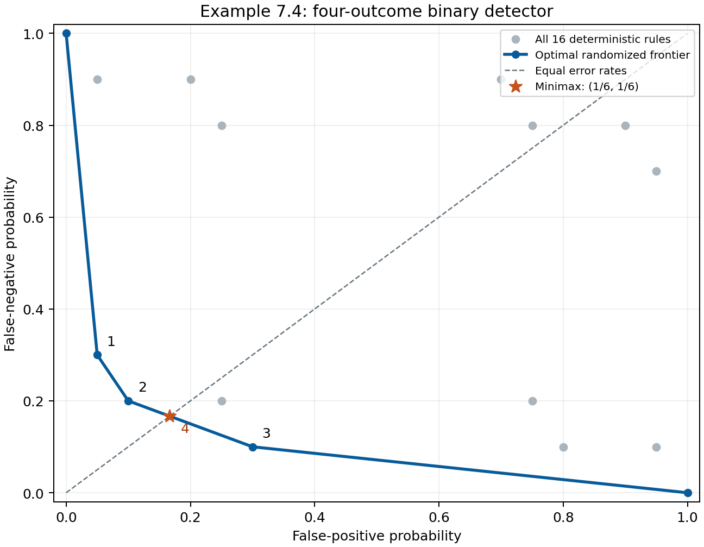

# Example 7.4: binary hypothesis testing

This is a numerical reproduction of the **worked example**, not Exercise 7.4.
It uses the four-outcome distribution matrix printed on textbook pp. 371–372
and reconstructs the error trade-off in Figure 7.4. No synthetic data is used.

- [Textbook, Example 7.4 and equation (7.15)](https://web.stanford.edu/~boyd/cvxbook/bv_cvxbook.pdf#page=385), printed pp. 371–372, PDF pp. 385–386
- [Official CVX reference](https://web.cvxr.com/cvx/examples/cvxbook/Ch07_statistical_estim/html/detector2.html), originally by Lieven Vandenberghe and adapted to CVX by Michael Grant
- [Original executable Python](../../examples/ex_7_4.py)
- [Tests](../../tests/test_worked_examples_7_4_8_3.py)

## Data and model

The first column is the observation distribution under the negative hypothesis;
the second is the distribution under the positive hypothesis:

```math
P=[p\ q]=\begin{bmatrix}
0.70&0.10\\
0.20&0.10\\
0.05&0.70\\
0.05&0.10
\end{bmatrix}.
```

Let $`r_i`$ be the probability of declaring positive after observation $`i`$.
Then $`0\le r\le1`$, $`P_{\mathrm{fp}}=p^T r`$, and
$`P_{\mathrm{fn}}=q^T(\mathbf1-r)`$. The detector matrix is
$`T=[(\mathbf1-r)^T;r^T]`$. Both columns of $`P`$ sum to one, so these
quantities are conditional error probabilities, not errors weighted by a prior.
The minimax detector solves the LP

```math
\begin{array}{ll}
\text{minimize}_{r,t}&t\\
\text{subject to}&0\le r\le1,\\
&p^Tr\le t,\\
&q^T(\mathbf1-r)\le t.
\end{array}
```

The Python implementation solves this model with CVXPY/CLARABEL and independently
with SciPy/HiGHS. It additionally solves the constrained trade-off problem
$`\min q^T(\mathbf1-r)`$, subject to $`p^Tr\le\alpha`$ and $`0\le r\le1`$,
at 102 budgets, including every vertex and the minimax point.

## Independent exact check

Ordering the observations by decreasing likelihood ratio $`q_i/p_i`$ gives
$`3,4,2,1`$. Switching the corresponding declarations from negative to positive
produces the frontier vertices

```math
(0,1),\quad(0.05,0.30),\quad(0.10,0.20),\quad(0.30,0.10),\quad(1,0),
```

where the coordinates are $`(P_{\mathrm{fp}},P_{\mathrm{fn}})`$.
Randomizing between consecutive threshold rules fills the line segments.
For positive error weights, the weighted loss separates over observations, so
selecting the smaller per-observation loss proves these segments form the
optimal frontier rather than merely a feasible curve.

The rule $`r=(0,1/3,1,1)`$ achieves equal errors $`1/6`$.
For every feasible rule, a matching lower bound is

```math
\max\{P_{\mathrm{fp}},P_{\mathrm{fn}}\}
\ge\frac{P_{\mathrm{fp}}+2P_{\mathrm{fn}}}{3}
\ge\sum_{i=1}^{4}\min\left\{\frac{p_i}{3},\frac{2q_i}{3}\right\}
=\frac16.
```

Thus the minimax value is exactly $`1/6`$. Enumerating all $`2^4=16`$
deterministic rules gives best worst-case error $`1/5`$, attained by
$`r=(0,0,1,1)`$. Randomization improves the worst-case error by exactly $`1/30`$.
The implementation checks the numerical dual multipliers, stationarity,
complementarity, feasibility, and objective against these exact certificates.

<!-- BEGIN GENERATED EXAMPLE RESULTS -->
## Executed results

Executed **2026-10-10T04:08:34.485204Z**, Python **3.12.14**, seed **0** (unused), elapsed **1.958 s**. These tables are generated from the [actual recorded run](../../artifacts/examples/7.4/results.json). They are not substituted expected values.

| Method | False positive | False negative | Worst error |
| --- | --- | --- | --- |
| CLARABEL minimax | 0.166666666667 | 0.166666666667 | 0.166666666667 |
| SciPy/HiGHS minimax | 0.166666666667 | 0.166666666667 | 0.166666666667 |
| Best deterministic | 0.100000000000 | 0.200000000000 | 0.200000000000 |

Measured positive-declaration probabilities:

| Observation | Probability |
| --- | --- |
| 1 | 0.000000000001 |
| 2 | 0.333333333330 |
| 3 | 1.000000000000 |
| 4 | 0.999999999998 |

| Check | Measured value |
| --- | --- |
| Primal constraint violation | 2.146e-14 |
| Primal–dual gap | 1.781e-12 |
| Stationarity residual | 1.172e-12 |
| Complementarity residual | 6.456e-13 |
| Absolute error versus exact 1/6 | 5.533e-13 |
| Independent-solver difference | 5.533e-13 |
| Frontier LPs solved | 102 |
| Maximum frontier interpolation error | 4.597e-11 |
| Maximum frontier primal violation | 1.551e-11 |

<!-- END GENERATED EXAMPLE RESULTS -->

## Figure



This is a newly drawn reproduction of the Figure 7.4 trade-off, with all 16
deterministic rules added for comparison. Labels 1–3 identify the same threshold
vertices; label 4 identifies the randomized minimax detector. Unlike the common
true-positive ROC convention, the vertical axis here is **false-negative**
probability, matching the book.

## Reproduce

From the repository root, after installing the project:

```sh
OPENBLAS_NUM_THREADS=1 python examples/ex_7_4.py --output artifacts/examples/7.4 --seed 0
python scripts/render_example_results.py
python scripts/render_example_results.py --check
python -m pytest tests/test_worked_examples_7_4_8_3.py tests/test_docs_formatting.py
```

The seed is recorded for a consistent interface but is unused: this example has
no random data. Full precision, all enumerated rules, every solved frontier
point, and solver diagnostics are in the recorded JSON. The results envelope
records the command, environment, execution time, and implementation SHA-256.

## Provenance and limits

The matrix is transcribed from the book and cross-checked against the official
CVX example. This repository's Python, explanation, and rendered plot are
original; no MATLAB source or book figure is redistributed. The
[CVX example library](https://web.cvxr.com/cvx/examples/index.html) identifies its
examples as public domain and requests author attribution; that attribution is
provided above. The textbook retains its original rights. The inspected book
PDF has SHA-256 `40d976c83c18cce1900eff8c41bd5ad408c102b813af39d05ff85678ccf8d76e`.
