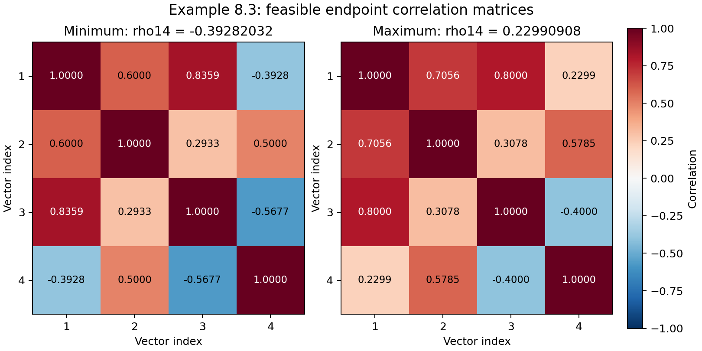

# Example 8.3: bounding correlation coefficients

This reproduces the **worked example** on textbook p. 408, not Exercise 8.3.
All four interval constraints are printed in the book; no generated replacement
data or outside dataset is needed.

- [Textbook, Example 8.3 and equation (8.7)](https://web.stanford.edu/~boyd/cvxbook/bv_cvxbook.pdf#page=422), printed p. 408, PDF p. 422
- [Official CVX reference by Joëlle Skaf](https://web.cvxr.com/cvx/examples/cvxbook/Ch08_geometric_probs/html/ex_8_3.html)
- [Original executable Python](../../examples/ex_8_3.py)
- [Tests](../../tests/test_worked_examples_7_4_8_3.py)

## Data and convex formulation

A correlation matrix $`C`$ is symmetric, positive semidefinite, and has unit
diagonal. Its entries are inner products of unit vectors. The known intervals are

```math
0.6\le C_{12}\le0.9,\qquad 0.8\le C_{13}\le0.9,
```

```math
0.5\le C_{24}\le0.7,\qquad -0.8\le C_{34}\le-0.4.
```

Solve one SDP minimizing and one maximizing $`C_{14}`$ subject to those intervals,
$`C\succeq0`$, and $`\mathrm{diag}(C)=\mathbf1`$.
$`C_{23}`$ remains free except for the PSD condition. Using elementwise
nonnegativity in place of positive semidefiniteness would change the problem
and incorrectly exclude the negative given correlations.

Both directions are implemented as minimizations: minimize $`sC_{14}`$ with
$`s=1`$ for the lower endpoint and $`s=-1`$ for the upper endpoint.
Results label the actual correlation separately from this signed objective.
CLARABEL supplies the primary solutions; SCS independently checks both endpoints.
Both are open-source solvers available through CVXPY.

## Independent sharp bounds

For three unit vectors, fixing the correlations $`a`$ and $`b`$ with their common
reference vector implies

```math
ab-\sqrt{(1-a^2)(1-b^2)}
\le c\le
ab+\sqrt{(1-a^2)(1-b^2)}.
```

This follows by decomposing the other two vectors into their projection on the
reference vector and orthogonal components, then applying Cauchy–Schwarz. It is
also the nonnegative-determinant condition for the corresponding principal
$`3\times3`$ correlation submatrix.

For the lower endpoint, take the common vector to be vector 2, with
$`a=C_{12}\in[0.6,0.9]`$ and $`b=C_{24}\in[0.5,0.7]`$.
The lower-bound expression increases with either positive argument. Therefore

```math
C_{14}\ge 0.6(0.5)-\sqrt{(1-0.6^2)(1-0.5^2)}
=0.3-\sqrt{0.48}.
```

For the upper endpoint, take vector 3 as the reference, with
$`a=C_{13}\in[0.8,0.9]`$ and $`b=C_{34}\in[-0.8,-0.4]`$.
The upper-bound expression decreases with $`a`$ and increases with $`b`$
on these intervals. Hence

```math
C_{14}\le0.8(-0.4)+\sqrt{(1-0.8^2)(1-(-0.4)^2)}
=-0.32+\sqrt{0.3024}.
```

These inequalities alone would give necessary bounds. To prove sharpness,
`analytic_bounds()` constructs full four-vector Gram matrices attaining both
bounds while satisfying every remaining interval:

- Lower endpoint: choose $`a_2=(1,0,0)`$, $`a_1=(0.6,0.8,0)`$, and
  $`a_4=(0.5,-\sqrt{0.75},0)`$. Solve for the first two coordinates of
  $`a_3`$ so $`a_1^Ta_3=0.85`$ and $`a_4^Ta_3=-0.55`$, then select its third
  coordinate to give unit length.
- Upper endpoint: choose $`a_3=(1,0,0)`$, $`a_1=(0.8,0.6,0)`$, and
  $`a_4=(-0.4,\sqrt{0.84},0)`$. Construct the unit vector $`a_2`$ in the
  same way with $`a_1^Ta_2=0.72`$ and $`a_4^Ta_2=0.60`$.

The prescribed dot products in these **original certificates** are convenient
choices, not new problem data and not the book's particular optimizer. The
squared unused-coordinate lengths are positive; full vectors, Gram matrices,
and residuals are stored in the output. A Gram matrix is PSD by construction.

## Dual and feasibility checks

For the signed minimization, let $`H_{ij}`$ satisfy
$`\mathrm{tr}(H_{ij}C)=C_{ij}`$. The stationarity check is

```math
sH_{14}+\mathrm{Diag}(\nu)
+\sum_{(i,j)}(\mu_{ij}-\lambda_{ij})H_{ij}-S=0,
```

where $`S\succeq0`$ is the PSD multiplier, $`\nu`$ multiplies the unit-diagonal
constraint, and $`\lambda,\mu\ge0`$ multiply the lower and upper interval
constraints. The dual objective is
$`-\mathbf1^T\nu+\sum_{(i,j)}(l_{ij}\lambda_{ij}-u_{ij}\mu_{ij})`$.
The code reports its gap from the signed primal objective, all feasibility
residuals, and complementarity. Analytic bounds and feasible Gram witnesses
supply a separate check that does not rely on either numerical solver.

<!-- BEGIN GENERATED EXAMPLE RESULTS -->
## Executed results

Executed **2026-10-10T04:08:36.840204Z**, Python **3.12.14**, seed **0** (unused), elapsed **2.124 s**. These tables are generated from the [actual recorded run](../../artifacts/examples/8.3/results.json). They are not substituted expected values.

| Endpoint | CLARABEL correlation | SCS correlation | Closed-form bound |
| --- | --- | --- | --- |
| Lower | -0.392820323037 | -0.392820323101 | -0.392820323028 |
| Upper | 0.229909083434 | 0.229909083384 | 0.229909083395 |

| CLARABEL endpoint | Primal violation | Stationarity | Primal–dual gap | Minimum eigenvalue |
| --- | --- | --- | --- | --- |
| Lower | 5.118e-12 | 5.577e-12 | 6.870e-12 | -5.118e-12 |
| Upper | 1.765e-11 | 1.724e-11 | 2.174e-11 | -1.765e-11 |

Lower-endpoint matrix returned by CLARABEL:

| Row | Column 1 | Column 2 | Column 3 | Column 4 |
| --- | --- | --- | --- | --- |
| 1 | 1.000000000 | 0.600000000 | 0.835909941 | -0.392820323 |
| 2 | 0.600000000 | 1.000000000 | 0.293304917 | 0.500000000 |
| 3 | 0.835909941 | 0.293304917 | 1.000000000 | -0.567739355 |
| 4 | -0.392820323 | 0.500000000 | -0.567739355 | 1.000000000 |

Upper-endpoint matrix returned by CLARABEL:

| Row | Column 1 | Column 2 | Column 3 | Column 4 |
| --- | --- | --- | --- | --- |
| 1 | 1.000000000 | 0.705615225 | 0.800000000 | 0.229909083 |
| 2 | 0.705615225 | 1.000000000 | 0.307835665 | 0.578530082 |
| 3 | 0.800000000 | 0.307835665 | 1.000000000 | -0.400000000 |
| 4 | 0.229909083 | 0.578530082 | -0.400000000 | 1.000000000 |

Original Gram-certificate checks (independent of the numerical solvers):

| Certificate | Achieved correlation | PSD violation | Interval violation | Diagonal residual |
| --- | --- | --- | --- | --- |
| Lower | -0.392820323028 | 0.000e+00 | 0.000e+00 | 1.110e-16 |
| Upper | 0.229909083395 | 1.587e-16 | 0.000e+00 | 0.000e+00 |

<!-- END GENERATED EXAMPLE RESULTS -->

## Original visualization



This heatmap is an original visualization of the executed matrices; Example 8.3
has no corresponding textbook figure. The extrema round to the book's
$`-0.39`$ and $`0.23`$. The optimizer is nonunique, so other entries need not match
the particular matrices printed in the book or returned by the MATLAB example.
The tests compare optimum values and feasibility, not those incidental entries.

Small negative minimum eigenvalues at numerical precision are reported directly;
the matrices are not silently projected onto the PSD cone. Displayed rounded
matrices are for reading; use full-precision JSON for numerical checks.

## Reproduce

From the repository root, after installing the project:

```sh
OPENBLAS_NUM_THREADS=1 python examples/ex_8_3.py --output artifacts/examples/8.3 --seed 0
python scripts/render_example_results.py
python scripts/render_example_results.py --check
python -m pytest tests/test_worked_examples_7_4_8_3.py tests/test_docs_formatting.py
```

The seed is recorded but unused. The results envelope records the command,
execution time, package versions, solver availability, and implementation hash.

## Provenance

The intervals are transcribed from equation (8.7) and cross-checked against the
official CVX example. All Python, derivations, certificates, and graphics here
are original; no MATLAB source, textbook text, or book figure is redistributed.
The [CVX example library](https://web.cvxr.com/cvx/examples/index.html) identifies
its examples as public domain and requests author attribution, provided above.
The textbook retains its original rights. The inspected PDF has SHA-256
`40d976c83c18cce1900eff8c41bd5ad408c102b813af39d05ff85678ccf8d76e`.
