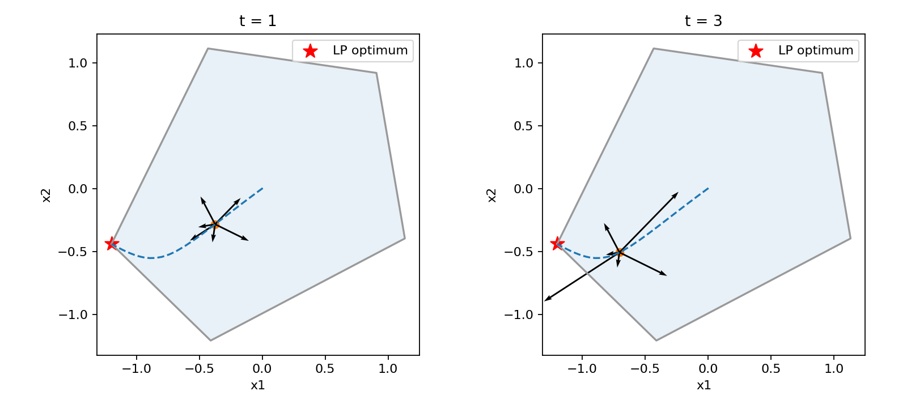

# Central path as a force equilibrium

[Textbook source](https://web.stanford.edu/~boyd/cvxbook/bv_cvxbook.pdf#page=581). 

## Formulation and method

```math
x^\star(t)=\arg\min_x\left(tc^Tx-\sum_i\log(b_i-a_i^Tx)\right),\quad\lambda_i(t)=\frac1{t(b_i-a_i^Tx)}.
```

Newton centering traces 63 parameter values, including t = 1, t = 3 and t = 10. The six-inequality plot marks the t = 10 point, its barrier contour and the tangent objective hyperplane; the force plots retain t = 1 and t = 3. Each inequality normal has unit length, so each repulsive force has the required inverse-distance magnitude. Primal feasibility, dual stationarity and the identity gap = m/t are checked numerically.

## Input provenance and comparison

Random instances use NumPy PCG64, with saved arrays and seeds. They are method reproductions; MATLAB rand(state,...) uses v5uniform and randn(state,...) uses v5normal, whereas seed selects the v4 family. Equal integer seeds do not identify equal arrays. No exact MATLAB fixture was published in the checked companion sources; exact book-figure matching is not claimed. [MATLAB generator documentation](https://www.mathworks.com/help/matlab/math/updating-your-random-number-generator-syntax.html).

The book does not publish the pictured polytope coordinates. This replacement uses unit normals at angles 2 pi j/m + 0.17, offsets 1 + 0.15 sin(2 angle), and c = (1,0.65). The dimension and number of inequalities follow the book separately: six for Example 11.1 and five for Example 11.3.

## Recomputed output

The following values come from the checked-in [results](../../artifacts/examples/example_11_3/results.json).

| Quantity | Computed value |
| :--- | ---: |
| Inequalities | 5 |
| Central points | 63 |
| Independent LP optimum | -1.48298380408 |
| Final central-point objective error | 0.00019997 |
| Maximum dual-stationarity residual | 1.7105e-07 |
| t=1.0: gap | 5 |
| t=3.0: gap | 1.6666667 |
| t=10.0: gap | 0.5 |



## Reproduction

```sh
OPENBLAS_NUM_THREADS=1 python -m examples.algorithms_ch11 example_11_3
```

The implementation preserves complete numerical histories, uses explicit algorithm steps, and checks the final conditions independently. Iteration counts denote accepted updates; the initial point is iteration zero.

## Compact input delivery

Generated inputs larger than 256 KiB are represented by [array hashes and regeneration metadata](../../artifacts/examples/example_11_3/input_manifest.json). The [regeneration helper](../../examples/algorithm_evidence.py) reconstructs every omitted array and verifies its exact bytes under the pinned numerical environment. Run the original study command to materialize all inputs locally. No problem dimension, trial count or numerical accuracy is reduced.
