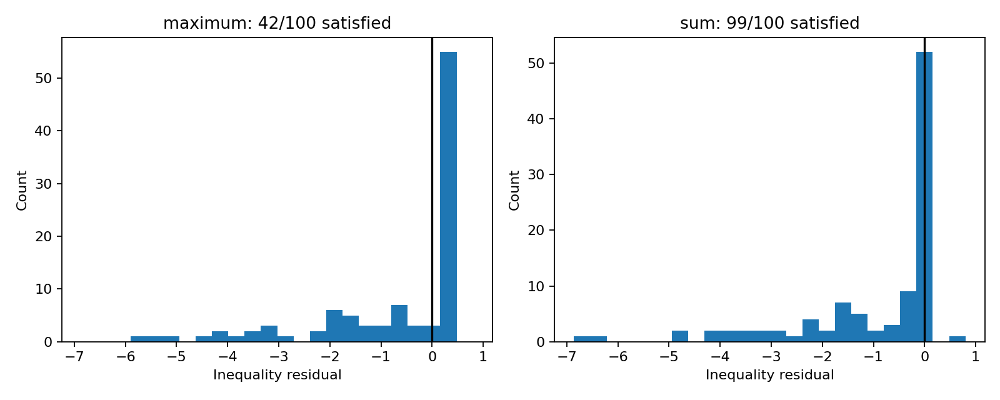

# Comparing maximum and total phase-I infeasibility

[Textbook source](https://web.stanford.edu/~boyd/cvxbook/bv_cvxbook.pdf#page=594). 

## Formulation and method

```math
\min_x\max_i(a_i^Tx-b_i),\qquad\min_x\sum_i\max\{a_i^Tx-b_i,0\}.
```

Both phase-I objectives are formulated as explicit linear programs. The maximum violation uses one unrestricted epigraph scalar; the sum uses 100 nonnegative individual slacks. Independent primal-dual LP certificates verify each optimum and histogram.

## Input provenance and comparison

Random instances use NumPy PCG64, with saved arrays and seeds. They are method reproductions; MATLAB rand(state,...) uses v5uniform and randn(state,...) uses v5normal, whereas seed selects the v4 family. Equal integer seeds do not identify equal arrays. No exact MATLAB fixture was published in the checked companion sources; exact book-figure matching is not claimed. [MATLAB generator documentation](https://www.mathworks.com/help/matlab/math/updating-your-random-number-generator-syntax.html).

The original 100-by-50 matrix is unpublished. The replacement seed is 1114; its first two rows are opposite normals with offsets -0.4, supplying an explicit infeasibility certificate. The book counts 39 and 79 apply only to its missing instance; the actual replacement counts are reported above.

## Recomputed output

The following values come from the checked-in [results](../../artifacts/examples/example_11_4/results.json).

| Quantity | Computed value |
| :--- | ---: |
| maximum satisfied inequalities | 42 |
| sum satisfied inequalities | 99 |
| maximum objective | 0.4 |
| sum objective | 0.8 |



## Reproduction

```sh
OPENBLAS_NUM_THREADS=1 python -m examples.algorithms_ch11 example_11_4
```

The implementation preserves complete numerical histories, uses explicit algorithm steps, and checks the final conditions independently. Iteration counts denote accepted updates; the initial point is iteration zero.

## Compact input delivery

Generated inputs larger than 256 KiB are represented by [array hashes and regeneration metadata](../../artifacts/examples/example_11_4/input_manifest.json). The [regeneration helper](../../examples/algorithm_evidence.py) reconstructs every omitted array and verifies its exact bytes under the pinned numerical environment. Run the original study command to materialize all inputs locally. No problem dimension, trial count or numerical accuracy is reduced.
