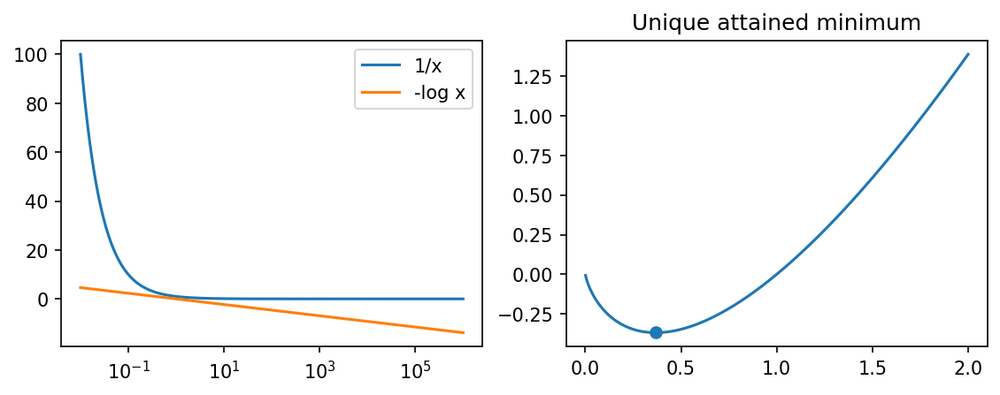

# example 4 1: Scalar optimal values, attainment, and unboundedness

**Exact-input reproduction.** Uses the printed instance or the named official numerical data. Numerical precision and drawing style can differ from the source.

[Textbook source](https://web.stanford.edu/~boyd/cvxbook/bv_cvxbook.pdf#page=142) · [Original Python](../../examples/application_basic.py) · [Executed JSON](../../artifacts/examples/example_4_1/results.json) · [Tests](../../tests/test_worked_applications.py)

## Model and verification

For x>0, compare 1/x, -log(x), and x log(x). The first tends to zero as x tends to infinity and remains positive, so the infimum is not attained. The second decreases without bound. The last has derivative 1+log(x) and positive second derivative 1/x, so its unique minimum is x=1/e, with value -1/e. A bounded scalar optimizer independently checks this last value.

## Inputs and source comparison

All three scalar objective functions and their common domain x>0 are explicitly supplied.


The implementation is original Python. Reused numeric data are attributed separately in `data/worked_examples`, including conversion hashes and the upstream GPL-3.0-or-later notice. No textbook scans or reference program bodies are redistributed.

## Executed results

Run at 2026-10-10T05:03:17.205329+00:00; Python 3.12.14; NumPy 2.3.5; CVXPY 1.9.3; elapsed 1.513 s.

| Quantity | Actual value |
| --- | --- |
| minimizer | 0.367879448712 |
| minimum | -0.367879441171 |
| reciprocal_infimum | 0 |
| reciprocal_attained | False |
| negative_log_infimum | -infinity |

## Numerical checks

| Check | Measured error | Acceptance limit |
| --- | --- | --- |
| numerical minimizer versus 1/e | 7.5407e-09 | 1e-06 |
| objective versus -1/e | 5.55112e-17 | 1e-06 |
| first derivative at 1/e | 0 | 1e-06 |

## Recomputed figures



## Reproduce

```sh
OPENBLAS_NUM_THREADS=1 python examples/application_basic.py example_4_1
python -m pytest tests/test_worked_applications.py -q
```
