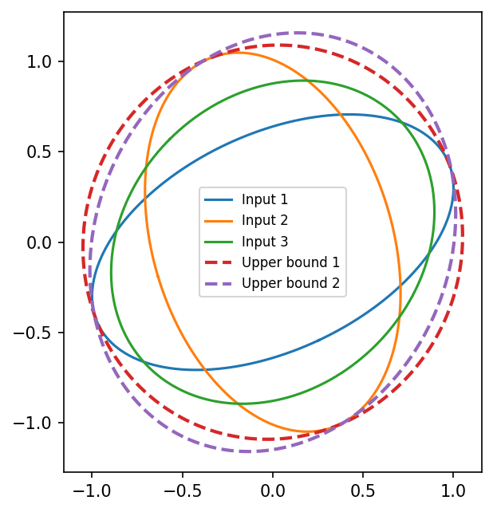

# example 4 10: Minimal matrix upper bounds via weighted SDP

**Method reproduction, approved substitute data or source convention.** This is not an exact recreation of the book’s random realization or figure. The specific differences are documented below.

[Textbook source](https://web.stanford.edu/~boyd/cvxbook/bv_cvxbook.pdf#page=194) · [Original Python](../../examples/application_geometry.py) · [Executed JSON](../../artifacts/examples/example_4_10/results.json) · [Tests](../../tests/test_worked_applications.py)

## Model and verification

For three explicitly published new positive-definite 2-by-2 matrices, solve min tr(WX) subject to X−Aᵢ positive semidefinite. Use two positive-definite weights, I and diag(4,1), to obtain different minimal upper bounds. The dual matrices sum to W and their weighted traces give an independent lower bound; stationarity and primal-dual gaps certify both results. Since W is positive definite, a strictly smaller feasible matrix in the PSD order would strictly improve the objective, proving minimality.

## Inputs and source comparison

The book specifies n=2 and three input matrices geometrically, but supplies neither their numerical entries nor the two weight matrices. No matching exact-data source was located in the official CVX/CVXOPT example indexes.

- Original Figure 4.10 numerical matrices and weights were not supplied in the textbook or located in the official indexes. This new instance demonstrates the same weighted-SDP minimal-upper-bound construction. Positive-definite W ensures no strictly smaller PSD-feasible upper bound can dominate the computed solution.

The implementation is original Python. Reused numeric data are attributed separately in `data/worked_examples`, including conversion hashes and the upstream GPL-3.0-or-later notice. No textbook scans or reference program bodies are redistributed.

## Executed results

Run at 2026-10-10T05:03:40.258398+00:00; Python 3.12.14; NumPy 2.3.5; CVXPY 1.9.3; elapsed 0.095 s.

| Quantity | Actual value |
| --- | --- |
| instance | new explicit 2x2 matrices and positive-definite objective weights |
| weighted_objectives | [2.2933034371229195, 5.440121945327011] |

## Numerical checks

| Check | Measured error | Acceptance limit |
| --- | --- | --- |
| weight 1 dual stationarity | 2.49072e-10 | 1e-07 |
| weight 1 primal-dual gap | 3.88959e-10 | 1e-07 |
| weight 2 dual stationarity | 4.58758e-10 | 1e-07 |
| weight 2 primal-dual gap | 8.56729e-10 | 1e-07 |

## Recomputed figures



## Reproduce

```sh
OPENBLAS_NUM_THREADS=1 python examples/application_geometry.py example_4_10
python -m pytest tests/test_worked_applications.py -q
```
