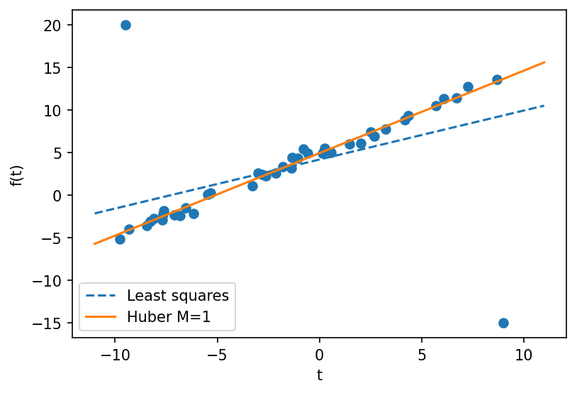

# example 6 2: Huber regression with two outliers

**Exact-input reproduction.** Uses the printed instance or the named official numerical data. Numerical precision and drawing style can differ from the source.

[Textbook source](https://web.stanford.edu/~boyd/cvxbook/bv_cvxbook.pdf#page=313) · [Original Python](../../examples/application_basic.py) · [Executed JSON](../../artifacts/examples/example_6_2/results.json) · [Tests](../../tests/test_worked_applications.py)

## Model and verification

Fit y≈α+βt to the 42 published points. Least squares minimizes the sum of squared residuals. The robust fit minimizes the sum of Huber losses with threshold M=1: r² for |r|≤1 and 2|r|−1 otherwise. The second expression is continuous at the threshold; the comment in the old companion code omits its constant but its QP implements the correct loss. Compare the convex solve against an independent analytic-gradient minimization and check the normal equations.

## Inputs and source comparison

CVXOPT publishes the 42 input points in huber.bin; CVX provides the original seeded generator.

- [Official reference](https://cvxopt.org/examples/book/huber.html)
- [Official reference](https://cvxopt.org/_downloads/66d5b904ed3f10518d9d58312e547ddf/huber.py)
- [Official reference](https://cvxr.com/cvx/examples/cvxbook/Ch06_approx_fitting/fig6_5.m)
- [huber.bin](https://cvxopt.org/_downloads/0da371743999afbbd02ededb651d77e6/huber.bin), SHA-256 `efce5fbab1428361d776d8d01d73d8801e9531cf513d889374e65ca2a5c97515`

The implementation is original Python. Reused numeric data are attributed separately in `data/worked_examples`, including conversion hashes and the upstream GPL-3.0-or-later notice. No textbook scans or reference program bodies are redistributed.

## Executed results

Run at 2026-10-10T05:03:17.881454+00:00; Python 3.12.14; NumPy 2.3.5; CVXPY 1.9.3; elapsed 0.067 s.

| Quantity | Actual value |
| --- | --- |
| least_squares_intercept | 4.18407200921 |
| least_squares_slope | 0.575483753356 |
| huber_intercept | 4.93591050716 |
| huber_slope | 0.968411640299 |
| huber_objective | 113.631935515 |

## Numerical checks

| Check | Measured error | Acceptance limit |
| --- | --- | --- |
| Huber gradient | 1.42245e-08 | 1e-05 |
| Huber independent BFGS objective | 0 | 1e-07 |
| least-squares normal equations | 5.25802e-13 | 1e-08 |

## Recomputed figures



## Reproduce

```sh
OPENBLAS_NUM_THREADS=1 python examples/application_basic.py example_6_2
python -m pytest tests/test_worked_applications.py -q
```
