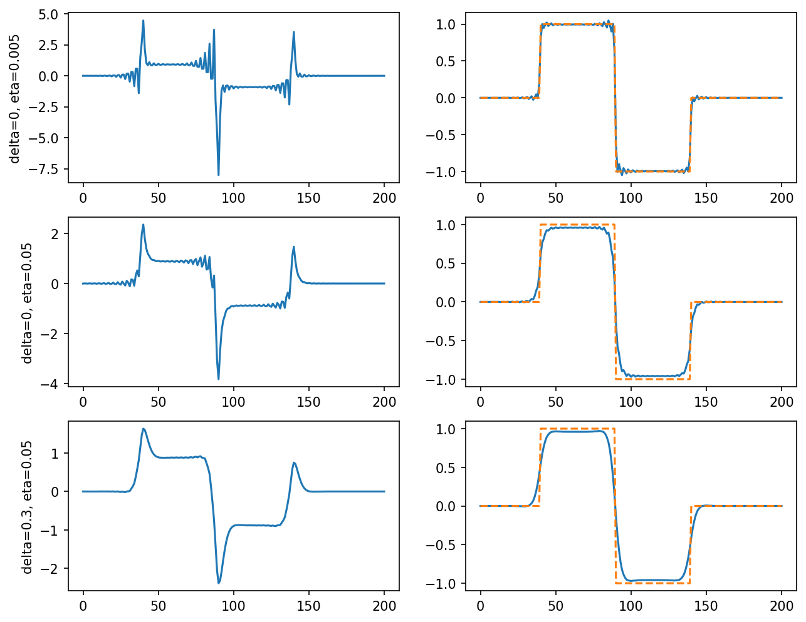

# example 6 3: Regularized input design

**Exact-input reproduction.** Uses the printed instance or the named official numerical data. Numerical precision and drawing style can differ from the source.

[Textbook source](https://web.stanford.edu/~boyd/cvxbook/bv_cvxbook.pdf#page=321) · [Original Python](../../examples/application_basic.py) · [Executed JSON](../../artifacts/examples/example_6_3/results.json) · [Tests](../../tests/test_worked_applications.py)

## Model and verification

The 201-point convolution matrix uses h(t)=0.9^t(1−0.4 cos(2t))/9. Solve Jtrack+η Jmag+δ Jder for the three stated weight pairs. Tracking and magnitude divide their squared norms by 201; the derivative term divides by 200. A stacked least-squares factorization and independently constructed convex QP agree. The official CVXOPT stacking lacks the relative 201/200 derivative factor; the implementation follows the printed model and CVX version.

## Inputs and source comparison

Impulse response and weights are in the text; the exact piecewise-constant desired output is specified in both companion scripts.

- [Official reference](https://cvxopt.org/examples/book/inputdesign.html)
- [Official reference](https://cvxopt.org/_downloads/04cc18744c2680be02ff1f2deef0df21/inputdesign.py)
- [Official reference](https://cvxr.com/cvx/examples/cvxbook/Ch06_approx_fitting/fig6_6.m)
- CVXOPT stacking omits the relative n/(n-1) derivative normalization. This implementation follows the book and CVX convention.

The implementation is original Python. Reused numeric data are attributed separately in `data/worked_examples`, including conversion hashes and the upstream GPL-3.0-or-later notice. No textbook scans or reference program bodies are redistributed.

## Executed results

Run at 2026-10-10T05:03:18.169675+00:00; Python 3.12.14; NumPy 2.3.5; CVXPY 1.9.3; elapsed 0.285 s.

| Quantity | Actual value |
| --- | --- |
| cases | 3 |
| normalization | Book: Jtrack and Jmag divide by n=201; Jder divides by n-1=200. |

| Case | Delta | Eta | Tracking | Magnitude | Derivative | Objective |
| --- | --- | --- | --- | --- | --- | --- |
| 1 | 0 | 0.005 | 0.002432796169 | 1.288766047 | 0.8511528463 | 0.008876626403 |
| 2 | 0 | 0.05 | 0.01399090981 | 0.6408749698 | 0.0789938778 | 0.0460346583 |
| 3 | 0.3 | 0.05 | 0.02190064973 | 0.5448414902 | 0.01362645285 | 0.05323066009 |

## Numerical checks

| Check | Measured error | Acceptance limit |
| --- | --- | --- |
| case 1 QR versus convex QP | 7.62013e-10 | 1e-07 |
| case 2 QR versus convex QP | 2.90144e-09 | 1e-07 |
| case 3 QR versus convex QP | 4.90328e-11 | 1e-07 |

## Recomputed figures



## Reproduce

```sh
OPENBLAS_NUM_THREADS=1 python examples/application_basic.py example_6_3
python -m pytest tests/test_worked_applications.py -q
```
