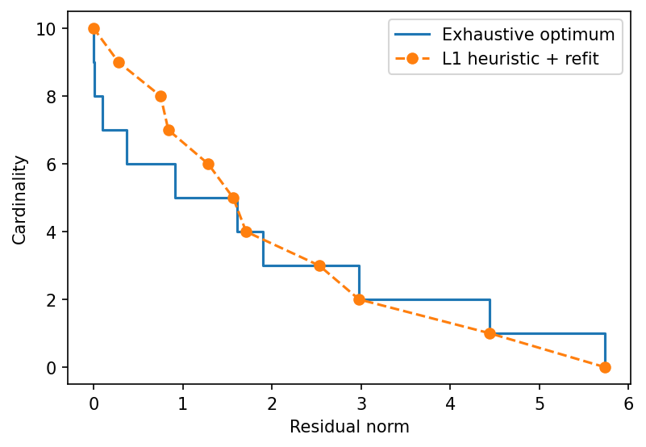

# example 6 4: Sparse regressor selection

**Method reproduction, approved substitute data or source convention.** This is not an exact recreation of the book’s random realization or figure. The specific differences are documented below.

[Textbook source](https://web.stanford.edu/~boyd/cvxbook/bv_cvxbook.pdf#page=324) · [Original Python](../../examples/application_fitting.py) · [Executed JSON](../../artifacts/examples/example_6_4/results.json) · [Tests](../../tests/test_worked_applications.py)

## Model and verification

Enumerate every support of cardinality zero through nine of the published 10-by-20 companion instance, solving least squares on each support. This is 431910 supports, not a heuristic substitute for exhaustive search. Rank ten permits exact interpolation. Separately solve 99 ℓ1-budget problems, discard coefficients below 10% of their maximum magnitude and refit each chosen support. Compare best residual by cardinality. The upstream script explicitly states these data differ from the book.

## Inputs and source comparison

The10-by-20 matrix and response are published in regsel.bin; regsel.py explicitly states that they differ from the book.

- [Official reference](https://cvxopt.org/examples/book/regsel.html)
- [Official reference](https://cvxopt.org/_downloads/3a5455dbfc777addda64cfe2dc058632/regsel.py)
- [Official reference](https://cvxr.com/cvx/examples/cvxbook/Ch06_approx_fitting/regressor_cvx.m)
- [regsel.bin](https://cvxopt.org/_downloads/9563108e5c0de500dfc9b13feb67f082/regsel.bin), SHA-256 `3f4785f872f24a263cb92f5fe361c9bb127e8ac8d180312b5ff33e17cc31c036`
- Official regsel.py explicitly states its problem data differ from the book. This is a complete method reproduction on the published companion instance.

The implementation is original Python. Reused numeric data are attributed separately in `data/worked_examples`, including conversion hashes and the upstream GPL-3.0-or-later notice. No textbook scans or reference program bodies are redistributed.

## Executed results

Run at 2026-10-10T05:03:31.933295+00:00; Python 3.12.14; NumPy 2.3.5; CVXPY 1.9.3; elapsed 10.828 s.

| Quantity | Actual value |
| --- | --- |
| matrix_shape | [10, 20] |
| subsets_enumerated | 431910 |
| reproduction | official companion data; explicitly different from book |

## Numerical checks

| Check | Measured error | Acceptance limit |
| --- | --- | --- |
| heuristic never beats exhaustive optimum | 0 | 1e-08 |
| enumerated all supports below rank | 0 | 0 |
| rank-ten support achieves zero residual | 1.3668e-15 | 1e-08 |

## Recomputed figures



## Reproduce

```sh
OPENBLAS_NUM_THREADS=1 python examples/application_fitting.py example_6_4
python -m pytest tests/test_worked_applications.py -q
```
