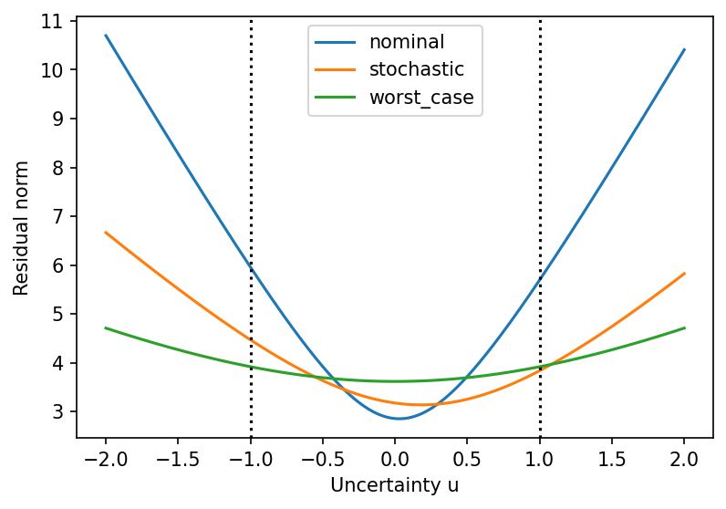

# example 6 5: Nominal, stochastic and worst-case least squares

**Exact-input reproduction.** Uses the printed instance or the named official numerical data. Numerical precision and drawing style can differ from the source.

[Textbook source](https://web.stanford.edu/~boyd/cvxbook/bv_cvxbook.pdf#page=333) · [Original Python](../../examples/application_fitting.py) · [Executed JSON](../../artifacts/examples/example_6_5/results.json) · [Tests](../../tests/test_worked_applications.py)

## Model and verification

For A+uB with u uniform on [−1,1], the expected squared residual is ||Ax−b||²+||Bx||²/3. The nominal and stochastic designs follow from linear least-squares equations. The worst residual on the interval occurs at an endpoint by convexity, giving a two-cone minimax model. An independent S-lemma semidefinite formulation certifies the same worst-case objective. Plot all three residuals on [−2,2].

## Inputs and source comparison

robls.bin contains the 20-by-10 instance indexed as 6.15.

- [Official reference](https://cvxopt.org/examples/book/robls.html)
- [Official reference](https://cvxopt.org/_downloads/7265e17252d497aeb7049a020a125d9c/robls.py)
- [Official reference](https://cvxr.com/cvx/examples/cvxbook/Ch06_approx_fitting/fig6_15.m)
- [robls.bin](https://cvxopt.org/_downloads/6bb5b505816527dd183c628a3c6bf57d/robls.bin), SHA-256 `ca5db0b8044a6f01845c6f7c84cc1327be4615dfe9e684818784c823bcc520e3`

The implementation is original Python. Reused numeric data are attributed separately in `data/worked_examples`, including conversion hashes and the upstream GPL-3.0-or-later notice. No textbook scans or reference program bodies are redistributed.

## Executed results

Run at 2026-10-10T05:03:20.866334+00:00; Python 3.12.14; NumPy 2.3.5; CVXPY 1.9.3; elapsed 0.099 s.

| Quantity | Actual value |
| --- | --- |
| worst_case_residual | 3.92076874718 |
| nominal_expected_squared_residual | 16.7768732759 |
| stochastic_expected_squared_residual | 12.5184998083 |

## Numerical checks

| Check | Measured error | Acceptance limit |
| --- | --- | --- |
| SOCP versus S-lemma SDP | 1.14842e-08 | 2e-06 |
| stochastic normal equations | 1.95399e-14 | 1e-08 |

## Recomputed figures



## Reproduce

```sh
OPENBLAS_NUM_THREADS=1 python examples/application_fitting.py example_6_5
python -m pytest tests/test_worked_applications.py -q
```
