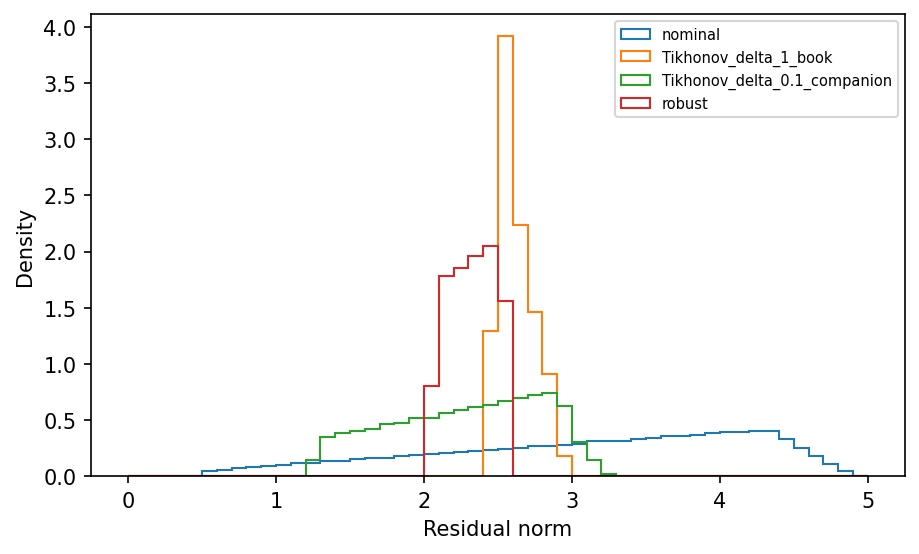

# example 6 6: Robust least squares with disk uncertainty

**Method reproduction, approved substitute data or source convention.** This is not an exact recreation of the book’s random realization or figure. The specific differences are documented below.

[Textbook source](https://web.stanford.edu/~boyd/cvxbook/bv_cvxbook.pdf#page=338) · [Original Python](../../examples/application_fitting.py) · [Executed JSON](../../artifacts/examples/example_6_6/results.json) · [Tests](../../tests/test_worked_applications.py)

## Model and verification

Use the published 50-by-20 matrix instance with two-dimensional unit-disk uncertainty. The robust squared-residual epigraph follows from the S-lemma and is solved as an SDP. Independently maximize the resulting residual over the circular boundary using a grid and bounded scalar refinements. Compare nominal least squares, both Tikhonov parameters, and robust fitting on 100000 area-uniform disk draws. The book specifies δ=1; both companion programs use δ=0.1, so both are retained.

## Inputs and source comparison

robls.bin contains the 50-by-20 instance indexed as 6.16. CVX supplies a seeded generator and Monte Carlo sampler.

- [Official reference](https://cvxopt.org/examples/book/robls.html)
- [Official reference](https://cvxopt.org/_downloads/7265e17252d497aeb7049a020a125d9c/robls.py)
- [Official reference](https://cvxr.com/cvx/examples/cvxbook/Ch06_approx_fitting/wcrobls.m)
- [robls.bin](https://cvxopt.org/_downloads/6bb5b505816527dd183c628a3c6bf57d/robls.bin), SHA-256 `ca5db0b8044a6f01845c6f7c84cc1327be4615dfe9e684818784c823bcc520e3`
- Both book delta=1 and companion delta=0.1 are executed. The seed-606 Monte Carlo sample is newly generated and is not the unpublished original histogram sample.

The implementation is original Python. Reused numeric data are attributed separately in `data/worked_examples`, including conversion hashes and the upstream GPL-3.0-or-later notice. No textbook scans or reference program bodies are redistributed.

## Executed results

Run at 2026-10-10T05:03:21.100049+00:00; Python 3.12.14; NumPy 2.3.5; CVXPY 1.9.3; elapsed 0.228 s.

| Quantity | Actual value |
| --- | --- |
| nominal / nominal_residual | 0.523749770022 |
| nominal / disk_maximum | 4.90479771726 |
| nominal / sample_mean | 3.1148310243 |
| nominal / sample_maximum | 4.90010375032 |
| Tikhonov_delta_1_book / nominal_residual | 2.51012127675 |
| Tikhonov_delta_1_book / disk_maximum | 2.94490247806 |
| Tikhonov_delta_1_book / sample_mean | 2.62418394835 |
| Tikhonov_delta_1_book / sample_maximum | 2.94439592521 |
| Tikhonov_delta_0.1_companion / nominal_residual | 1.26045263626 |
| Tikhonov_delta_0.1_companion / disk_maximum | 3.23439197448 |
| Tikhonov_delta_0.1_companion / sample_mean | 2.27709686156 |
| Tikhonov_delta_0.1_companion / sample_maximum | 3.23410431519 |
| robust / nominal_residual | 2.05344670141 |
| robust / disk_maximum | 2.59990376765 |
| robust / sample_mean | 2.32424469563 |
| robust / sample_maximum | 2.59979649278 |

## Numerical checks

| Check | Measured error | Acceptance limit |
| --- | --- | --- |
| SDP objective versus independently maximized disk boundary | 1.97812e-10 | 2e-05 |
| all disk draws feasible | 0 | 1e-06 |

## Recomputed figures



## Reproduce

```sh
OPENBLAS_NUM_THREADS=1 python examples/application_fitting.py example_6_6
python -m pytest tests/test_worked_applications.py -q
```
