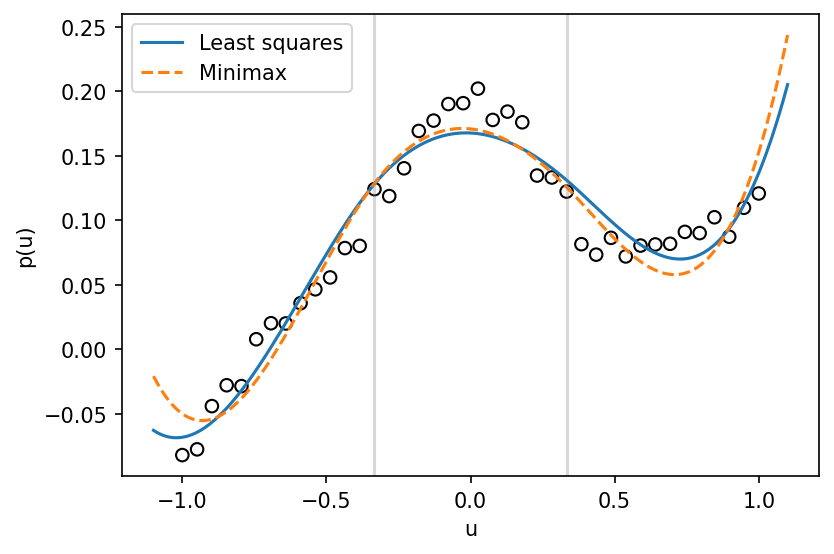

# example 6 8: Cubic spline fitting

**Exact-input reproduction.** Uses the printed instance or the named official numerical data. Numerical precision and drawing style can differ from the source.

[Textbook source](https://web.stanford.edu/~boyd/cvxbook/bv_cvxbook.pdf#page=346) · [Original Python](../../examples/application_fitting.py) · [Executed JSON](../../artifacts/examples/example_6_8/results.json) · [Tests](../../tests/test_worked_applications.py)

## Model and verification

Represent a C² piecewise cubic on the three intervals with knots −1/3 and 1/3 using 1,t,t²,t³,(t+1/3)₊³,(t−1/3)₊³. This six-dimensional basis exactly spans the twelve-coefficient, six-continuity-constraint formulation. Fit the same 40 points under least-squares and maximum-residual losses. The knots have continuous value, first derivative and second derivative by construction. An independent epigraph LP verifies the minimax objective.

## Inputs and source comparison

Same 40 input pairs as Example 6.7, published in polapprox.bin.

- [Official reference](https://cvxopt.org/examples/book/polapprox.html)
- [Official reference](https://cvxopt.org/_downloads/ad5823961411da4165f3d7cb85b21f2c/polapprox.py)
- [Official reference](https://cvxr.com/cvx/examples/cvxbook/Ch06_approx_fitting/fig6_20.m)
- [polapprox.bin](https://cvxopt.org/_downloads/7e1f992be338a8c8dea5f5e165b529df/polapprox.bin), SHA-256 `bd181e2d598f6cb03bd8d1364fce8075e0dc18e3347cfaa820948ca35a345d69`

The implementation is original Python. Reused numeric data are attributed separately in `data/worked_examples`, including conversion hashes and the upstream GPL-3.0-or-later notice. No textbook scans or reference program bodies are redistributed.

## Executed results

Run at 2026-10-10T05:03:20.675089+00:00; Python 3.12.14; NumPy 2.3.5; CVXPY 1.9.3; elapsed 0.073 s.

| Quantity | Actual value |
| --- | --- |
| basis | C2 cubic truncated powers |
| least_squares_residual_l2 | 0.116603357532 |
| least_squares_residual_linf | 0.0392995254801 |
| minimax_residual_l2 | 0.126609114707 |
| minimax_residual_linf | 0.0320383345263 |

## Numerical checks

| Check | Measured error | Acceptance limit |
| --- | --- | --- |
| minimax objective versus independent HiGHS LP | 3.41249e-12 | 1e-08 |
| LS normal equations | 6.14177e-15 | 1e-08 |

## Recomputed figures



## Reproduce

```sh
OPENBLAS_NUM_THREADS=1 python examples/application_fitting.py example_6_8
python -m pytest tests/test_worked_applications.py -q
```
