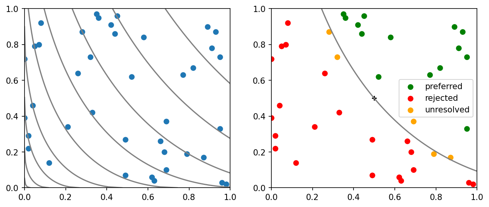

# example 6 9: Consumer preference bounds

**Exact-input reproduction.** Uses the printed instance or the named official numerical data. Numerical precision and drawing style can differ from the source.

[Textbook source](https://web.stanford.edu/~boyd/cvxbook/bv_cvxbook.pdf#page=355) · [Original Python](../../examples/application_statistics.py) · [Executed JSON](../../artifacts/examples/example_6_9/results.json) · [Tests](../../tests/test_worked_applications.py)

## Model and verification

Use the forty literal companion baskets and preference ordering induced by (1.1√x1+0.8√x2)/1.9. Represent a monotone concave utility by values and nonnegative supergradients at all baskets and the comparison basket (0.5,0.5), normalized to utility zero there. Enforce unit gaps in the known strict preference ordering. Two LPs per basket bound its utility; unbounded sides remain explicitly unbounded. A strictly positive lower bound proves preference and a negative upper bound proves rejection. Dual certificates and the printed classification totals are checked.

## Inputs and source comparison

Companion source contains the forty goods baskets as literal constants.

- [Official reference](https://cvxopt.org/examples/book/consumerpref.html)
- [Official reference](https://cvxopt.org/_downloads/b749d1b815c1a4f3d804af9f1b1b917d/consumerpref.py)
- [Official reference](https://cvxr.com/cvx/examples/cvxbook/Ch06_approx_fitting/preference_regions.m)

The implementation is original Python. Reused numeric data are attributed separately in `data/worked_examples`, including conversion hashes and the upstream GPL-3.0-or-later notice. No textbook scans or reference program bodies are redistributed.

## Executed results

Run at 2026-10-10T05:03:37.247917+00:00; Python 3.12.14; NumPy 2.3.5; CVXPY 1.9.3; elapsed 2.631 s.

| Quantity | Actual value |
| --- | --- |
| preferred | 14 |
| rejected | 21 |
| unresolved | 5 |

## Numerical checks

| Check | Measured error | Acceptance limit |
| --- | --- | --- |
| basket 1, sign 1: LP dual gap | 3.55271e-15 | 1e-06 |
| basket 2, sign -1: LP dual gap | 3.55271e-15 | 1e-06 |
| basket 4, sign -1: LP dual gap | 4.44089e-16 | 1e-06 |
| basket 5, sign -1: LP dual gap | 0 | 1e-06 |
| basket 6, sign -1: LP dual gap | 7.10543e-15 | 1e-06 |
| basket 7, sign -1: LP dual gap | 0 | 1e-06 |
| basket 8, sign -1: LP dual gap | 8.88178e-16 | 1e-06 |
| basket 9, sign 1: LP dual gap | 8.88178e-16 | 1e-06 |
| basket 10, sign 1: LP dual gap | 0 | 1e-06 |
| basket 11, sign -1: LP dual gap | 7.10543e-15 | 1e-06 |
| basket 12, sign 1: LP dual gap | 3.55271e-15 | 1e-06 |
| basket 14, sign -1: LP dual gap | 3.55271e-15 | 1e-06 |
| basket 15, sign -1: LP dual gap | 7.10543e-15 | 1e-06 |
| basket 16, sign 1: LP dual gap | 3.55271e-15 | 1e-06 |
| basket 17, sign 1: LP dual gap | 1.77636e-15 | 1e-06 |
| basket 18, sign -1: LP dual gap | 1.77636e-15 | 1e-06 |
| basket 19, sign 1: LP dual gap | 3.55271e-15 | 1e-06 |
| basket 20, sign -1: LP dual gap | 0 | 1e-06 |
| basket 21, sign 1: LP dual gap | 3.55271e-15 | 1e-06 |
| basket 22, sign -1: LP dual gap | 6.66134e-16 | 1e-06 |
| basket 23, sign 1: LP dual gap | 0 | 1e-06 |
| basket 24, sign 1: LP dual gap | 1.77636e-15 | 1e-06 |
| basket 25, sign -1: LP dual gap | 4.44089e-16 | 1e-06 |
| basket 27, sign 1: LP dual gap | 0 | 1e-06 |
| basket 28, sign 1: LP dual gap | 3.55271e-15 | 1e-06 |
| basket 29, sign -1: LP dual gap | 1.42109e-14 | 1e-06 |
| basket 30, sign -1: LP dual gap | 8.88178e-16 | 1e-06 |
| basket 31, sign -1: LP dual gap | 3.55271e-15 | 1e-06 |
| basket 33, sign -1: LP dual gap | 3.55271e-15 | 1e-06 |
| basket 34, sign -1: LP dual gap | 8.88178e-15 | 1e-06 |
| basket 36, sign -1: LP dual gap | 7.10543e-15 | 1e-06 |
| basket 37, sign -1: LP dual gap | 0 | 1e-06 |
| basket 38, sign -1: LP dual gap | 0 | 1e-06 |
| basket 39, sign 1: LP dual gap | 8.88178e-16 | 1e-06 |
| basket 40, sign 1: LP dual gap | 0 | 1e-06 |
| printed classification counts | 0 | 0 |

## Recomputed figures



## Reproduce

```sh
OPENBLAS_NUM_THREADS=1 python examples/application_statistics.py example_6_9
python -m pytest tests/test_worked_applications.py -q
```
