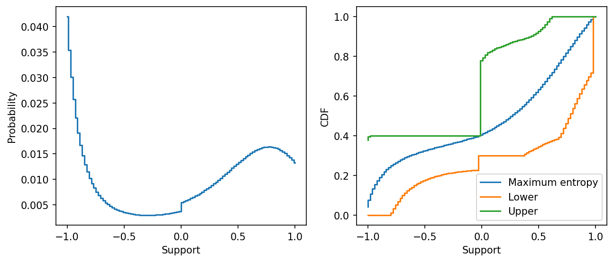

# example 7 2: Maximum entropy and distribution bounds

**Exact-input reproduction.** Uses the printed instance or the named official numerical data. Numerical precision and drawing style can differ from the source.

[Textbook source](https://web.stanford.edu/~boyd/cvxbook/bv_cvxbook.pdf#page=376) · [Original Python](../../examples/application_statistics.py) · [Executed JSON](../../artifacts/examples/example_7_2/results.json) · [Tests](../../tests/test_worked_applications.py)

## Model and verification

On 100 equally spaced support points in [−1,1], maximize Shannon entropy under the four printed moment intervals and probability-simplex constraints. Compute every upper and lower CDF value through 200 independently assembled HiGHS LPs, retaining dual gap checks. A separately implemented exponential-family dual checks the entropy objective. All four moments are recomputed rather than substituted from the printed rounded benchmark.

## Inputs and source comparison

100 equally spaced support points and all four prior constraints are stated in the text.

- [Official reference](https://cvxopt.org/examples/book/maxent.html)
- [Official reference](https://cvxopt.org/_downloads/73038e5fc1c68aae0f7d2aad9b003126/maxent.py)
- [Official reference](https://cvxr.com/cvx/examples/cvxbook/Ch07_statistical_estim/maxent.m)

The implementation is original Python. Reused numeric data are attributed separately in `data/worked_examples`, including conversion hashes and the upstream GPL-3.0-or-later notice. No textbook scans or reference program bodies are redistributed.

## Executed results

Run at 2026-10-10T05:03:34.612919+00:00; Python 3.12.14; NumPy 2.3.5; CVXPY 1.9.3; elapsed 0.423 s.

| Quantity | Actual value |
| --- | --- |
| entropy | 4.38629433767 |
| mean | 0.0563617145365 |
| second_moment | 0.499999999988 |
| cubic_moment | -0.200000000006 |
| negative_probability | 0.399999999957 |
| cdf_lps | 200 |

## Numerical checks

| Check | Measured error | Acceptance limit |
| --- | --- | --- |
| moment feasibility | 1.44498e-11 | 1e-07 |
| entropy primal versus independent exponential-family dual | 6.08029e-11 | 1e-07 |
| all 200 HiGHS primal-dual gaps | 8.88178e-16 | 1e-08 |
| CDF contains maximum entropy distribution | 1.44497e-11 | 1e-07 |

## Recomputed figures



## Reproduce

```sh
OPENBLAS_NUM_THREADS=1 python examples/application_statistics.py example_7_2
python -m pytest tests/test_worked_applications.py -q
```
