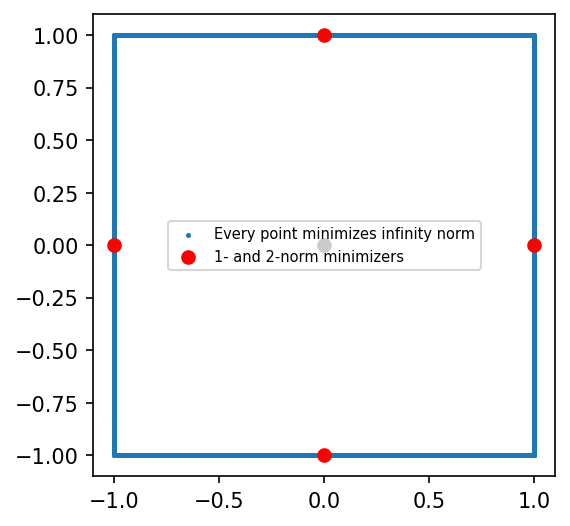

# example 8 1: Projection of the origin on the unit-square boundary

**Exact-input reproduction.** Uses the printed instance or the named official numerical data. Numerical precision and drawing style can differ from the source.

[Textbook source](https://web.stanford.edu/~boyd/cvxbook/bv_cvxbook.pdf#page=411) · [Original Python](../../examples/application_basic.py) · [Executed JSON](../../artifacts/examples/example_8_1/results.json) · [Tests](../../tests/test_worked_applications.py)

## Model and verification

The boundary of the centered unit square is {x:max(|x1|,|x2|)=1}. Consequently all boundary points have infinity norm one. For the 1- and 2-norms the minimum is one and is achieved only at the four axis points. A dense enumeration of all four edges supplements the exact norm inequality proof. The nonconvex boundary is never incorrectly passed to a convex solver.

## Inputs and source comparison

Set and point are explicitly given; no external data.


The implementation is original Python. Reused numeric data are attributed separately in `data/worked_examples`, including conversion hashes and the upstream GPL-3.0-or-later notice. No textbook scans or reference program bodies are redistributed.

## Executed results

Run at 2026-10-10T05:03:18.280447+00:00; Python 3.12.14; NumPy 2.3.5; CVXPY 1.9.3; elapsed 0.106 s.

| Quantity | Actual value |
| --- | --- |
| l1_distance | 1 |
| l2_distance | 1 |
| linfinity_distance | 1 |
| l1_l2_minimizers | [[1, 0], [-1, 0], [0, 1], [0, -1]] |

## Numerical checks

| Check | Measured error | Acceptance limit |
| --- | --- | --- |
| all infinity-norm values equal one | 0 | 1e-06 |
| l1 and l2 exact minimum | 0 | 1e-06 |

## Recomputed figures



## Reproduce

```sh
OPENBLAS_NUM_THREADS=1 python examples/application_basic.py example_8_1
python -m pytest tests/test_worked_applications.py -q
```
