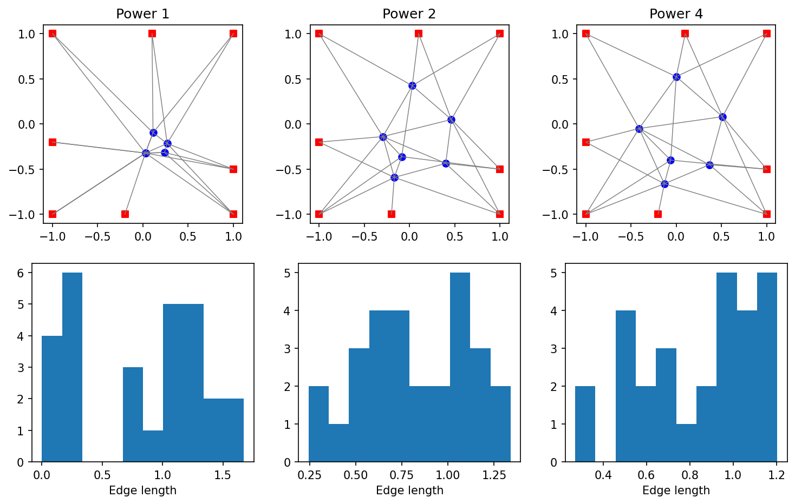

# example 8 6: Linear, quadratic and fourth-order placement

**Method reproduction, approved substitute data or source convention.** This is not an exact recreation of the book’s random realization or figure. The specific differences are documented below.

[Textbook source](https://web.stanford.edu/~boyd/cvxbook/bv_cvxbook.pdf#page=448) · [Original Python](../../examples/application_geometry.py) · [Executed JSON](../../artifacts/examples/example_8_6/results.json) · [Tests](../../tests/test_worked_applications.py)

## Model and verification

Use the published companion graph with six free and eight fixed nodes. Its 28 edges differ from the book’s 27-link instance. Minimize sums of edge lengths, squared lengths, and fourth powers of lengths. The linear formulation is checked against an independently assembled conic dual, the quadratic solution against ordinary least squares, and the quartic solution against its analytic stationarity equations. Show all three layouts and corresponding length distributions.

## Inputs and source comparison

The companion placement.bin publishes eight fixed points, six free points and28 edges, explicitly different from the book’s27-edge instance.

- [Official reference](https://cvxopt.org/examples/book/placement.html)
- [Official reference](https://cvxopt.org/_downloads/d5f22d58ce9353c155230e4f39a5a2e2/placement.py)
- [Official reference](https://cvxr.com/cvx/examples/cvxbook/Ch08_geometric_probs/placement_lin.m)
- [Official reference](https://cvxr.com/cvx/examples/cvxbook/Ch08_geometric_probs/placement_quad.m)
- [Official reference](https://cvxr.com/cvx/examples/cvxbook/Ch08_geometric_probs/placement_quar.m)
- [placement.bin](https://cvxopt.org/_downloads/4bd45910c021ff3cac4d723f947594ef/placement.bin), SHA-256 `7fd8e2b2e7135cbf92379aeeb36bb37da86b01f53bd154032706ec5078fc1eb5`
- Official placement.py explicitly states its data differ from the book. Published placement.bin has 28 edges, not the inventory’s earlier count of 27. This is a complete method reproduction on that companion instance.

The implementation is original Python. Reused numeric data are attributed separately in `data/worked_examples`, including conversion hashes and the upstream GPL-3.0-or-later notice. No textbook scans or reference program bodies are redistributed.

## Executed results

Run at 2026-10-10T05:03:40.787634+00:00; Python 3.12.14; NumPy 2.3.5; CVXPY 1.9.3; elapsed 0.315 s.

| Quantity | Actual value |
| --- | --- |
| fixed_nodes | 8 |
| free_nodes | 6 |
| edges | 28 |
| objectives / 1 | 22.1744579822 |
| objectives / 2 | 21.1523623956 |
| objectives / 4 | 21.4961525146 |

## Numerical checks

| Check | Measured error | Acceptance limit |
| --- | --- | --- |
| linear placement independent dual gap | 6.38245e-09 | 1e-06 |
| quadratic placement versus independent least squares | 4.23408e-07 | 1e-06 |
| quartic placement stationarity | 7.67605e-05 | 0.0001 |

## Recomputed figures



## Reproduce

```sh
OPENBLAS_NUM_THREADS=1 python examples/application_geometry.py example_8_6
python -m pytest tests/test_worked_applications.py -q
```
