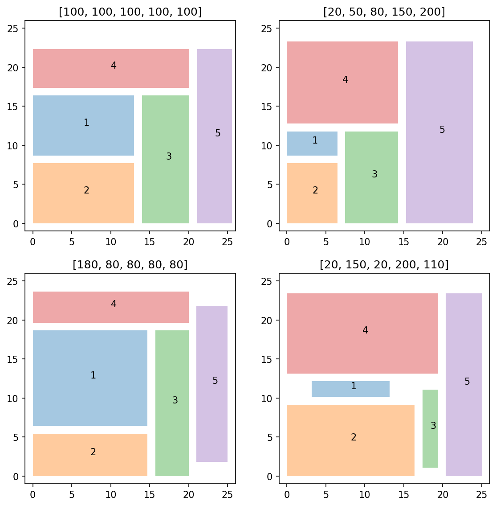

# example 8 7: Five-cell floor planning

**Exact-input reproduction.** Uses the printed instance or the named official numerical data. Numerical precision and drawing style can differ from the source.

[Textbook source](https://web.stanford.edu/~boyd/cvxbook/bv_cvxbook.pdf#page=455) · [Original Python](../../examples/application_geometry.py) · [Executed JSON](../../artifacts/examples/example_8_7/results.json) · [Tests](../../tests/test_worked_applications.py)

## Model and verification

Choose positions, widths and heights of five rectangles while minimizing W+H, half the bounding perimeter. Enforce the source’s ordering graph, one-unit spacing, aspect ratio between 1/5 and 5, and wᵢhᵢ≥Aᵢ. The latter is represented by Aᵢ/hᵢ≤wᵢ and independently by the equivalent rotated quadratic cone ||(2√Aᵢ,wᵢ−hᵢ)||≤wᵢ+hᵢ. Execute all four published area vectors. Check the two formulations’ objectives and recompute every attained area.

## Inputs and source comparison

Companion source supplies spacing 1, aspect-ratio bound 5, relative-position constraints and all four minimum-area vectors.

- [Official reference](https://cvxopt.org/examples/book/floorplan.html)
- [Official reference](https://cvxopt.org/_downloads/70ce961772f98b5f2a84efdcc921cac4/floorplan.py)

The implementation is original Python. Reused numeric data are attributed separately in `data/worked_examples`, including conversion hashes and the upstream GPL-3.0-or-later notice. No textbook scans or reference program bodies are redistributed.

## Executed results

Run at 2026-10-10T05:03:41.189347+00:00; Python 3.12.14; NumPy 2.3.5; CVXPY 1.9.3; elapsed 0.398 s.

| Quantity | Actual value |
| --- | --- |
| half_perimeters | [47.93446178780976, 47.1562220587648, 48.669203564181565, 48.54574638321826] |
| widths | [25.573781946772858, 23.86901512698037, 25.00000048112376, 25.09366748638375] |
| heights | [22.3606798410369, 23.287206931784425, 23.669203083057806, 23.45207889683451] |

## Numerical checks

| Check | Measured error | Acceptance limit |
| --- | --- | --- |
| layout 1 reciprocal versus rotated-cone objective | 3.89678e-09 | 2e-05 |
| layout 1 min-area satisfaction | 3.4074e-07 | 2e-05 |
| layout 2 reciprocal versus rotated-cone objective | 5.76737e-08 | 2e-05 |
| layout 2 min-area satisfaction | 2.85852e-06 | 2e-05 |
| layout 3 reciprocal versus rotated-cone objective | 2.5643e-08 | 2e-05 |
| layout 3 min-area satisfaction | 3.3965e-06 | 2e-05 |
| layout 4 reciprocal versus rotated-cone objective | 6.38597e-08 | 2e-05 |
| layout 4 min-area satisfaction | 2.74638e-06 | 2e-05 |

## Recomputed figures



## Reproduce

```sh
OPENBLAS_NUM_THREADS=1 python examples/application_geometry.py example_8_7
python -m pytest tests/test_worked_applications.py -q
```
