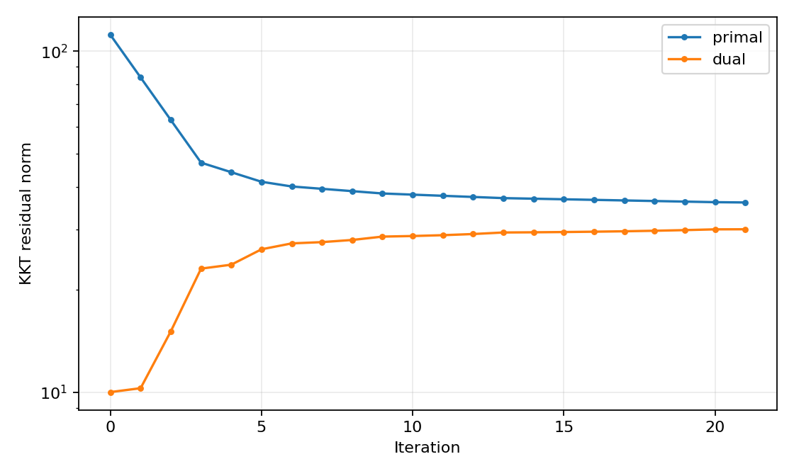
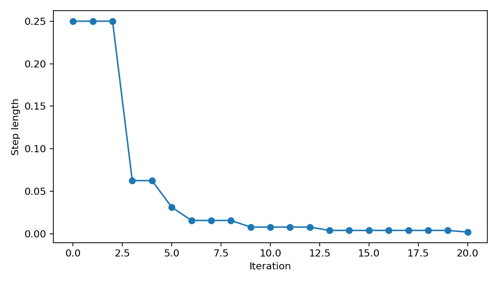

# Infeasible-start Newton on an infeasible problem

[Textbook source](https://web.stanford.edu/~boyd/cvxbook/bv_cvxbook.pdf#page=556). [Official reference 1](https://web.stanford.edu/~boyd/cvxbook/cvxbook_examples/chap10/figure_10_1.m).

## Formulation and method

```math
\min_x -\sum_{j=1}^{100}\log x_j\quad\mathrm{subject\ to}\quad Ax=b,\quad x>0.
```

Newton solves the primal-dual KKT residual by eliminating the diagonal Hessian. The line search decreases the combined residual while retaining positive x. A separate linear program checks the required feasibility property of each generated instance.

## Input provenance and comparison

Random instances use NumPy PCG64, with saved arrays and seeds. They are method reproductions; MATLAB rand(state,...) uses v5uniform and randn(state,...) uses v5normal, whereas seed selects the v4 family. Equal integer seeds do not identify equal arrays. No exact MATLAB fixture was published in the checked companion sources; exact book-figure matching is not claimed. [MATLAB generator documentation](https://www.mathworks.com/help/matlab/math/updating-your-random-number-generator-syntax.html).

The substituted random family is conditioned by rejection: feasible experiments require a positive primal point and a strictly positive dual image; infeasible experiments require a Farkas certificate with A-transpose y nonnegative and b-transpose y = -1. This prevents assuming that a new random draw has the same feasibility outcome as the original MATLAB draw.

## Recomputed output

The following values come from the checked-in [results](../../artifacts/examples/fig_10_3/results.json).

| Quantity | Computed value |
| :--- | ---: |
| Accepted random seed | 1004 |
| Updates | 21 |
| Primal residual | 35.9867 |
| Dual residual | 30.0276 |
| Smallest x | 0.0150795 |
| Last step | 0.00195312 |
| Certificate minimum A-transpose y | -5.29091e-16 |
| Certificate b-transpose y | -1 |





## Reproduction

```sh
OPENBLAS_NUM_THREADS=1 python -m examples.algorithms_ch10 fig_10_3
```

The implementation preserves complete numerical histories, uses explicit algorithm steps, and checks the final conditions independently. Iteration counts denote accepted updates; the initial point is iteration zero.

## Compact input delivery

Generated inputs larger than 256 KiB are represented by [array hashes and regeneration metadata](../../artifacts/examples/fig_10_3/input_manifest.json). The [regeneration helper](../../examples/algorithm_evidence.py) reconstructs every omitted array and verifies its exact bytes under the pinned numerical environment. Run the original study command to materialize all inputs locally. No problem dimension, trial count or numerical accuracy is reduced.
