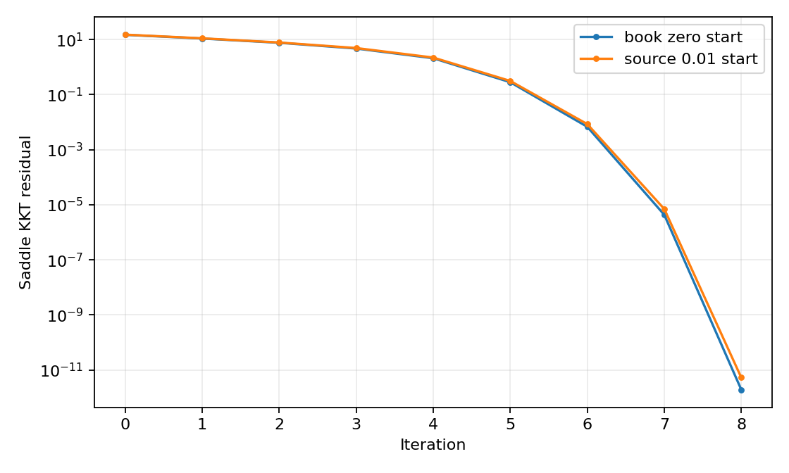

# Newton method for a convex-concave game

[Textbook source](https://web.stanford.edu/~boyd/cvxbook/bv_cvxbook.pdf#page=556). [Official reference 1](https://web.stanford.edu/~boyd/cvxbook/cvxbook_examples/chap10/figure_10_5.m).

## Formulation and method

```math
f(x,y)=x^TAy+c^Tx+d^Ty-\log(1-x^Tx)+\log(1-y^Ty),\quad \min_x\max_y f(x,y).
```

The root of the convex-concave saddle gradient is found with explicit block Newton steps and residual backtracking. Both players remain inside their open unit balls. Convexity in x and concavity in y make a stationary point a global saddle.

## Input provenance and comparison

Random instances use NumPy PCG64, with saved arrays and seeds. They are method reproductions; MATLAB rand(state,...) uses v5uniform and randn(state,...) uses v5normal, whereas seed selects the v4 family. Equal integer seeds do not identify equal arrays. No exact MATLAB fixture was published in the checked companion sources; exact book-figure matching is not claimed. [MATLAB generator documentation](https://www.mathworks.com/help/matlab/math/updating-your-random-number-generator-syntax.html).

The book starts at zero and the companion starts at 0.01 in every coordinate. Both are evaluated on the same replacement instance and reported separately.

## Recomputed output

The following values come from the checked-in [results](../../artifacts/examples/fig_10_5/results.json).

| Quantity | Computed value |
| :--- | ---: |
| book zero start updates | 8 |
| source 0.01 start updates | 8 |
| book zero start residual | 1.932e-12 |
| source 0.01 start residual | 5.287e-12 |



## Reproduction

```sh
OPENBLAS_NUM_THREADS=1 python -m examples.algorithms_ch10 fig_10_5
```

The implementation preserves complete numerical histories, uses explicit algorithm steps, and checks the final conditions independently. Iteration counts denote accepted updates; the initial point is iteration zero.

## Compact input delivery

Generated inputs larger than 256 KiB are represented by [array hashes and regeneration metadata](../../artifacts/examples/fig_10_5/input_manifest.json). The [regeneration helper](../../examples/algorithm_evidence.py) reconstructs every omitted array and verifies its exact bytes under the pinned numerical environment. Run the original study command to materialize all inputs locally. No problem dimension, trial count or numerical accuracy is reduced.
