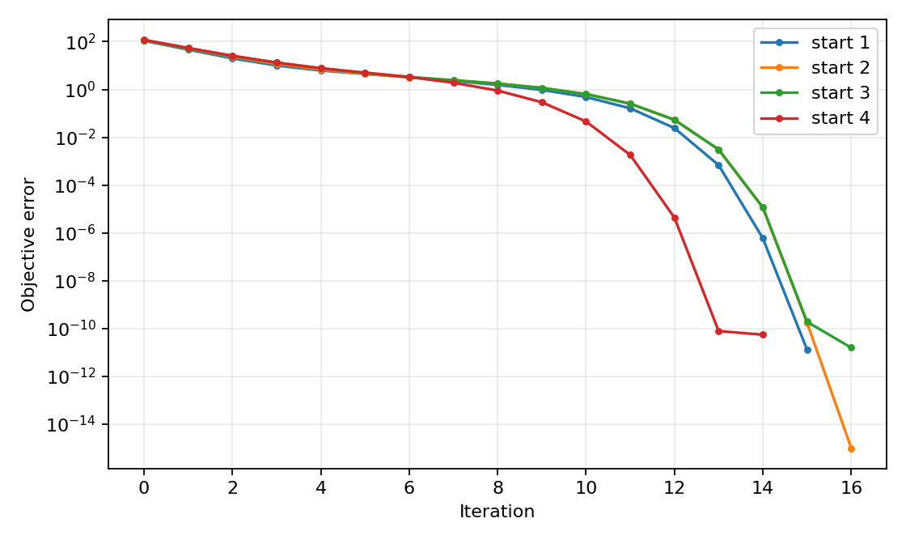
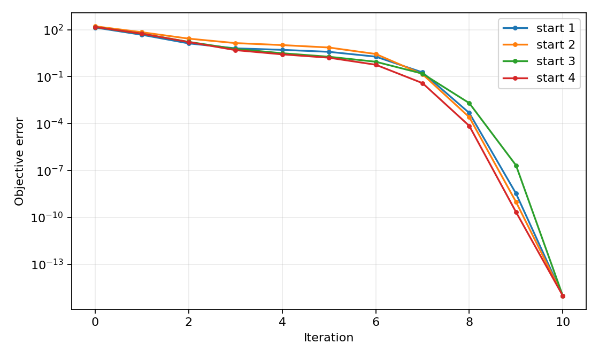
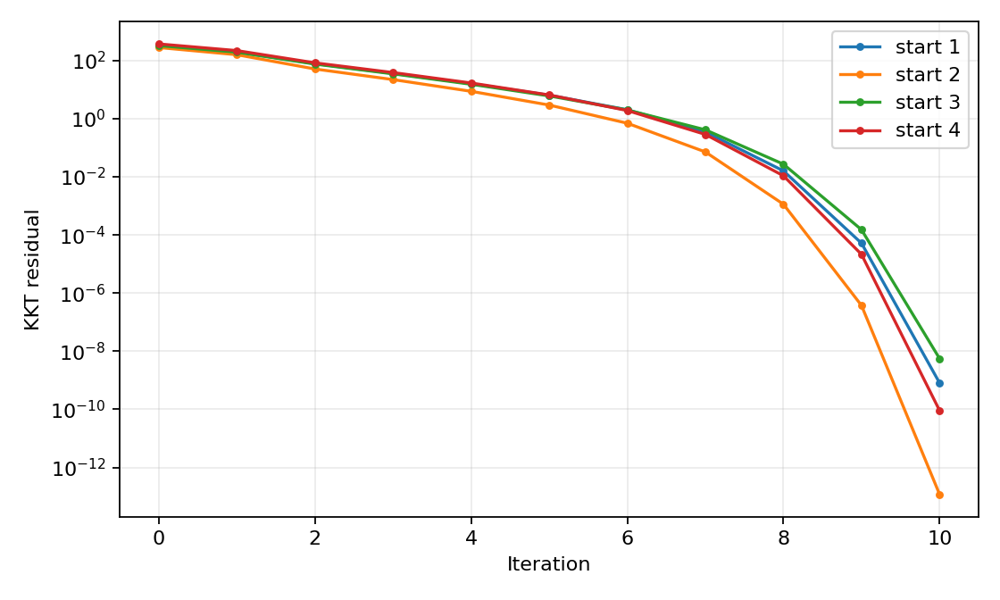

# Three Newton formulations for analytic centering

[Textbook source](https://web.stanford.edu/~boyd/cvxbook/bv_cvxbook.pdf#page=562). [Official reference 1](https://web.stanford.edu/~boyd/cvxbook/cvxbook_examples/chap10/figure_10_6.m).

## Formulation and method

```math
\min_{x>0,\ Ax=b}-\sum_j\log x_j,\qquad\min_{A^Tz>0}b^Tz-\sum_j\log(A^Tz)_j.
```

Four near-boundary starts are used for each feasible primal and dual formulation, and four positive infeasible starts for the KKT formulation. Feasible primal steps lie in the equality nullspace. Dual minimizers recover primal points by x = 1/(A-transpose z).

## Input provenance and comparison

Random instances use NumPy PCG64, with saved arrays and seeds. They are method reproductions; MATLAB rand(state,...) uses v5uniform and randn(state,...) uses v5normal, whereas seed selects the v4 family. Equal integer seeds do not identify equal arrays. No exact MATLAB fixture was published in the checked companion sources; exact book-figure matching is not claimed. [MATLAB generator documentation](https://www.mathworks.com/help/matlab/math/updating-your-random-number-generator-syntax.html).

Corrections to the published MATLAB script: the feasible-primal Armijo expression uses log(x+s dx), not log(1+x+s dx); its BETA*S typo is corrected; both primal and dual Armijo right-hand sides include the step length. These are implementation errors in the source, not changes to the textbook algorithms.

## Recomputed output

The following values come from the checked-in [results](../../artifacts/examples/fig_10_6/results.json).

| Quantity | Computed value |
| :--- | ---: |
| feasible primal start 1: updates | 15 |
| feasible primal start 1: primal residual | 5.395e-12 |
| feasible primal start 2: updates | 16 |
| feasible primal start 2: primal residual | 5.511e-12 |
| feasible primal start 3: updates | 16 |
| feasible primal start 3: primal residual | 4.451e-12 |
| feasible primal start 4: updates | 14 |
| feasible primal start 4: primal residual | 5.278e-12 |
| dual start 1: updates | 10 |
| dual start 1: primal residual | 5.823e-09 |
| dual start 2: updates | 10 |
| dual start 2: primal residual | 1.663e-09 |
| dual start 3: updates | 10 |
| dual start 3: primal residual | 7.252e-07 |
| dual start 4: updates | 10 |
| dual start 4: primal residual | 8.344e-10 |
| infeasible KKT start 1: updates | 10 |
| infeasible KKT start 1: primal residual | 5.957e-14 |
| infeasible KKT start 2: updates | 10 |
| infeasible KKT start 2: primal residual | 6.246e-14 |
| infeasible KKT start 3: updates | 10 |
| infeasible KKT start 3: primal residual | 6.026e-14 |
| infeasible KKT start 4: updates | 10 |
| infeasible KKT start 4: primal residual | 7.153e-14 |







## Reproduction

```sh
OPENBLAS_NUM_THREADS=1 python -m examples.algorithms_ch10 fig_10_6
```

The implementation preserves complete numerical histories, uses explicit algorithm steps, and checks the final conditions independently. Iteration counts denote accepted updates; the initial point is iteration zero.

## Compact input delivery

Generated inputs larger than 256 KiB are represented by [array hashes and regeneration metadata](../../artifacts/examples/fig_10_6/input_manifest.json). The [regeneration helper](../../examples/algorithm_evidence.py) reconstructs every omitted array and verifies its exact bytes under the pinned numerical environment. Run the original study command to materialize all inputs locally. No problem dimension, trial count or numerical accuracy is reduced.
