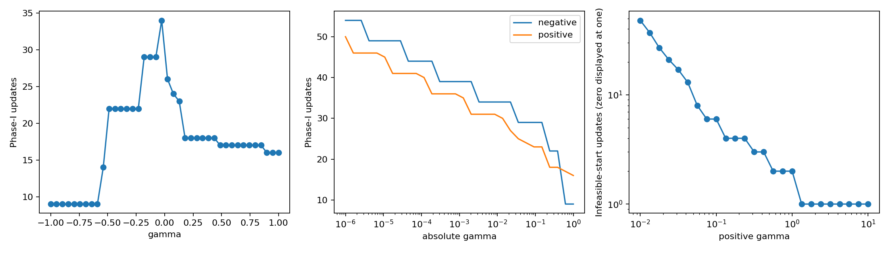

# Feasibility difficulty near the boundary

[Textbook source](https://web.stanford.edu/~boyd/cvxbook/bv_cvxbook.pdf#page=596). 

## Formulation and method

```math
Ax\leq b+\gamma\mathbf1,\quad A\in\mathbb R^{50\times20},\quad b=b_0+s_\star\mathbf1.
```

A full Gaussian 50-by-20 matrix and random right-hand side are shifted by the optimal common-slack LP value. Thus gamma positive has strictly feasible x-star, gamma zero is feasible without an interior, and gamma negative is infeasible. The boundary LP supplies an independent certificate of this classification. Phase I explicitly centers the common-slack LP with mu = 10 and stops when the auxiliary scalar s is negative or a corrected dual certificate proves infeasibility. Saved feasible points, auxiliary scalars, dual vectors and their normalizations permit independent checks of both stopping conditions. Infeasible-start Newton solves the slack analytic-center KKT equations with alpha = 0.01, beta = 0.9.

## Input provenance and comparison

Random instances use NumPy PCG64, with saved arrays and seeds. They are method reproductions; MATLAB rand(state,...) uses v5uniform and randn(state,...) uses v5normal, whereas seed selects the v4 family. Equal integer seeds do not identify equal arrays. No exact MATLAB fixture was published in the checked companion sources; exact book-figure matching is not claimed. [MATLAB generator documentation](https://www.mathworks.com/help/matlab/math/updating-your-random-number-generator-syntax.html).

The unpublished original A, b and perturbation are replaced by the explicit seed-1110 family above. The 40-value main sweep, positive/negative near-boundary range down to 1e-6 and 25 positive infeasible-start tests are executed. Exact counts and slopes depend on the instance, so no claim is made to match the original curves.

## Recomputed output

The following values come from the checked-in [results](../../artifacts/examples/fig_11_10/results.json).

| Quantity | Computed value |
| :--- | ---: |
| Linear gamma values | 40 |
| Near-boundary values | 60 |
| Infeasible-start values | 25 |
| Largest phase-I count | 54 |
| Largest infeasible-start count | 48 |



## Reproduction

```sh
OPENBLAS_NUM_THREADS=1 python -m examples.algorithms_ch11 fig_11_10
```

The implementation preserves complete numerical histories, uses explicit algorithm steps, and checks the final conditions independently. Iteration counts denote accepted updates; the initial point is iteration zero.

## Compact input delivery

Generated inputs larger than 256 KiB are represented by [array hashes and regeneration metadata](../../artifacts/examples/fig_11_10/input_manifest.json). The [regeneration helper](../../examples/algorithm_evidence.py) reconstructs every omitted array and verifies its exact bytes under the pinned numerical environment. Run the original study command to materialize all inputs locally. No problem dimension, trial count or numerical accuracy is reduced.
