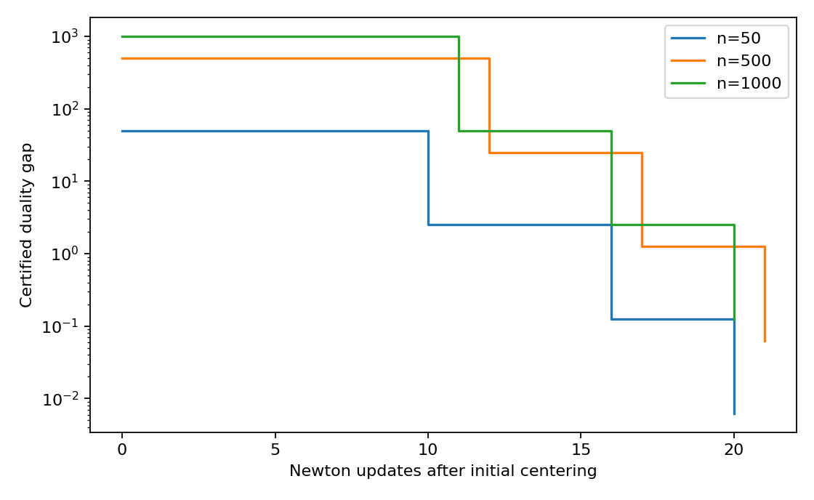

# Barrier method on three SDP sizes

[Textbook source](https://web.stanford.edu/~boyd/cvxbook/bv_cvxbook.pdf#page=617). [Official reference 1](https://web.stanford.edu/~boyd/cvxbook/cvxbook_examples/chap11/figure_11_19.m).

## Formulation and method

```math
\min\mathbf1^Tx\quad\mathrm{subject\ to}\quad B+\mathrm{diag}(x)\succeq0.
```

The three full-size runs preserve the textbook dimensions and use custom Newton centering with backtracking. Initial centering is excluded from plotted update counts. Explicit feasible dual certificates give the reported objective gaps.

## Input provenance and comparison

Random instances use NumPy PCG64, with saved arrays and seeds. They are method reproductions; MATLAB rand(state,...) uses v5uniform and randn(state,...) uses v5normal, whereas seed selects the v4 family. Equal integer seeds do not identify equal arrays. No exact MATLAB fixture was published in the checked companion sources; exact book-figure matching is not claimed. [MATLAB generator documentation](https://www.mathworks.com/help/matlab/math/updating-your-random-number-generator-syntax.html).

The textbook stops after relative gap reduction 10000 (LP) or 8000 (SDP); the companion instead requests absolute gaps 0.001 or 0.0001. This implementation follows the book relative-reduction experiment. For SDP it also retains the textbook random diagonal, unlike the companion zero-diagonal construction.

## Recomputed output

The following values come from the checked-in [results](../../artifacts/examples/fig_11_19/results.json).

| Quantity | Computed value |
| :--- | ---: |
| 50: updates after centering | 20 |
| 500: updates after centering | 21 |
| 1000: updates after centering | 20 |
| 50: gap reduction | 7999.9 |
| 500: gap reduction | 7999.618 |
| 1000: gap reduction | 7999.507 |



## Reproduction

```sh
OPENBLAS_NUM_THREADS=1 python -m examples.algorithms_ch11 fig_11_19
```

The implementation preserves complete numerical histories, uses explicit algorithm steps, and checks the final conditions independently. Iteration counts denote accepted updates; the initial point is iteration zero.

## Compact input delivery

Generated inputs larger than 256 KiB are represented by [array hashes and regeneration metadata](../../artifacts/examples/fig_11_19/input_manifest.json). The [regeneration helper](../../examples/algorithm_evidence.py) reconstructs every omitted array and verifies its exact bytes under the pinned numerical environment. Run the original study command to materialize all inputs locally. No problem dimension, trial count or numerical accuracy is reduced.

The order-1000 dual matrix is reconstructed from the saved final iterate using the explicit Newton correction described in the results JSON. Its gap, stationarity, primal and dual eigenvalue checks remain in the published result.
