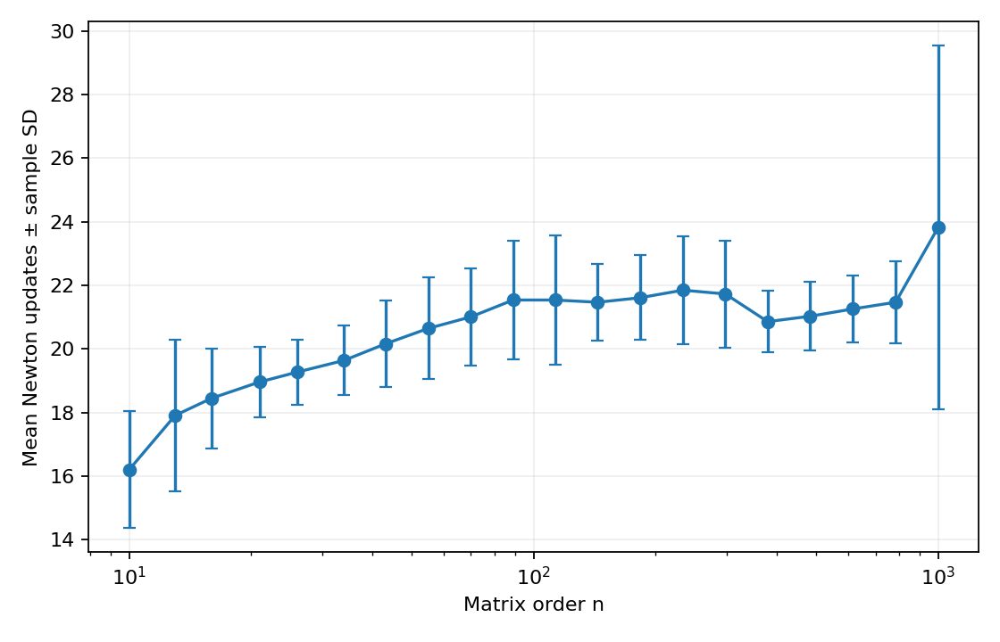

# Barrier-method scaling across 2000 SDPs

[Textbook source](https://web.stanford.edu/~boyd/cvxbook/bv_cvxbook.pdf#page=619). 

## Formulation and method

```math
\min\mathbf1^Tx\quad\mathrm{subject\ to}\quad B+\mathrm{diag}(x)\succeq0.
```

All 2000 dense symmetric matrices have independent Gaussian lower triangles, reflected upper triangles and spectral norm one. The barrier runs start on the t = 1 central path; reported counts exclude initial centering. The original book stopping rule is a gap reduction of 10000 for LP and 8000 for SDP, not a fixed absolute tolerance.

## Input provenance and comparison

Random instances use NumPy PCG64, with saved arrays and seeds. They are method reproductions; MATLAB rand(state,...) uses v5uniform and randn(state,...) uses v5normal, whereas seed selects the v4 family. Equal integer seeds do not identify equal arrays. No exact MATLAB fixture was published in the checked companion sources; exact book-figure matching is not claimed. [MATLAB generator documentation](https://www.mathworks.com/help/matlab/math/updating-your-random-number-generator-syntax.html).

The original 20 dimension values and seeds are not published; the replacement uses 20 rounded geometric spacings from 10 through 1000. Every trial seed and independently recomputed feasibility/certificate check is saved. No sample count or maximum dimension is reduced.

The SDP companion zeros the diagonal of its random matrix, whereas the textbook samples the diagonal normally. These scaling experiments follow the textbook distribution.

## Recomputed output

The following values come from the checked-in [results](../../artifacts/examples/fig_11_20/results.json).

| Quantity | Computed value |
| :--- | ---: |
| n=10: mean ± SD | 16.200 ± 1.837 |
| n=13: mean ± SD | 17.910 ± 2.391 |
| n=16: mean ± SD | 18.450 ± 1.572 |
| n=21: mean ± SD | 18.960 ± 1.100 |
| n=26: mean ± SD | 19.270 ± 1.024 |
| n=34: mean ± SD | 19.640 ± 1.097 |
| n=43: mean ± SD | 20.160 ± 1.369 |
| n=55: mean ± SD | 20.650 ± 1.598 |
| n=70: mean ± SD | 21.010 ± 1.521 |
| n=89: mean ± SD | 21.540 ± 1.872 |
| n=113: mean ± SD | 21.540 ± 2.027 |
| n=144: mean ± SD | 21.470 ± 1.201 |
| n=183: mean ± SD | 21.610 ± 1.333 |
| n=234: mean ± SD | 21.850 ± 1.708 |
| n=298: mean ± SD | 21.730 ± 1.681 |
| n=379: mean ± SD | 20.860 ± 0.964 |
| n=483: mean ± SD | 21.030 ± 1.087 |
| n=616: mean ± SD | 21.260 ± 1.050 |
| n=785: mean ± SD | 21.470 ± 1.283 |
| n=1000: mean ± SD | 23.820 ± 5.725 |



## Reproduction

```sh
OPENBLAS_NUM_THREADS=1 python -m examples.algorithms_ch11 fig_11_20
```

The implementation preserves complete numerical histories, uses explicit algorithm steps, and checks the final conditions independently. Iteration counts denote accepted updates; the initial point is iteration zero.

## Compact input delivery

Generated inputs larger than 256 KiB are represented by [array hashes and regeneration metadata](../../artifacts/examples/fig_11_20/input_manifest.json). The [regeneration helper](../../examples/algorithm_evidence.py) reconstructs every omitted array and verifies its exact bytes under the pinned numerical environment. Run the original study command to materialize all inputs locally. No problem dimension, trial count or numerical accuracy is reduced.

## Complete trial evidence

All 2000 trials are retained in the twenty dimension shards listed, counted and SHA256-bound in results.json. Each record includes its random seed, kernel hash, execution metadata, iteration history and primal-dual certificate diagnostics. The compact main file contains all aggregate means, sample deviations and ranges.
