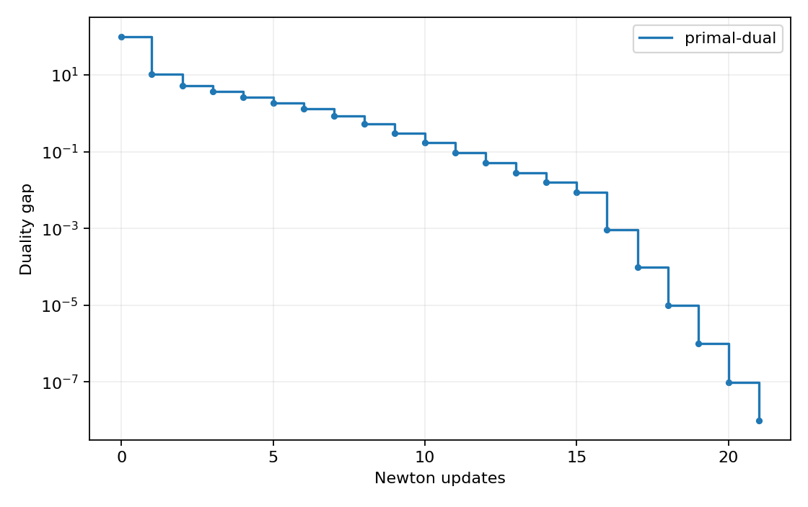
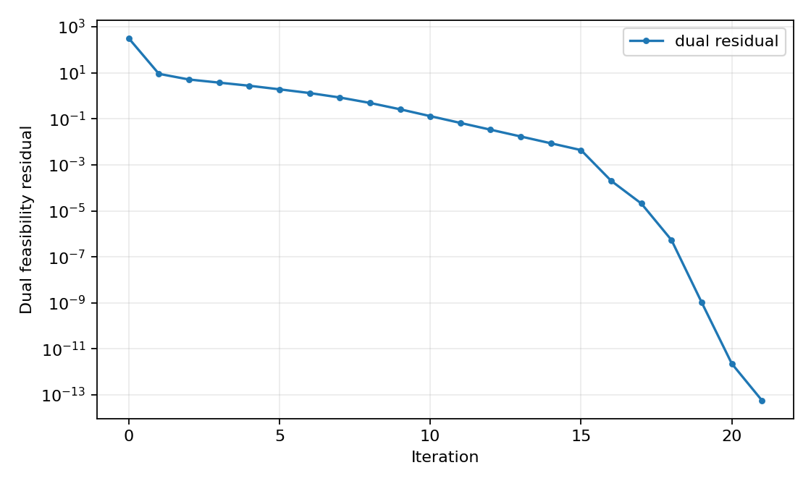

# Primal-dual method on a small GP

[Textbook source](https://web.stanford.edu/~boyd/cvxbook/bv_cvxbook.pdf#page=627). [Official reference 1](https://web.stanford.edu/~boyd/cvxbook/cvxbook_examples/chap11/figure_11_22.m).

## Formulation and method

```math
\min_x\log\sum_{k=1}^5 e^{a_{0k}^Tx+b_{0k}}\quad\mathrm{subject\ to}\quad\log\sum_{k=1}^5 e^{a_{ik}^Tx+b_{ik}}\leq0,\quad i=1,\ldots,100.
```

The primal-dual direction solves the linearized KKT equations by Schur elimination. Each update preserves strictly positive inequality slacks and multipliers and decreases the combined centering and dual residual. The barrier parameter is recomputed from the current surrogate gap with mu = 10.

## Input provenance and comparison

Random instances use NumPy PCG64, with saved arrays and seeds. They are method reproductions; MATLAB rand(state,...) uses v5uniform and randn(state,...) uses v5normal, whereas seed selects the v4 family. Equal integer seeds do not identify equal arrays. No exact MATLAB fixture was published in the checked companion sources; exact book-figure matching is not claimed. [MATLAB generator documentation](https://www.mathworks.com/help/matlab/math/updating-your-random-number-generator-syntax.html).

The primal-dual method plots the surrogate gap minus f(x)-transpose lambda and the combined KKT residual. It stops only when both are below 1e-8. Its lambda multipliers and saved primal point permit independent positivity, feasibility, stationarity and complementarity checks; no entropy-dual correction or nominal degree/t quantity is used in this experiment.

## Recomputed output

The following values come from the checked-in [results](../../artifacts/examples/fig_11_22/results.json).

| Quantity | Computed value |
| :--- | ---: |
| primal-dual updates | 21 |
| primal-dual objective | 0.9999999702 |
| primal-dual final gap | 9.82e-09 |
| primal-dual stationarity | 5.72e-14 |





## Reproduction

```sh
OPENBLAS_NUM_THREADS=1 python -m examples.algorithms_ch11 fig_11_22
```

The implementation preserves complete numerical histories, uses explicit algorithm steps, and checks the final conditions independently. Iteration counts denote accepted updates; the initial point is iteration zero.

## Compact input delivery

Generated inputs larger than 256 KiB are represented by [array hashes and regeneration metadata](../../artifacts/examples/fig_11_22/input_manifest.json). The [regeneration helper](../../examples/algorithm_evidence.py) reconstructs every omitted array and verifies its exact bytes under the pinned numerical environment. Run the original study command to materialize all inputs locally. No problem dimension, trial count or numerical accuracy is reduced.
