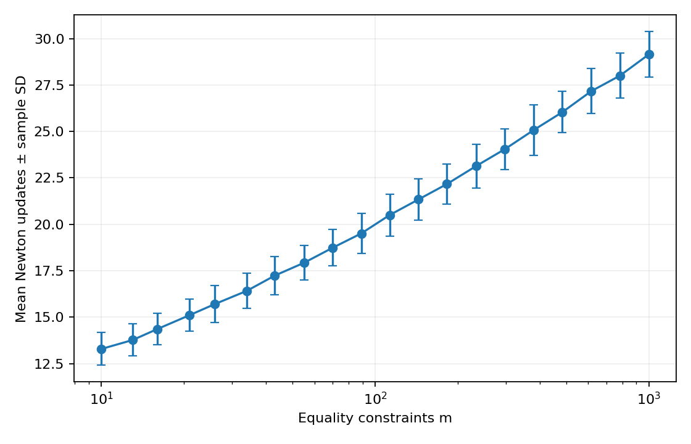

# Primal-dual scaling across 2000 LPs

[Textbook source](https://web.stanford.edu/~boyd/cvxbook/bv_cvxbook.pdf#page=629). 

## Formulation and method

```math
\min c^Tx\quad\mathrm{subject\ to}\quad Ax=b,\ x\geq0,\quad n=2m.
```

All 2000 Gaussian standard-form LPs are generated once and reused by both the barrier and primal-dual sweeps. Primal and dual strictly feasible points are constructed. Primal-dual runs start from x = 1, inequality multipliers = 1 and equality multipliers = 0, as specified for Figure11.23, and require both absolute gap and feasibility residuals below 1e-8, using mu = 10 and positivity/residual backtracking. Below gap 1e-4 the same Newton equations are solved as a scaled symmetric augmented system, avoiding the squared conditioning of normal equations and preserving all residual equations at high accuracy.

## Input provenance and comparison

Random instances use NumPy PCG64, with saved arrays and seeds. They are method reproductions; MATLAB rand(state,...) uses v5uniform and randn(state,...) uses v5normal, whereas seed selects the v4 family. Equal integer seeds do not identify equal arrays. No exact MATLAB fixture was published in the checked companion sources; exact book-figure matching is not claimed. [MATLAB generator documentation](https://www.mathworks.com/help/matlab/math/updating-your-random-number-generator-syntax.html).

The original 20 dimension values and seeds are not published; the replacement uses 20 rounded geometric spacings from 10 through 1000. Every trial seed and independently recomputed feasibility/certificate check is saved. No sample count or maximum dimension is reduced.

## Recomputed output

The following values come from the checked-in [results](../../artifacts/examples/fig_11_23/results.json).

| Quantity | Computed value |
| :--- | ---: |
| m=10: mean ± SD | 13.290 ± 0.880 |
| m=13: mean ± SD | 13.770 ± 0.863 |
| m=16: mean ± SD | 14.360 ± 0.859 |
| m=21: mean ± SD | 15.110 ± 0.875 |
| m=26: mean ± SD | 15.710 ± 0.988 |
| m=34: mean ± SD | 16.420 ± 0.945 |
| m=43: mean ± SD | 17.240 ± 1.026 |
| m=55: mean ± SD | 17.930 ± 0.935 |
| m=70: mean ± SD | 18.740 ± 0.981 |
| m=89: mean ± SD | 19.510 ± 1.087 |
| m=113: mean ± SD | 20.500 ± 1.124 |
| m=144: mean ± SD | 21.340 ± 1.112 |
| m=183: mean ± SD | 22.170 ± 1.074 |
| m=234: mean ± SD | 23.140 ± 1.181 |
| m=298: mean ± SD | 24.050 ± 1.104 |
| m=379: mean ± SD | 25.070 ± 1.358 |
| m=483: mean ± SD | 26.040 ± 1.109 |
| m=616: mean ± SD | 27.170 ± 1.215 |
| m=785: mean ± SD | 28.010 ± 1.227 |
| m=1000: mean ± SD | 29.150 ± 1.234 |



## Reproduction

```sh
OPENBLAS_NUM_THREADS=1 python -m examples.algorithms_ch11 fig_11_23
```

The implementation preserves complete numerical histories, uses explicit algorithm steps, and checks the final conditions independently. Iteration counts denote accepted updates; the initial point is iteration zero.

## Compact input delivery

Generated inputs larger than 256 KiB are represented by [array hashes and regeneration metadata](../../artifacts/examples/fig_11_23/input_manifest.json). The [regeneration helper](../../examples/algorithm_evidence.py) reconstructs every omitted array and verifies its exact bytes under the pinned numerical environment. Run the original study command to materialize all inputs locally. No problem dimension, trial count or numerical accuracy is reduced.

## Complete trial evidence

All 2000 trials are retained in the twenty dimension shards listed, counted and SHA256-bound in results.json. Each record includes its random seed, kernel hash, execution metadata, iteration history and primal-dual certificate diagnostics. The compact main file contains all aggregate means, sample deviations and ranges.
