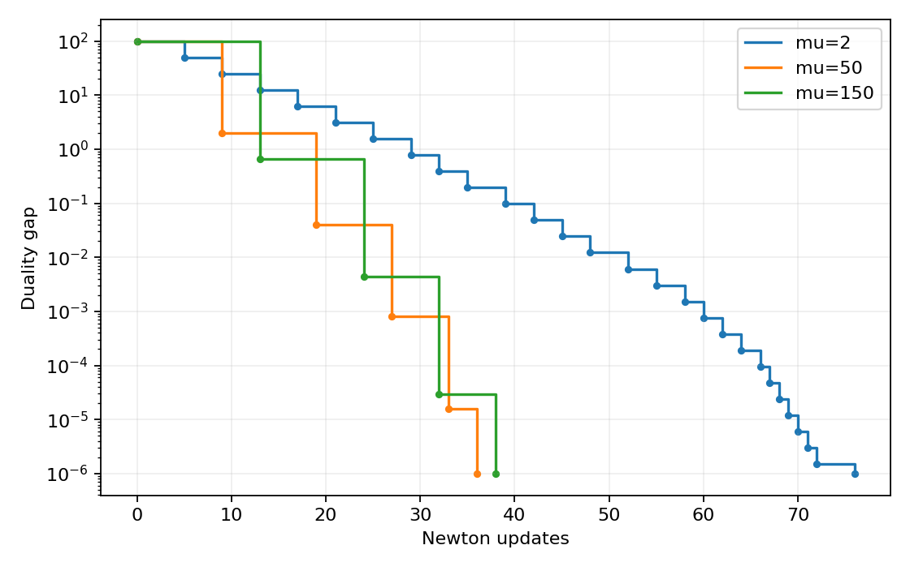
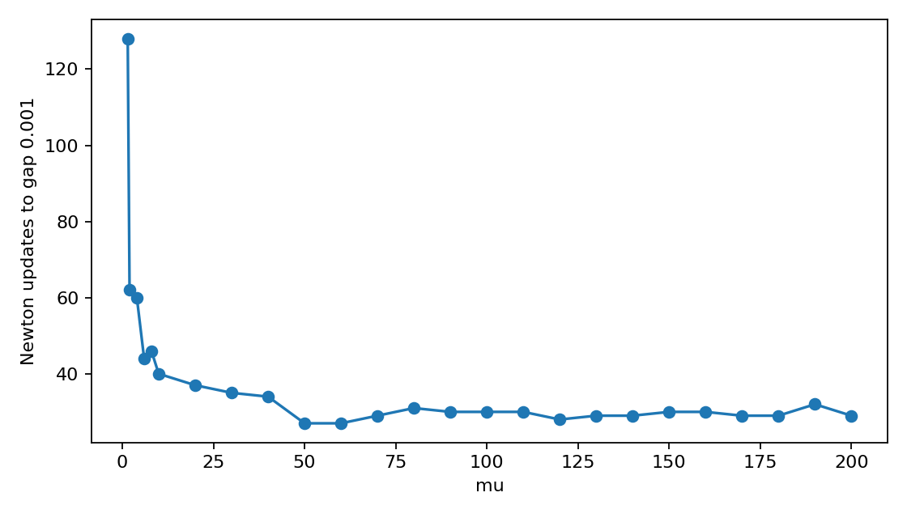

# Barrier method on a small inequality-form LP

[Textbook source](https://web.stanford.edu/~boyd/cvxbook/bv_cvxbook.pdf#page=585). [Official reference 1](https://web.stanford.edu/~boyd/cvxbook/cvxbook_examples/chap11/figure_11_4.m).

## Formulation and method

```math
\min_x c^Tx\quad\mathrm{subject\ to}\quad Ax\leq b,\quad A\in\mathbb R^{100\times50}.
```

Explicit Newton centering uses alpha = 0.01, beta = 0.5 and squared decrement divided by two at most 1e-5. A t = 1 central point initializes each comparison. A log-sum-exp barrier, Lorentz-cone logarithm, or log determinant is differentiated directly as required. The optimal value is shifted to approximately one as in the book.

## Input provenance and comparison

Random instances use NumPy PCG64, with saved arrays and seeds. They are method reproductions; MATLAB rand(state,...) uses v5uniform and randn(state,...) uses v5normal, whereas seed selects the v4 family. Equal integer seeds do not identify equal arrays. No exact MATLAB fixture was published in the checked companion sources; exact book-figure matching is not claimed. [MATLAB generator documentation](https://www.mathworks.com/help/matlab/math/updating-your-random-number-generator-syntax.html).

The companion generator uses c = A-transpose z but labels z a strictly feasible dual multiplier, which would require c = -A-transpose z. The replacement enforces that negative sign, guaranteeing the declared strict dual feasibility. Its mu = 150 curve is mislabeled mu = 100 in one source annotation; the numeric parameter 150 is retained.

## Recomputed output

The following values come from the checked-in [results](../../artifacts/examples/fig_11_4/results.json).

| Quantity | Computed value |
| :--- | ---: |
| mu=2 updates | 76 |
| mu=2 objective | 1.000000495 |
| mu=2 final gap | 9.901e-07 |
| mu=2 stationarity | 1.161e-14 |
| mu=50 updates | 36 |
| mu=50 objective | 1.000000495 |
| mu=50 final gap | 9.898e-07 |
| mu=50 stationarity | 1.125e-14 |
| mu=150 updates | 38 |
| mu=150 objective | 1.000000495 |
| mu=150 final gap | 9.901e-07 |
| mu=150 stationarity | 9.943e-15 |





## Reproduction

```sh
OPENBLAS_NUM_THREADS=1 python -m examples.algorithms_ch11 fig_11_4
```

The implementation preserves complete numerical histories, uses explicit algorithm steps, and checks the final conditions independently. Iteration counts denote accepted updates; the initial point is iteration zero.

## Compact input delivery

Generated inputs larger than 256 KiB are represented by [array hashes and regeneration metadata](../../artifacts/examples/fig_11_4/input_manifest.json). The [regeneration helper](../../examples/algorithm_evidence.py) reconstructs every omitted array and verifies its exact bytes under the pinned numerical environment. Run the original study command to materialize all inputs locally. No problem dimension, trial count or numerical accuracy is reduced.
