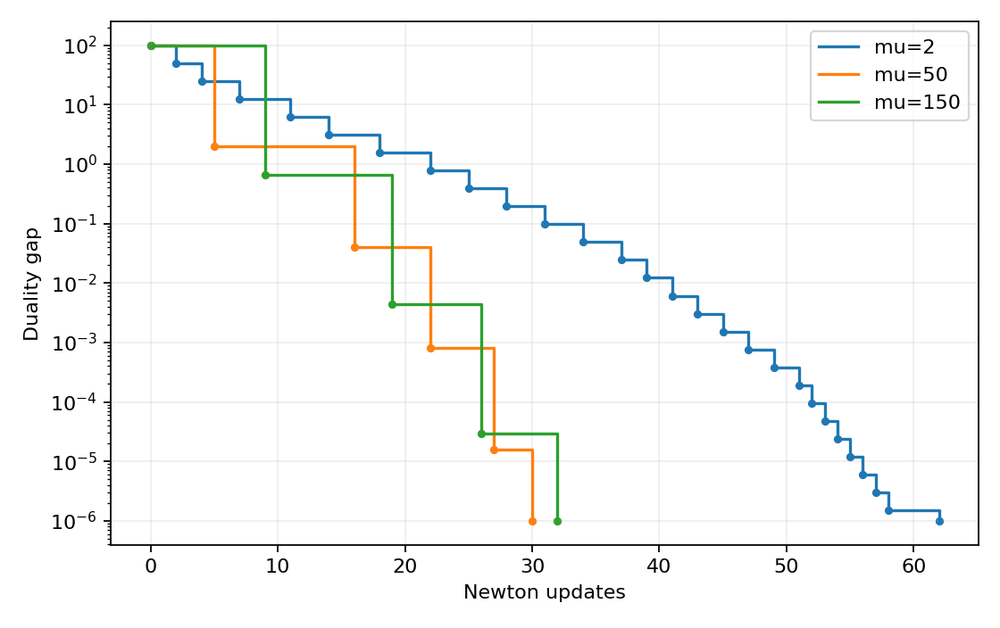
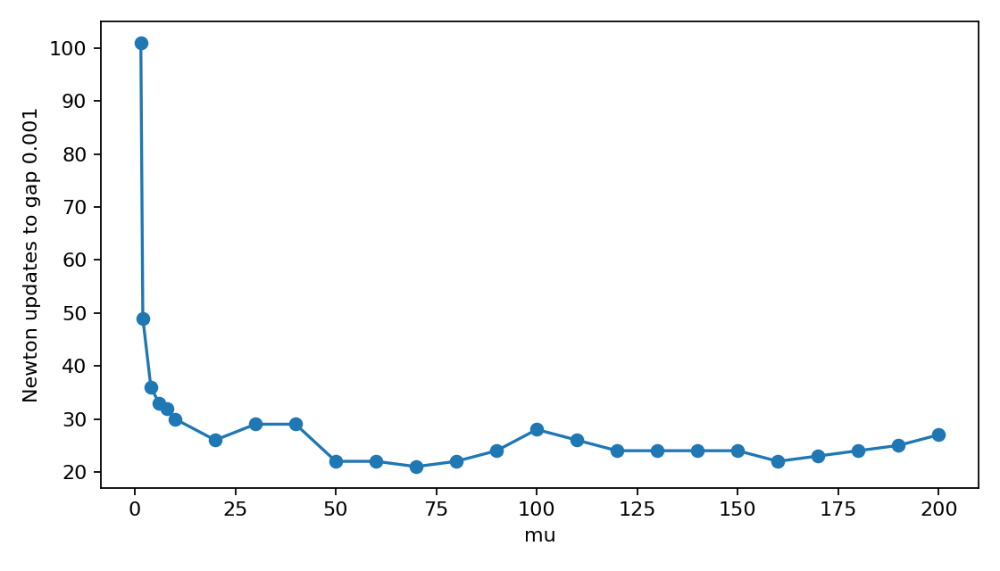

# Barrier method on a small geometric program

[Textbook source](https://web.stanford.edu/~boyd/cvxbook/bv_cvxbook.pdf#page=587). [Official reference 1](https://web.stanford.edu/~boyd/cvxbook/cvxbook_examples/chap11/figure_11_6.m).

## Formulation and method

```math
\min_x\log\sum_{k=1}^5 e^{a_{0k}^Tx+b_{0k}}\quad\mathrm{subject\ to}\quad\log\sum_{k=1}^5 e^{a_{ik}^Tx+b_{ik}}\leq0,\quad i=1,\ldots,100.
```

Explicit Newton centering uses alpha = 0.01, beta = 0.5 and squared decrement divided by two at most 1e-5. A t = 1 central point initializes each comparison. A log-sum-exp barrier, Lorentz-cone logarithm, or log determinant is differentiated directly as required. The optimal value is shifted to approximately one as in the book.

## Input provenance and comparison

Random instances use NumPy PCG64, with saved arrays and seeds. They are method reproductions; MATLAB rand(state,...) uses v5uniform and randn(state,...) uses v5normal, whereas seed selects the v4 family. Equal integer seeds do not identify equal arrays. No exact MATLAB fixture was published in the checked companion sources; exact book-figure matching is not claimed. [MATLAB generator documentation](https://www.mathworks.com/help/matlab/math/updating-your-random-number-generator-syntax.html).

A Newton correction is applied to the central-path dual variables, enforcing dual linear equations despite approximate centering. The corrected feasible-dual objective gap is plotted; nominal degree/t is retained separately in the JSON. Cone or entropy-dual feasibility is checked independently.

## Recomputed output

The following values come from the checked-in [results](../../artifacts/examples/fig_11_6/results.json).

| Quantity | Computed value |
| :--- | ---: |
| mu=2 updates | 62 |
| mu=2 objective | 1.000000294 |
| mu=2 final gap | 9.901e-07 |
| mu=2 stationarity | 7.405e-15 |
| mu=50 updates | 30 |
| mu=50 objective | 1.000000294 |
| mu=50 final gap | 9.899e-07 |
| mu=50 stationarity | 8.302e-15 |
| mu=150 updates | 32 |
| mu=150 objective | 1.000000294 |
| mu=150 final gap | 9.901e-07 |
| mu=150 stationarity | 6.811e-15 |





## Reproduction

```sh
OPENBLAS_NUM_THREADS=1 python -m examples.algorithms_ch11 fig_11_6
```

The implementation preserves complete numerical histories, uses explicit algorithm steps, and checks the final conditions independently. Iteration counts denote accepted updates; the initial point is iteration zero.

## Compact input delivery

Generated inputs larger than 256 KiB are represented by [array hashes and regeneration metadata](../../artifacts/examples/fig_11_6/input_manifest.json). The [regeneration helper](../../examples/algorithm_evidence.py) reconstructs every omitted array and verifies its exact bytes under the pinned numerical environment. Run the original study command to materialize all inputs locally. No problem dimension, trial count or numerical accuracy is reduced.
