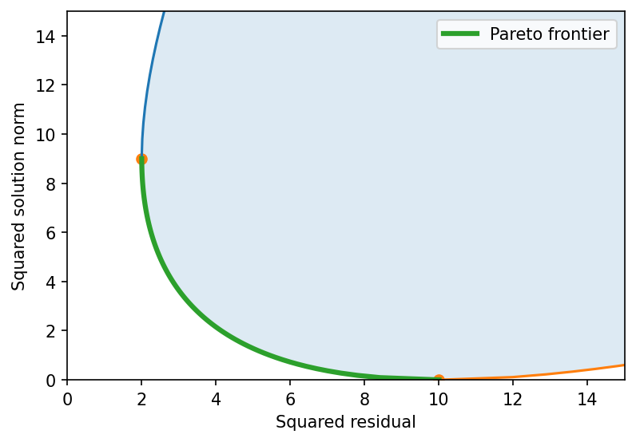

# fig 4 11: Regularized least-squares achievable set and Pareto curve

**Exact-input reproduction.** Uses the printed instance or the named official numerical data. Numerical precision and drawing style can differ from the source.

[Textbook source](https://web.stanford.edu/~boyd/cvxbook/bv_cvxbook.pdf#page=198) · [Original Python](../../examples/application_basic.py) · [Executed JSON](../../artifacts/examples/fig_4_11/results.json) · [Tests](../../tests/test_worked_applications.py)

## Model and verification

Write H=A^T A and g=A^T b. On each sphere ||x||²=α, diagonalizing H reduces stationarity to a scalar secular equation in a Lagrange multiplier. Its root on the positive-semidefinite branch gives the minimum; the corresponding negative-definite branch gives the maximum. Both boundaries of the achievable set are computed. Independent two-variable semidefinite duals certify all nonzero-radius extrema. The lower-left boundary through the zero and least-squares endpoints is the Pareto frontier.

## Inputs and source comparison

The textbook gives A in R^(100x10), b in R^100 but not their entries. The author-endorsed CVXOPT book example supplies A and b in rls.bin, plus a figure-specific script.

- [Official reference](https://cvxopt.org/examples/book/rls.html)
- [Official reference](https://cvxopt.org/_downloads/6fb195d61a883874a99a4b69b1ba550a/rls.py)
- [rls.bin](https://cvxopt.org/_downloads/ae5082f8c98ecb01b98907b9b0cbea52/rls.bin), SHA-256 `b6eb7186d4ee7cbb4abd610edd517aca171d738f988368ffe38ea60357103b1f`

The implementation is original Python. Reused numeric data are attributed separately in `data/worked_examples`, including conversion hashes and the upstream GPL-3.0-or-later notice. No textbook scans or reference program bodies are redistributed.

## Executed results

Run at 2026-10-10T05:03:17.552775+00:00; Python 3.12.14; NumPy 2.3.5; CVXPY 1.9.3; elapsed 0.343 s.

| Quantity | Actual value |
| --- | --- |
| least_squares_residual_squared | 2 |
| least_squares_solution_squared | 9 |
| zero_solution_residual_squared | 10 |
| boundary_sdps | 48 |

## Numerical checks

| Check | Measured error | Acceptance limit |
| --- | --- | --- |
| all secular extrema versus SDP dual bounds | 3.21043e-08 | 2e-06 |
| SDP feasibility | 2.85691e-09 | 2e-06 |
| sphere norm constraints | 2.53131e-13 | 1e-07 |

## Recomputed figures



## Reproduce

```sh
OPENBLAS_NUM_THREADS=1 python examples/application_basic.py fig_4_11
python -m pytest tests/test_worked_applications.py -q
```
