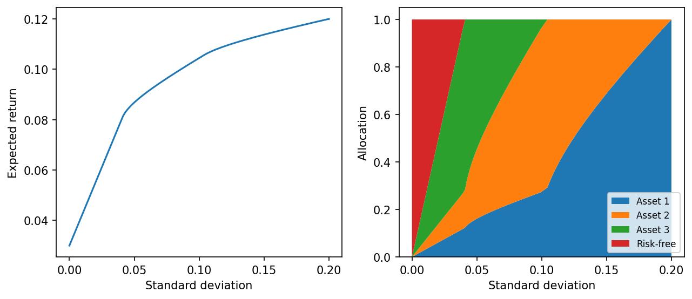

# fig 4 12: Four-asset portfolio risk-return trade-off

**Exact-input reproduction.** Uses the printed instance or the named official numerical data. Numerical precision and drawing style can differ from the source.

[Textbook source](https://web.stanford.edu/~boyd/cvxbook/bv_cvxbook.pdf#page=200) · [Original Python](../../examples/application_basic.py) · [Executed JSON](../../artifacts/examples/fig_4_12/results.json) · [Tests](../../tests/test_worked_applications.py)

## Model and verification

For each μ>0 solve min (μ/2)w^TΣw−r^Tw, subject to w≥0 and 1^Tw=1. The covariance and expected returns are the printed four-asset constants. Include the two limiting portfolios explicitly. Plot return against standard deviation and stacked allocations. Independent constrained SciPy optimization checks every QP objective. The factor 1/2 follows the companion QP convention and changes only the parameterization of the frontier.

## Inputs and source comparison

Book supplies means [0.12,0.10,0.07,0.03], standard deviations [0.20,0.10,0.05,0], and correlations rho12=0.30, rho13=-0.40, rho23=0. The implied covariance matrix is [[0.04,0.006,-0.004,0],[0.006,0.01,0,0],[-0.004,0,0.0025,0],[0,0,0,0]].

- [Official reference](https://cvxopt.org/examples/book/portfolio.html)
- [Official reference](https://cvxopt.org/_downloads/68e7505eaa1966a039c3a646aee0e421/portfolio.py)

The implementation is original Python. Reused numeric data are attributed separately in `data/worked_examples`, including conversion hashes and the upstream GPL-3.0-or-later notice. No textbook scans or reference program bodies are redistributed.

## Executed results

Run at 2026-10-10T05:03:17.810876+00:00; Python 3.12.14; NumPy 2.3.5; CVXPY 1.9.3; elapsed 0.254 s.

| Quantity | Actual value |
| --- | --- |
| portfolios | 103 |
| risk_free_return | 0.03 |
| maximum_return | 0.12 |
| maximum_risk | 0.2 |

## Numerical checks

| Check | Measured error | Acceptance limit |
| --- | --- | --- |
| independent SLSQP objective agreement | 8.48554e-10 | 1e-06 |
| simplex violation | 5.30687e-14 | 1e-06 |
| frontier return monotonicity | 1.33751e-09 | 1e-07 |

## Recomputed figures



## Reproduce

```sh
OPENBLAS_NUM_THREADS=1 python examples/application_basic.py fig_4_12
python -m pytest tests/test_worked_applications.py -q
```
