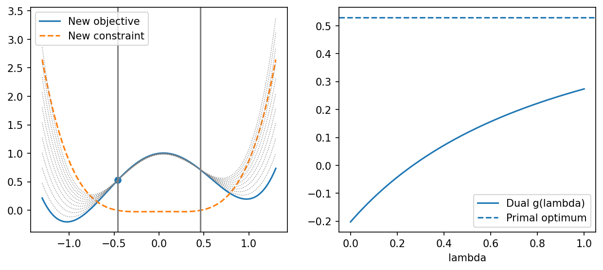

# fig 5 1 5 2: Nonconvex scalar primal and Lagrangian dual numerical illustration

**Method reproduction, approved substitute data or source convention.** This is not an exact recreation of the book’s random realization or figure. The specific differences are documented below.

[Textbook source](https://web.stanford.edu/~boyd/cvxbook/bv_cvxbook.pdf#page=230) · [Original Python](../../examples/application_signals.py) · [Executed JSON](../../artifacts/examples/fig_5_1_5_2/results.json) · [Tests](../../tests/test_worked_applications.py)

## Model and verification

The original plotted functions are unavailable, so use two explicitly new nonconvex quartics: f₀(x)=(x²−1)²+0.2x and f₁(x)=(x²−0.46²)(x²+0.1). The feasible interval is[−0.46,0.46]; direct derivative analysis and endpoint comparison locate the primal optimum. For every nonnegative multiplier, the Lagrangian remains coercive quartic, so enumerating all real roots of its cubic derivative obtains the global infimum. Plot the objective, constraint, ten Lagrangians and concave dual; verify stationary roots, weak duality and discrete concavity. The new objective value is deliberately distinguished from the book’s1.54.

## Inputs and source comparison

Numerical results and plots appear in the captions, but formulas or sampled data for f0 and f1 are not provided. No matching exact-data companion was located in the official example indexes.

- The original formulas for Figures5.1–5.2 were not published or located in official companion sources. Both functions here are newly specified nonconvex quartics. Their feasible interval is[-0.46,0.46], but the new objective value is not the book’s1.54. All ten Lagrangian curves and the concave dual function belong to this explicitly different instance.

The implementation is original Python. Reused numeric data are attributed separately in `data/worked_examples`, including conversion hashes and the upstream GPL-3.0-or-later notice. No textbook scans or reference program bodies are redistributed.

## Executed results

Run at 2026-10-10T05:10:09.385263+00:00; Python 3.12.14; NumPy 2.3.5; CVXPY 1.9.3; elapsed 0.230 s.

| Quantity | Actual value |
| --- | --- |
| new_primal_minimizer | -0.46 |
| new_primal_value | 0.52957456 |
| dual_optimal_lambda | 5.75799494017 |
| dual_optimal_value | 0.52957456 |
| gap | 3.33066907388e-16 |

## Numerical checks

| Check | Measured error | Acceptance limit |
| --- | --- | --- |
| weak duality over 501 multipliers | 0 | 1e-09 |
| dual discrete concavity | 0 | 1e-08 |
| lambda0.1 stationarity | 3.71925e-15 | 1e-08 |
| lambda0.2 stationarity | 3.71925e-15 | 1e-08 |
| lambda0.3 stationarity | 6.05072e-15 | 1e-08 |
| lambda0.4 stationarity | 3.71925e-15 | 1e-08 |
| lambda0.5 stationarity | 2.94209e-15 | 1e-08 |
| lambda0.6 stationarity | 1.94289e-15 | 1e-08 |
| lambda0.7 stationarity | 3.27516e-15 | 1e-08 |
| lambda0.8 stationarity | 2.38698e-15 | 1e-08 |
| lambda0.9 stationarity | 3.27516e-15 | 1e-08 |
| lambda1.0 stationarity | 2.498e-15 | 1e-08 |

## Recomputed figures



## Reproduce

```sh
OPENBLAS_NUM_THREADS=1 python examples/application_signals.py fig_5_1_5_2
python -m pytest tests/test_worked_applications.py -q
```
