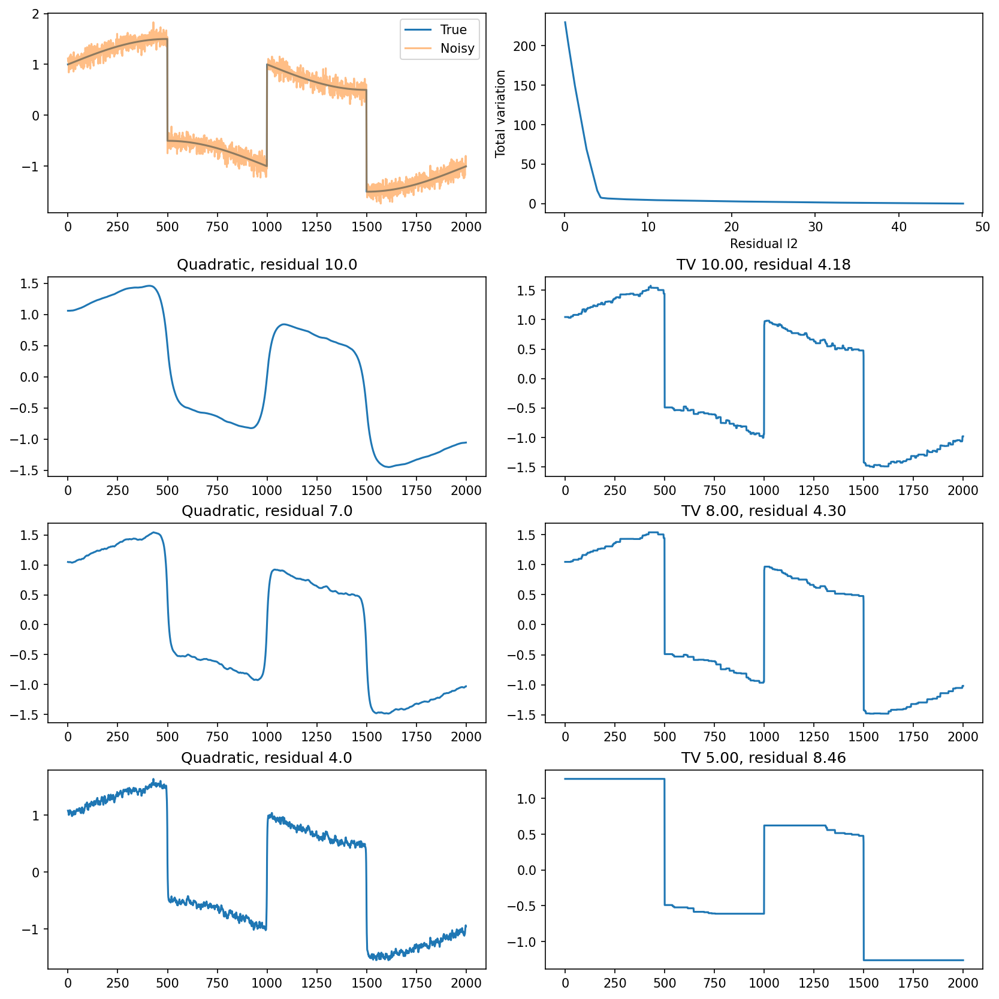
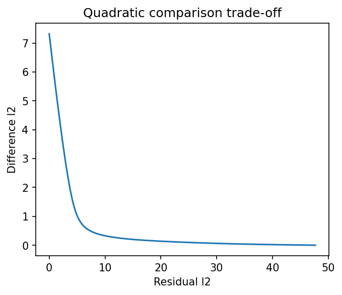

# fig 6 11: Total-variation signal reconstruction

**Method reproduction, approved substitute data or source convention.** This is not an exact recreation of the book’s random realization or figure. The specific differences are documented below.

[Textbook source](https://web.stanford.edu/~boyd/cvxbook/bv_cvxbook.pdf#page=328) · [Original Python](../../examples/application_signals.py) · [Executed JSON](../../artifacts/examples/fig_6_11/results.json) · [Tests](../../tests/test_worked_applications.py)

## Model and verification

Generate the source’s2000-point piecewise signal and new standard-deviation0.1 noise. Compute the100-point quadratic-smoothing trade-off and three comparison reconstructions. Solve fifteen TV problems min(1/2)||x−y||²+λ||Dx||₁; separately solve the book’s exact variation budgets10,8,5 as constrained QPs. The source15-point sweep and its nearest-grid comparisons remain separately recorded. Dual box-constrained difference variables provide feasible lower bounds and stationarity certificates. Report both absolute and normalized primal-dual gaps, with relative acceptance1e−6, avoiding misleading absolute tolerances across widely different objective scales.

## Inputs and source comparison

Companion code defines the piecewise signal but draws unseeded Gaussian noise. Original noise samples are not published in these sources.

- [Official reference](https://cvxopt.org/examples/book/tv.html)
- [Official reference](https://cvxopt.org/_downloads/47ea946c2737b6243ed47275097fc816/tv.py)
- [Official reference](https://cvxr.com/cvx/examples/cvxbook/Ch06_approx_fitting/tv_cvx.m)
- New PCG64 seed611 replaces original unseeded noise; the 2000-point signal and noise standard deviation0.1 follow the companion. The book reconstructions are separately solved at exact TV budgets10,8,5. The companion15-point weight sweep and nearest-grid20,8,5 comparisons are also retained, clearly separate from the book targets.

The implementation is original Python. Reused numeric data are attributed separately in `data/worked_examples`, including conversion hashes and the upstream GPL-3.0-or-later notice. No textbook scans or reference program bodies are redistributed.

## Executed results

Run at 2026-10-10T05:10:09.051304+00:00; Python 3.12.14; NumPy 2.3.5; CVXPY 1.9.3; elapsed 1.730 s.

| Quantity | Actual value |
| --- | --- |
| length | 2000 |
| seed | 611 |
| TV_tradeoff_points | 15 |
| quadratic_tradeoff_points | 100 |
| selected_TV | [9.999999993888107, 7.999999998011544, 4.9999999999718305] |

## Numerical checks

| Check | Measured error | Acceptance limit |
| --- | --- | --- |
| weight0.001 TV relative primal-dual gap | 2.69009e-10 | 1e-06 |
| weight0.001 TV stationarity | 1.04552e-14 | 1e-06 |
| weight0.0026827 TV relative primal-dual gap | 3.40072e-10 | 1e-06 |
| weight0.0026827 TV stationarity | 2.4444e-14 | 1e-06 |
| weight0.00719686 TV relative primal-dual gap | 1.33661e-10 | 1e-06 |
| weight0.00719686 TV stationarity | 8.06646e-16 | 1e-06 |
| weight0.019307 TV relative primal-dual gap | 5.53754e-10 | 1e-06 |
| weight0.019307 TV stationarity | 2.01922e-15 | 1e-06 |
| weight0.0517947 TV relative primal-dual gap | 1.64636e-10 | 1e-06 |
| weight0.0517947 TV stationarity | 3.38618e-15 | 1e-06 |
| weight0.13895 TV relative primal-dual gap | 8.67475e-11 | 1e-06 |
| weight0.13895 TV stationarity | 6.32827e-15 | 1e-06 |
| weight0.372759 TV relative primal-dual gap | 5.98717e-11 | 1e-06 |
| weight0.372759 TV stationarity | 2.25375e-14 | 1e-06 |
| weight1 TV relative primal-dual gap | 4.16221e-12 | 1e-06 |
| weight1 TV stationarity | 3.66374e-15 | 1e-06 |
| weight2.6827 TV relative primal-dual gap | 6.3546e-13 | 1e-06 |
| weight2.6827 TV stationarity | 1.55431e-15 | 1e-06 |
| weight7.19686 TV relative primal-dual gap | 1.72149e-12 | 1e-06 |
| weight7.19686 TV stationarity | 5.55112e-15 | 1e-06 |
| weight19.307 TV relative primal-dual gap | 1.0439e-12 | 1e-06 |
| weight19.307 TV stationarity | 1.05249e-12 | 1e-06 |
| weight51.7947 TV relative primal-dual gap | 5.27622e-12 | 1e-06 |
| weight51.7947 TV stationarity | 2.02616e-14 | 1e-06 |
| weight138.95 TV relative primal-dual gap | 5.47218e-13 | 1e-06 |
| weight138.95 TV stationarity | 4.86278e-14 | 1e-06 |
| weight372.759 TV relative primal-dual gap | 6.45597e-09 | 1e-06 |
| weight372.759 TV stationarity | 2.39364e-13 | 1e-06 |
| weight1000 TV relative primal-dual gap | 4.3793e-07 | 1e-06 |
| weight1000 TV stationarity | 1.23823e-12 | 1e-06 |
| book TV budget10.0 primal-dual gap | 3.13768e-09 | 1e-05 |
| book TV budget10.0 attained target | 6.11189e-09 | 1e-05 |
| book TV budget8.0 primal-dual gap | 1.54545e-09 | 1e-05 |
| book TV budget8.0 attained target | 1.98846e-09 | 1e-05 |
| book TV budget5.0 primal-dual gap | 1.31199e-09 | 1e-05 |
| book TV budget5.0 attained target | 2.81695e-11 | 1e-05 |

## Recomputed figures





## Reproduce

```sh
OPENBLAS_NUM_THREADS=1 python examples/application_signals.py fig_6_11
python -m pytest tests/test_worked_applications.py -q
```
