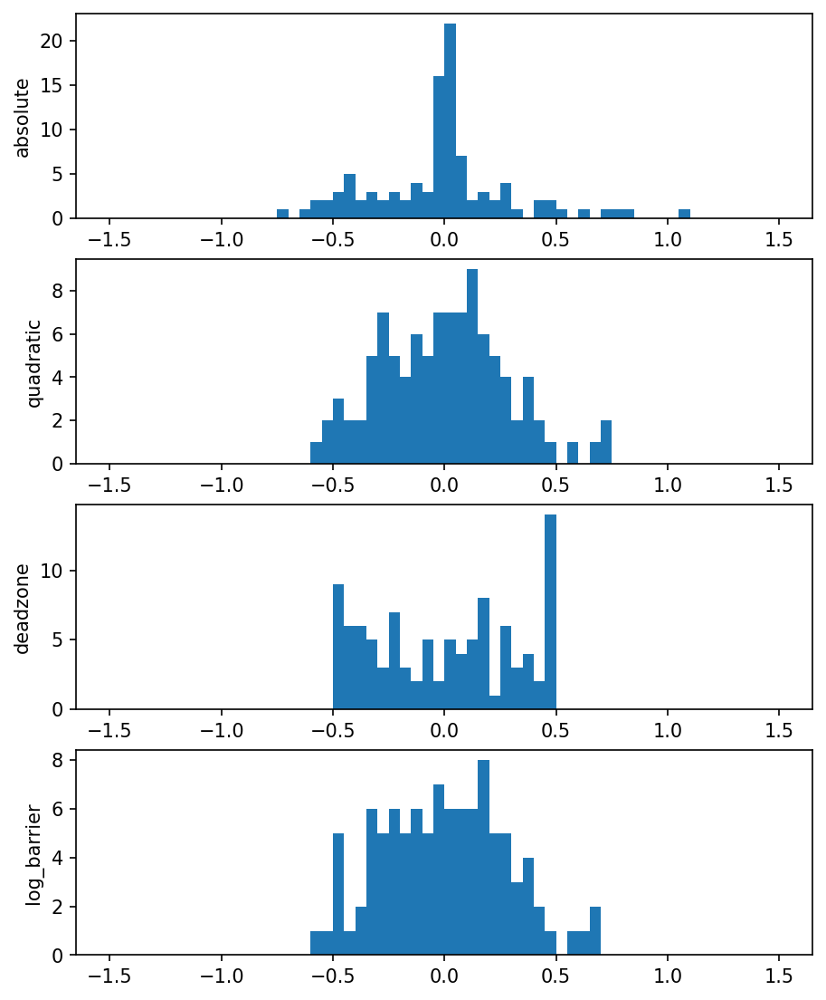

# fig 6 2: Comparing four residual penalties

**Method reproduction, approved substitute data or source convention.** This is not an exact recreation of the book’s random realization or figure. The specific differences are documented below.

[Textbook source](https://web.stanford.edu/~boyd/cvxbook/bv_cvxbook.pdf#page=310) · [Original Python](../../examples/application_signals.py) · [Executed JSON](../../artifacts/examples/fig_6_2/results.json) · [Tests](../../tests/test_worked_applications.py)

## Model and verification

On a new100-by-30 PCG64 instance, minimize four residual losses: absolute, squared, deadzone max(|r|−0.5,0), and logarithmic −log(1−r²). Scale the shared response so x=0 is strictly in the barrier domain. Compare four residual histograms. Independent HiGHS LPs check the piecewise-linear losses; normal equations check least squares; analytic-gradient BFGS checks the barrier objective. The old CVXOPT least-squares branch accidentally solves with a zero right-hand side; this implementation solves the actual stated A x+b problem.

## Inputs and source comparison

Text gives a random 100-by-30 problem; CVX fixes the legacy MATLAB randn state; CVXOPT generates fresh random arrays.

- [Official reference](https://cvxopt.org/examples/book/penalties.html)
- [Official reference](https://cvxopt.org/_downloads/d69ceac6463de6e4146ad32d11708d99/penalties.py)
- [Official reference](https://cvxr.com/cvx/examples/cvxbook/Ch06_approx_fitting/penalty_comp_cvx.m)
- New PCG64 seed602 100-by-30 instance. Common b is scaled by 1/(1.1 max|b|), making x=0 strictly feasible for the logarithmic loss. This follows the CVXOPT input convention; its source explicitly says its own data differ from the book. Unlike the old CVXOPT least-squares branch, the right-hand side is actually -b rather than a zero vector.

The implementation is original Python. Reused numeric data are attributed separately in `data/worked_examples`, including conversion hashes and the upstream GPL-3.0-or-later notice. No textbook scans or reference program bodies are redistributed.

## Executed results

Run at 2026-10-10T05:10:06.582569+00:00; Python 3.12.14; NumPy 2.3.5; CVXPY 1.9.3; elapsed 2.205 s.

| Quantity | Actual value |
| --- | --- |
| absolute | 20.8677139702 |
| quadratic | 7.87837793142 |
| deadzone | 0 |
| log_barrier | 8.98420012076 |

## Numerical checks

| Check | Measured error | Acceptance limit |
| --- | --- | --- |
| absolute independent HiGHS objective | 1.82869e-10 | 1e-07 |
| quadratic normal equations | 3.9968e-15 | 1e-07 |
| quadratic least-squares coefficients | 1.14492e-16 | 1e-07 |
| deadzone independent HiGHS objective | 0 | 1e-07 |
| barrier versus independent BFGS | 3.55271e-15 | 1e-07 |
| barrier residual domain | 0 | 0 |

## Recomputed figures



## Reproduce

```sh
OPENBLAS_NUM_THREADS=1 python examples/application_signals.py fig_6_2
python -m pytest tests/test_worked_applications.py -q
```
