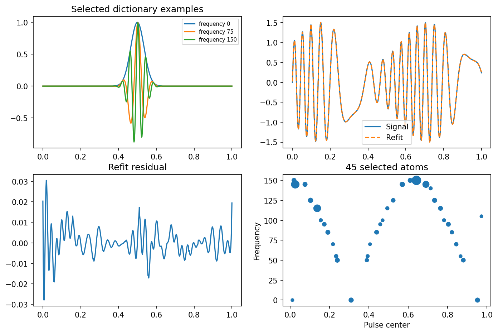
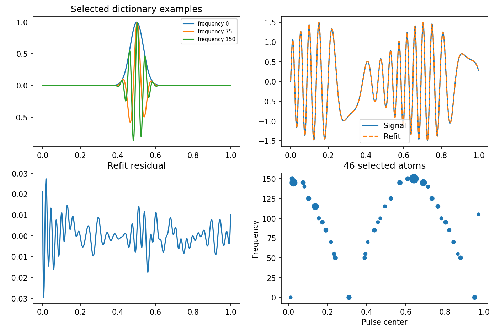
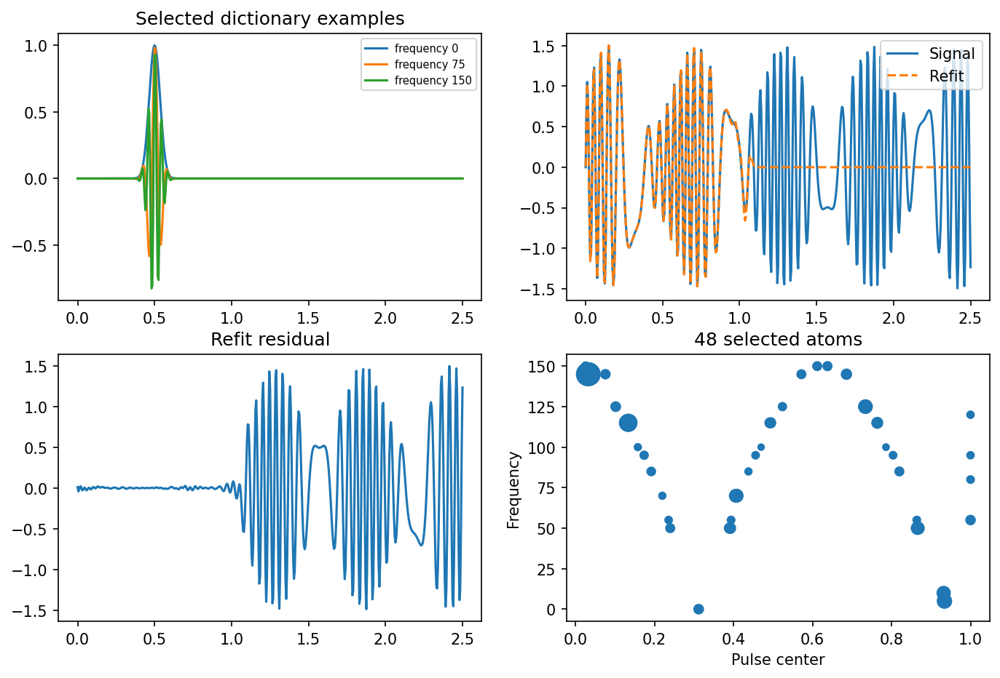

# fig 6 21: Gabor basis pursuit and time-frequency recovery

**Method reproduction, approved substitute data or source convention.** This is not an exact recreation of the book’s random realization or figure. The specific differences are documented below.

[Textbook source](https://web.stanford.edu/~boyd/cvxbook/bv_cvxbook.pdf#page=348) · [Original Python](../../examples/application_basis.py) · [Executed JSON](../../artifacts/examples/fig_6_21/results.json) · [Tests](../../tests/test_worked_applications.py)

## Model and verification

Build the full501-by-30561 Gabor dictionary and minimize ||Ax−y||²+||x||₁. An active-column strategy is only a computational device: every iteration computes all30561 dual correlations, and termination requires a valid full-dictionary primal-dual gap. Refit least squares on coefficients exceeding1e−5 and report count and relative squared error. Execute the CVX endpoint grid with0.001 tail truncation, CVXOPT k/501 untruncated grid, and the book’s literal0.005k grid ending at2.5. Plot dictionary examples, signals, residuals and selected time-frequency atoms separately for all three conventions.

## Inputs and source comparison

Signal and dictionary are explicit. The sampling-grid statements in the text and companion implementations need reconciliation.

- [Official reference](https://cvxopt.org/examples/book/basispursuit.html)
- [Official reference](https://cvxopt.org/_downloads/1ab809e118eaf84a74c5a3d776d973bc/basispursuit.py)
- [Official reference](https://cvxr.com/cvx/examples/cvxbook/Ch06_approx_fitting/basispursuit.m)
- The text says501 equally spaced samples on[0,1], but prints0.005k, whose endpoint is2.5. CVX usesk/500 and removes Gaussian tails below0.001. CVXOPT usesk/501 without truncation. All three conventions are executed and reported separately.
- The full dictionary has30561 columns. Active-column optimization is accepted only after a full-dictionary dual certificate; this is not a reduced-dictionary substitute. The l1 optimum is followed by least-squares refitting on coefficients exceeding1e-5, matching the source workflow.
- The book reports42 selected atoms and relative squared error2.6e-4. Those are comparison benchmarks; source ambiguities and solver-sensitive support thresholds preclude silently asserting that every convention must recover them.

The implementation is original Python. Reused numeric data are attributed separately in `data/worked_examples`, including conversion hashes and the upstream GPL-3.0-or-later notice. No textbook scans or reference program bodies are redistributed.

## Executed results

Run at 2026-10-10T05:10:28.497596+00:00; Python 3.12.14; NumPy 2.3.5; CVXPY 1.9.3; elapsed 17.757 s.

| Quantity | Actual value |
| --- | --- |
| CVX_endpoint_grid / selected_atoms | 45 |
| CVX_endpoint_grid / relative_squared_refit_error | 6.75724587504e-05 |
| CVX_endpoint_grid / primal_dual_gap | 2.04745020937e-09 |
| CVXOPT_k_over_501 / selected_atoms | 46 |
| CVXOPT_k_over_501 / relative_squared_refit_error | 6.38369099137e-05 |
| CVXOPT_k_over_501 / primal_dual_gap | 1.14957465769e-09 |
| book_literal_0.005_grid / selected_atoms | 48 |
| book_literal_0.005_grid / relative_squared_refit_error | 0.577827577791 |
| book_literal_0.005_grid / primal_dual_gap | 3.01739078168e-09 |

## Numerical checks

| Check | Measured error | Acceptance limit |
| --- | --- | --- |
| CVX_endpoint_grid full-dictionary primal-dual gap | 2.04745e-09 | 2e-06 |
| CVX_endpoint_grid refit normal equations | 7.97388e-14 | 1e-07 |
| CVXOPT_k_over_501 full-dictionary primal-dual gap | 1.14957e-09 | 2e-06 |
| CVXOPT_k_over_501 refit normal equations | 1.01129e-13 | 1e-07 |
| book_literal_0.005_grid full-dictionary primal-dual gap | 3.01739e-09 | 2e-06 |
| book_literal_0.005_grid refit normal equations | 1.98654e-14 | 1e-07 |

## Recomputed figures







## Reproduce

```sh
OPENBLAS_NUM_THREADS=1 python examples/application_basis.py fig_6_21
python -m pytest tests/test_worked_applications.py -q
```
