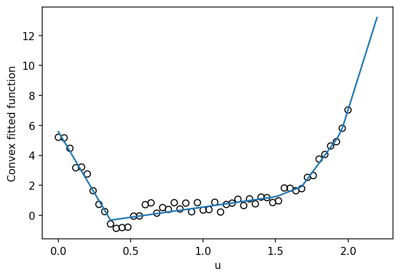

# fig 6 24: Convex least-squares function fitting

**Exact-input reproduction.** Uses the printed instance or the named official numerical data. Numerical precision and drawing style can differ from the source.

[Textbook source](https://web.stanford.edu/~boyd/cvxbook/bv_cvxbook.pdf#page=352) · [Original Python](../../examples/application_fitting.py) · [Executed JSON](../../artifacts/examples/fig_6_24/results.json) · [Tests](../../tests/test_worked_applications.py)

## Model and verification

Choose fitted values z and subgradients g minimizing ||z−y||², subject to z_j≥z_i+g_i(u_j−u_i) for every pair. The reported convex function is max_i{z_i+g_i(t−u_i)}. Independently sort the abscissas and impose nondecreasing adjacent slopes, giving a different QP representation of the same fitted values. Check objective agreement, values and all supporting-hyperplane inequalities.

## Inputs and source comparison

The data pairs for the figure are published in cvxfit.bin.

- [Official reference](https://cvxopt.org/examples/book/cvxfit.html)
- [Official reference](https://cvxopt.org/_downloads/527b2018360bec147bada98523768bc4/cvxfit.py)
- [Official reference](https://cvxr.com/cvx/examples/cvxbook/Ch06_approx_fitting/convex_interpolation.m)
- [cvxfit.bin](https://cvxopt.org/_downloads/49bc8ceaf2704cd7a6ad2e498dc26ad9/cvxfit.bin), SHA-256 `2df84eb2b5048295b7869f1f6b3051cf02d2463f7cc0b8e2d9901975509186e5`

The implementation is original Python. Reused numeric data are attributed separately in `data/worked_examples`, including conversion hashes and the upstream GPL-3.0-or-later notice. No textbook scans or reference program bodies are redistributed.

## Executed results

Run at 2026-10-10T05:03:20.761783+00:00; Python 3.12.14; NumPy 2.3.5; CVXPY 1.9.3; elapsed 0.083 s.

| Quantity | Actual value |
| --- | --- |
| samples | 51 |
| squared_error | 5.17228506376 |
| support_inequalities | 2601 |

## Numerical checks

| Check | Measured error | Acceptance limit |
| --- | --- | --- |
| support feasibility | 0 | 1e-06 |
| objective versus independent monotone-slope formulation | 5.06635e-11 | 1e-06 |
| fit versus monotone-slope formulation | 6.65324e-10 | 2e-05 |

## Recomputed figures



## Reproduce

```sh
OPENBLAS_NUM_THREADS=1 python examples/application_fitting.py fig_6_24
python -m pytest tests/test_worked_applications.py -q
```
