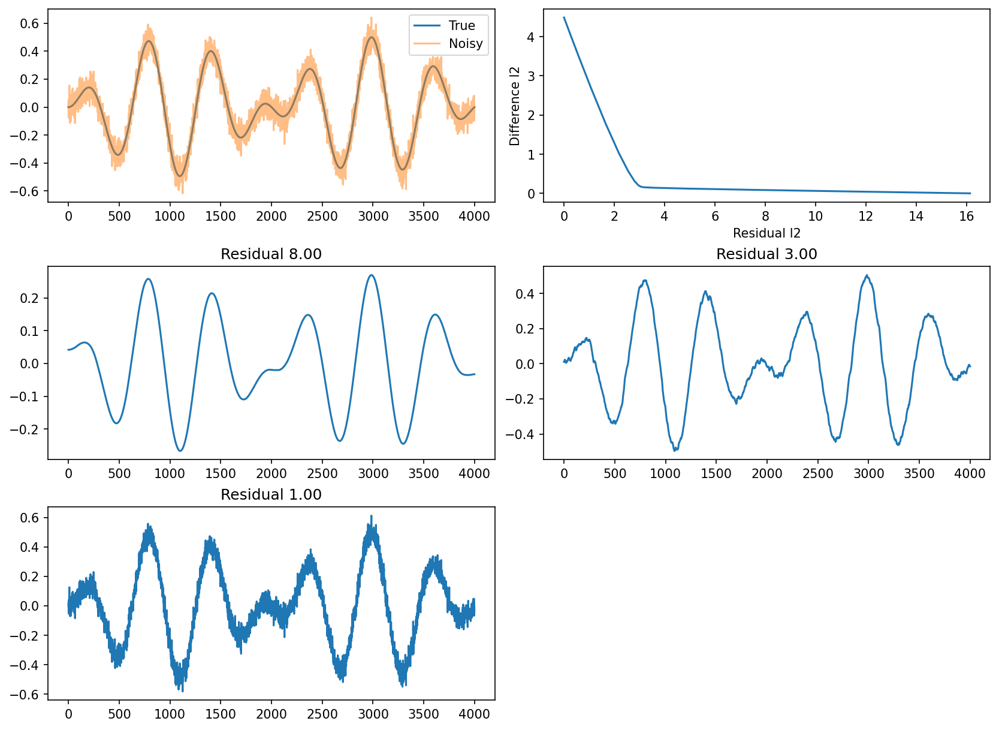

# fig 6 8: Quadratic signal smoothing

**Method reproduction, approved substitute data or source convention.** This is not an exact recreation of the book’s random realization or figure. The specific differences are documented below.

[Textbook source](https://web.stanford.edu/~boyd/cvxbook/bv_cvxbook.pdf#page=326) · [Original Python](../../examples/application_signals.py) · [Executed JSON](../../artifacts/examples/fig_6_8/results.json) · [Tests](../../tests/test_worked_applications.py)

## Model and verification

Generate the published4000-point oscillatory signal with new Gaussian noise of standard deviation0.05. Solve min||x−y||²+λ||Dx||² for fifty log-spaced weights using the exact symmetric tridiagonal normal system. Find three weights whose residual norms equal8,3,1 and independently check each reconstruction with a convex QP. Plot original/noisy signals, the complete trade-off and all three reconstructions. The new seed is fully recorded and does not claim MATLAB-RNG equivalence.

## Inputs and source comparison

Signal formula is explicit in companion code; noise realization is fixed by legacy MATLAB randn state 0 in CVX. CVXOPT draws fresh noise.

- [Official reference](https://cvxopt.org/examples/book/smoothrec.html)
- [Official reference](https://cvxopt.org/_downloads/27e112f8f30e42f92dd9e307b9da002f/smoothrec.py)
- [Official reference](https://cvxr.com/cvx/examples/cvxbook/Ch06_approx_fitting/smoothrec_cvx.m)
- [Official reference](https://cvxr.com/cvx/examples/cvxbook/Ch06_approx_fitting/fig6_9.m)
- New PCG64 seed608 noise replaces the unpublished MATLAB realization. Formula, length4000 and noise standard deviation0.05 match the source. Exact target residuals8,3,1 are found by a scalar root instead of picking the closest point on the coarse trade-off grid.

The implementation is original Python. Reused numeric data are attributed separately in `data/worked_examples`, including conversion hashes and the upstream GPL-3.0-or-later notice. No textbook scans or reference program bodies are redistributed.

## Executed results

Run at 2026-10-10T05:10:07.289370+00:00; Python 3.12.14; NumPy 2.3.5; CVXPY 1.9.3; elapsed 0.697 s.

| Quantity | Actual value |
| --- | --- |
| length | 4000 |
| seed | 608 |
| tradeoff_points | 50 |
| reconstruction_residuals | [8.000000000000059, 3.0000000000000013, 1.0000000000000002] |

## Numerical checks

| Check | Measured error | Acceptance limit |
| --- | --- | --- |
| reconstruction1 tridiagonal versus QP | 1.84019e-13 | 2e-06 |
| reconstruction2 tridiagonal versus QP | 4.60743e-15 | 2e-06 |
| reconstruction3 tridiagonal versus QP | 2.22045e-16 | 2e-06 |

## Recomputed figures



## Reproduce

```sh
OPENBLAS_NUM_THREADS=1 python examples/application_signals.py fig_6_8
python -m pytest tests/test_worked_applications.py -q
```
