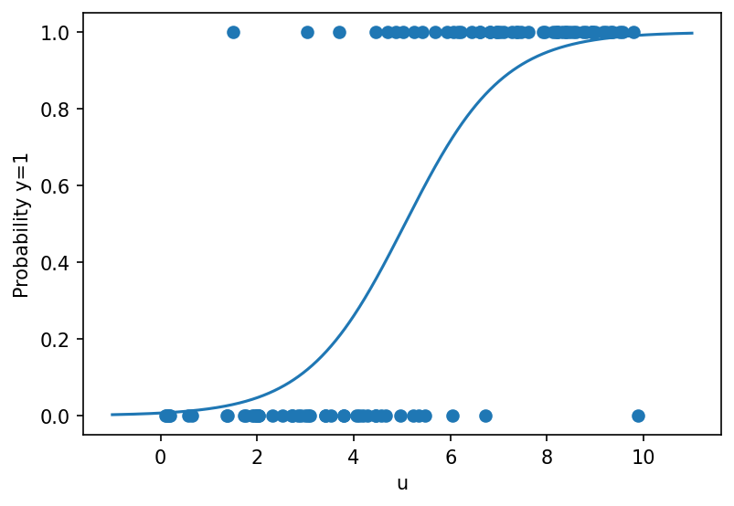

# fig 7 1: Logistic maximum-likelihood regression

**Exact-input reproduction.** Uses the printed instance or the named official numerical data. Numerical precision and drawing style can differ from the source.

[Textbook source](https://web.stanford.edu/~boyd/cvxbook/bv_cvxbook.pdf#page=368) · [Original Python](../../examples/application_statistics.py) · [Executed JSON](../../artifacts/examples/fig_7_1/results.json) · [Tests](../../tests/test_worked_applications.py)

## Model and verification

Fit logit probability sigmoid(au+b) by minimizing Σ log(1+exp(au_i+b))−y_i(au_i+b). Stable log-add-exp arithmetic avoids overflow. Compare the exponential-cone formulation with an independent Newton trust-region method using the exact gradient and Hessian. The published input has 100 observations, consistent with both official scripts; the earlier inventory statement of 50 was incorrect.

## Inputs and source comparison

The official logreg.bin file and both companion scripts contain100 observations. This corrects the earlier inventory count of50.

- [Official reference](https://cvxopt.org/examples/book/logreg.html)
- [Official reference](https://cvxopt.org/_downloads/3524328e70d5d80efced606f6ec4f894/logreg.py)
- [Official reference](https://cvxr.com/cvx/examples/cvxbook/Ch07_statistical_estim/logistics.m)
- [Official reference](https://cvxr.com/cvx/examples/cvxbook/Ch07_statistical_estim/logistics_gp.m)
- [logreg.bin](https://cvxopt.org/_downloads/79c404697770003ca62bd2ecf26ce2f4/logreg.bin), SHA-256 `25fefcfe575e18274fdeeb38839986b937c927c35f9034b2de9d0ffee5ccaf7f`
- The data file and both official scripts contain 100 observations. The earlier catalog count of 50 was incorrect.

The implementation is original Python. Reused numeric data are attributed separately in `data/worked_examples`, including conversion hashes and the upstream GPL-3.0-or-later notice. No textbook scans or reference program bodies are redistributed.

## Executed results

Run at 2026-10-10T05:03:34.186564+00:00; Python 3.12.14; NumPy 2.3.5; CVXPY 1.9.3; elapsed 1.426 s.

| Quantity | Actual value |
| --- | --- |
| observations | 100 |
| slope | 0.984779053402 |
| intercept | -4.98197752257 |
| negative_log_likelihood | 32.9797026709 |

## Numerical checks

| Check | Measured error | Acceptance limit |
| --- | --- | --- |
| independent Newton versus exponential-cone objective | 6.25278e-13 | 1e-07 |
| likelihood gradient | 1.08358e-13 | 1e-07 |

## Recomputed figures



## Reproduce

```sh
OPENBLAS_NUM_THREADS=1 python examples/application_statistics.py fig_7_1
python -m pytest tests/test_worked_applications.py -q
```
