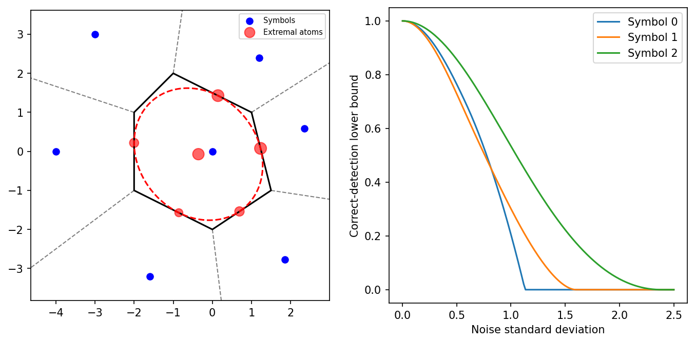

# fig 7 5: Chebyshev bounds for symbol detection

**Exact-input reproduction.** Uses the printed instance or the named official numerical data. Numerical precision and drawing style can differ from the source.

[Textbook source](https://web.stanford.edu/~boyd/cvxbook/bv_cvxbook.pdf#page=395) · [Original Python](../../examples/application_probability.py) · [Executed JSON](../../artifacts/examples/fig_7_5/results.json) · [Tests](../../tests/test_worked_applications.py)

## Model and verification

Use the six published Voronoi vertices to recover all seven constellation symbols. For each of the first three symbols and151 noise levels, minimize E[q(X)] over nonnegative quadratic majorants of the outside-cell indicator. Semidefinite constraints implement the halfspace S-lemma. The lower detection bound is1−E[q(X)]. At unit variance, dual PSD matrices recover an extremal atomic distribution; its total mass, zero mean and identity covariance are checked independently. Plot the constellation, atoms, quadratic level set and all three bound curves.

## Inputs and source comparison

Official source fixes the seven-symbol constellation via literal Voronoi vertices.

- [Official reference](https://cvxopt.org/examples/book/probbounds.html)
- [Official reference](https://cvxopt.org/_downloads/f07af2363af9fdd34b42aa85d369b95e/probbounds.py)
- [Official reference](https://cvxr.com/cvx/examples/cvxbook/Ch07_statistical_estim/probbounds.m)
- [Official reference](https://cvxr.com/cvx/examples/cvxbook/Ch07_statistical_estim/cheb.m)
- Extremal outside atoms can lie exactly on Voronoi boundaries. The strict/open-cell worst-case probability is the limiting distribution under arbitrarily small outward perturbations; a tie-breaking convention should not be mistaken for a discrepancy in the moment bound.

The implementation is original Python. Reused numeric data are attributed separately in `data/worked_examples`, including conversion hashes and the upstream GPL-3.0-or-later notice. No textbook scans or reference program bodies are redistributed.

## Executed results

Run at 2026-10-10T05:07:10.806731+00:00; Python 3.12.14; NumPy 2.3.5; CVXPY 1.9.3; elapsed 3.133 s.

| Quantity | Actual value |
| --- | --- |
| sigma1_correct_detection_lower_bound | 0.204761904783 |
| sweep_sdps | 453 |
| extremal_atoms | 6 |

## Numerical checks

| Check | Measured error | Acceptance limit |
| --- | --- | --- |
| printed sigma=1 benchmark | 3.80952e-05 | 5e-05 |
| all SDP feasibility | 7.82087e-10 | 2e-06 |
| dual mass/mean/covariance matrix | 8.19136e-11 | 2e-06 |
| atomic mean | 5.10411e-11 | 2e-06 |
| atomic covariance | 2.09639e-10 | 2e-05 |

## Recomputed figures



## Reproduce

```sh
OPENBLAS_NUM_THREADS=1 python examples/application_probability.py fig_7_5
python -m pytest tests/test_worked_applications.py -q
```
