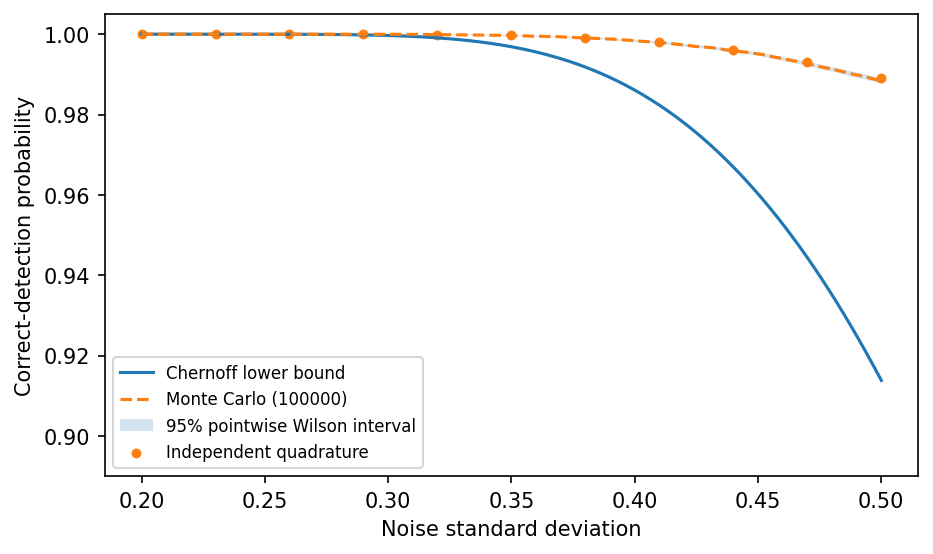

# fig 7 8: Chernoff and Monte Carlo detection bounds

**Method reproduction, approved substitute data or source convention.** This is not an exact recreation of the book’s random realization or figure. The specific differences are documented below.

[Textbook source](https://web.stanford.edu/~boyd/cvxbook/bv_cvxbook.pdf#page=396) · [Original Python](../../examples/application_probability.py) · [Executed JSON](../../artifacts/examples/fig_7_8/results.json) · [Tests](../../tests/test_worked_applications.py)

## Model and verification

Project the origin onto each competing Voronoi region. If its squared distance is dᵢ², the Gaussian Chernoff union bound gives detection probability at least1−Σexp(−dᵢ²/(2σ²)). Independently verify all six projection QPs with SciPy. Run100000 new standard-Gaussian draws across201 noise levels, using common random numbers; display pointwise95% Wilson intervals. Independent one-dimensional Gaussian quadrature at eleven noise levels checks the simulation and verifies the deterministic bounds.

## Inputs and source comparison

Same fixed constellation as Figures 7.5–7.7; Monte Carlo noise samples are generated afresh.

- [Official reference](https://cvxopt.org/examples/book/chernoff.html)
- [Official reference](https://cvxopt.org/_downloads/daabe7e663a62ead7b9905f9cbd1cac6/chernoff.py)
- [Official reference](https://cvxr.com/cvx/examples/cvxbook/Ch07_statistical_estim/probbounds.m)
- [Official reference](https://cvxr.com/cvx/examples/cvxbook/Ch07_statistical_estim/cher.m)
- [Official reference](https://cvxr.com/cvx/examples/cvxbook/Ch07_statistical_estim/montecarlo.m)
- The deterministic bounds use the published constellation. A new PCG64 seed708 Gaussian sample is used, with common random numbers across noise levels and pointwise uncertainty intervals. Original Monte Carlo samples were not published.

The implementation is original Python. Reused numeric data are attributed separately in `data/worked_examples`, including conversion hashes and the upstream GPL-3.0-or-later notice. No textbook scans or reference program bodies are redistributed.

## Executed results

Run at 2026-10-10T05:07:10.944686+00:00; Python 3.12.14; NumPy 2.3.5; CVXPY 1.9.3; elapsed 0.134 s.

| Quantity | Actual value |
| --- | --- |
| minimum_squared_distances | [1.8000000000006502, 4.500000001657998, 4.000000000329983, 3.2000000000097337, 2.7692307693198175, 1.470588235322992] |
| sigma0.5_bound | 0.91381970522 |
| sigma0.5_estimate | 0.98835 |
| samples_per_sigma | 100000 |
| seed | 708 |
| standardized_maximum_MC_error | 2.25519362941 |

## Numerical checks

| Check | Measured error | Acceptance limit |
| --- | --- | --- |
| region1 projection versus SLSQP | 6.25722e-13 | 1e-07 |
| region2 projection versus SLSQP | 1.65798e-09 | 1e-07 |
| region3 projection versus SLSQP | 3.29958e-10 | 1e-07 |
| region4 projection versus SLSQP | 9.70646e-12 | 1e-07 |
| region5 projection versus SLSQP | 8.90532e-11 | 1e-07 |
| region6 projection versus SLSQP | 2.88582e-11 | 1e-07 |
| Monte Carlo versus independent Gaussian quadrature (six sigma) | 0 | 1e-08 |
| Chernoff lower bounds below exact Gaussian probability | 0 | 1e-09 |

## Recomputed figures



## Reproduce

```sh
OPENBLAS_NUM_THREADS=1 python examples/application_probability.py fig_7_8
python -m pytest tests/test_worked_applications.py -q
```
