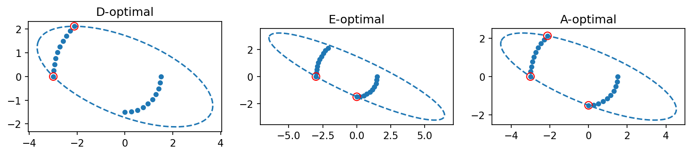
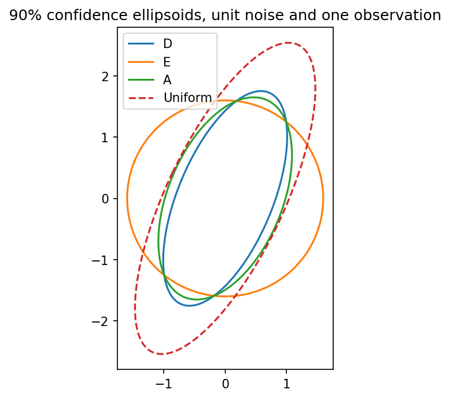

# fig 7 9: D-, E- and A-optimal experiment design

**Exact-input reproduction.** Uses the printed instance or the named official numerical data. Numerical precision and drawing style can differ from the source.

[Textbook source](https://web.stanford.edu/~boyd/cvxbook/bv_cvxbook.pdf#page=402) · [Original Python](../../examples/application_statistics.py) · [Executed JSON](../../artifacts/examples/fig_7_9/results.json) · [Tests](../../tests/test_worked_applications.py)

## Model and verification

For the 20 published candidate vectors form information M=Σw_i v_i v_i^T on the simplex. D design maximizes log det M, E design maximizes its smallest eigenvalue, and A design minimizes tr(M⁻¹). Independent constrained SciPy objectives check all three solutions. The relevant dual quadratic forms give enclosing ellipsoids; direct containment inequalities are verified. Covariance M⁻¹ yields the 90% Gaussian confidence ellipsoids using the two-dimensional χ² quantile, compared with uniform allocation.

## Inputs and source comparison

Twenty 2D candidate measurement vectors are literal constants in companion source.

- [Official reference](https://cvxopt.org/examples/book/expdesign.html)
- [Official reference](https://cvxopt.org/_downloads/092ec0dafbdb3d6700157d0c0b0d4313/expdesign.py)
- [Official reference](https://cvxr.com/cvx/examples/cvxbook/Ch07_statistical_estim/expdesign.m)
- Official candidate coordinates are rounded to four decimal places; optimal weights should be compared at book precision.

The implementation is original Python. Reused numeric data are attributed separately in `data/worked_examples`, including conversion hashes and the upstream GPL-3.0-or-later notice. No textbook scans or reference program bodies are redistributed.

## Executed results

Run at 2026-10-10T05:03:37.575858+00:00; Python 3.12.14; NumPy 2.3.5; CVXPY 1.9.3; elapsed 0.324 s.

| Quantity | Actual value |
| --- | --- |
| D / selected_indices_one_based | [1, 10] |
| D / selected_weights | [0.49999998254252487, 0.5000000091871821] |
| D / objective | -2.31498842793 |
| E / selected_indices_one_based | [10, 20] |
| E / selected_weights | [0.20000000000621218, 0.7999999999761945] |
| E / objective | 1.79999999999 |
| A / selected_indices_one_based | [1, 10, 20] |
| A / selected_weights | [0.29660432074358456, 0.37796360072301344, 0.3254320777838453] |
| A / objective | 0.849532756477 |

## Numerical checks

| Check | Measured error | Acceptance limit |
| --- | --- | --- |
| D versus SLSQP objective | 4.87865e-09 | 2e-06 |
| D dual ellipsoid containment | 5.72984e-08 | 2e-05 |
| E versus SLSQP objective | 1.13749e-09 | 2e-06 |
| E dual ellipsoid containment | 2.68652e-11 | 2e-05 |
| A versus SLSQP objective | 9.78494e-11 | 2e-06 |
| A dual ellipsoid containment | 5.25845e-06 | 2e-05 |

## Recomputed figures





## Reproduce

```sh
OPENBLAS_NUM_THREADS=1 python examples/application_statistics.py fig_7_9
python -m pytest tests/test_worked_applications.py -q
```
