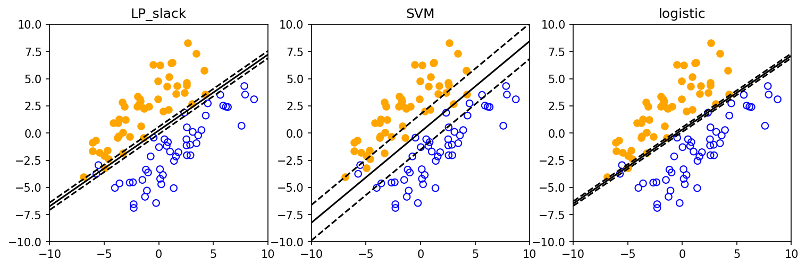

# fig 8 10: Approximate linear classification comparison

**Method reproduction, approved substitute data or source convention.** This is not an exact recreation of the book’s random realization or figure. The specific differences are documented below.

[Textbook source](https://web.stanford.edu/~boyd/cvxbook/bv_cvxbook.pdf#page=440) · [Original Python](../../examples/application_geometry.py) · [Executed JSON](../../artifacts/examples/fig_8_10/results.json) · [Tests](../../tests/test_worked_applications.py)

## Model and verification

Compare sum of hinge slacks, ||a||₂+0.1 times hinge slacks, and logistic negative log-likelihood on the same two published fifty-point classes. The margin is yᵢ(aᵀxᵢ−b). Independent dual optimization verifies both hinge classifiers; the logistic gradient certifies its optimum. Misclassifications have negative margin and correctly classified points strictly inside the slab have margin in (0,1), excluding a 1e−6 boundary tolerance. The verified companion result has fourteen such SVM points, while the book caption says fifteen; this discrepancy is explicit and prevents an exact-output-match claim.

## Inputs and source comparison

The common two 50-point classes are published in linsep.bin.

- [Official reference](https://cvxopt.org/examples/book/linsep.html)
- [Official reference](https://cvxopt.org/_downloads/dcf8e07bee53213cc48e8418ad9a582a/linsep.py)
- [Official reference](https://cvxr.com/cvx/examples/cvxbook/Ch08_geometric_probs/svm_1.m)
- [Official reference](https://cvxr.com/cvx/examples/cvxbook/Ch08_geometric_probs/svm_2.m)
- [linsep.bin](https://cvxopt.org/_downloads/da0d150f68832278ed35e574bd162715/linsep.bin), SHA-256 `cf323f0d23ca8513c5fa2f07585ae9922d18c8f26be75ee543989c2d2639e14e`
- Book reports correctly classified strict-slab counts 4/15/3; this published companion instance gives 4/14/3 at 1e-6 boundary tolerance. Misclassification counts match 1/3/2. Boundary points are reported separately from strict interior points; no count is silently forced to the book.

The implementation is original Python. Reused numeric data are attributed separately in `data/worked_examples`, including conversion hashes and the upstream GPL-3.0-or-later notice. No textbook scans or reference program bodies are redistributed.

## Executed results

Run at 2026-10-10T05:03:40.468823+00:00; Python 3.12.14; NumPy 2.3.5; CVXPY 1.9.3; elapsed 0.207 s.

| Quantity | Actual value |
| --- | --- |
| LP_slack / a | [2.0647121426855635, -2.959732514566787] |
| LP_slack / b | -0.717810378548 |
| LP_slack / objective | 6.14856943237 |
| LP_slack / misclassified | 1 |
| LP_slack / correct_inside_slab | 4 |
| SVM / a | [0.5117662413307719, -0.6128169393276824] |
| SVM / b | -0.0648703157343 |
| SVM / objective | 1.82570021914 |
| SVM / misclassified | 3 |
| SVM / correct_inside_slab | 14 |
| logistic / a | [3.198511497340165, -4.7008606594691145] |
| logistic / b | -1.48189892615 |
| logistic / objective | 6.12542143704 |
| logistic / misclassified | 2 |
| logistic / correct_inside_slab | 3 |

## Numerical checks

| Check | Measured error | Acceptance limit |
| --- | --- | --- |
| LP_slack independent dual gap | 1.43643e-09 | 1e-06 |
| LP_slack objective re-evaluation | 0 | 1e-06 |
| SVM independent dual gap | 8.12148e-11 | 1e-06 |
| SVM objective re-evaluation | 0 | 1e-06 |
| logistic gradient | 8.16985e-09 | 0.0001 |
| logistic objective re-evaluation | 0 | 1e-06 |
| printed misclassification counts | 0 | 0 |
| verified companion correctly-classified slab counts | 0 | 0 |

## Recomputed figures



## Reproduce

```sh
OPENBLAS_NUM_THREADS=1 python examples/application_geometry.py fig_8_10
python -m pytest tests/test_worked_applications.py -q
```
