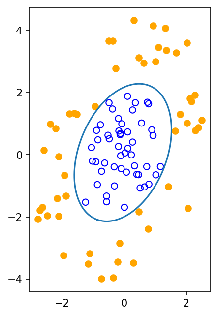

# fig 8 13: Quadratic ellipsoidal discrimination

**Method reproduction, approved substitute data or source convention.** This is not an exact recreation of the book’s random realization or figure. The specific differences are documented below.

[Textbook source](https://web.stanford.edu/~boyd/cvxbook/bv_cvxbook.pdf#page=444) · [Original Python](../../examples/application_classification_methods.py) · [Executed JSON](../../artifacts/examples/fig_8_13/results.json) · [Tests](../../tests/test_worked_applications.py)

## Model and verification

Generate fifty inside and fifty outside points using the published radial ranges and linear transform with new PCG64 randomness. Find a convex quadratic q(x)=xᵀPx+qᵀx+r whose values are at most−1 on the inner class and at least1 on the outer class, with P≽I. Trace minimization selects one feasible ellipse. Check all inequalities, recover its center and principal axes, and independently construct a separating quadratic from the known inverse transform and radial gap.

## Inputs and source comparison

Official section-specific CVX script provides a seeded 2D point-cloud generator.

- [Official reference](https://cvxr.com/cvx/examples/cvxbook/Ch08_geometric_probs/quad_discr.m)
- New PCG64 seed813 replaces the legacy MATLAB random streams. The 50+50 points retain the stated inside/outside radial construction and transform. A trace objective selects one valid ellipse from the feasible set.

The implementation is original Python. Reused numeric data are attributed separately in `data/worked_examples`, including conversion hashes and the upstream GPL-3.0-or-later notice. No textbook scans or reference program bodies are redistributed.

## Executed results

Run at 2026-10-10T05:03:47.941565+00:00; Python 3.12.14; NumPy 2.3.5; CVXPY 1.9.3; elapsed 0.055 s.

| Quantity | Actual value |
| --- | --- |
| class_sizes | [50, 50] |
| center | [-0.04378858162399606, 0.07239837417480682] |
| maximum_inner_polynomial | -0.999999999999 |
| minimum_outer_polynomial | 0.99999999999 |
| seed | 813 |

## Numerical checks

| Check | Measured error | Acceptance limit |
| --- | --- | --- |
| SDP feasibility | 9.89164e-12 | 1e-07 |
| independent radial separator inner inequality | 0 | 1e-06 |
| independent radial separator outer inequality | 0 | 1e-06 |

## Recomputed figures



## Reproduce

```sh
OPENBLAS_NUM_THREADS=1 python examples/application_classification_methods.py fig_8_13
python -m pytest tests/test_worked_applications.py -q
```
