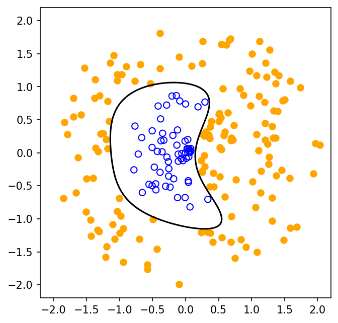

# fig 8 14: Minimum-degree polynomial discrimination

**Method reproduction, approved substitute data or source convention.** This is not an exact recreation of the book’s random realization or figure. The specific differences are documented below.

[Textbook source](https://web.stanford.edu/~boyd/cvxbook/bv_cvxbook.pdf#page=444) · [Original Python](../../examples/application_classification_methods.py) · [Executed JSON](../../artifacts/examples/fig_8_14/results.json) · [Tests](../../tests/test_worked_applications.py)

## Model and verification

Generate the source’s 100/120 initial radial points and exchanged wedge using new seed0. For each degree one through four, construct all bivariate monomials and solve the signed-margin feasibility LP. Degree-three infeasibility is independently certified by nonnegative weights summing to one whose weighted signed feature rows sum to zero, a Farkas witness. Degree four admits a separator; minimize its coefficient norm to select a stable witness and plot its zero contour. The seed selection and unsuccessful first trial are disclosed.

## Inputs and source comparison

Official section-specific scripts share a seeded generator with an exchanged wedge between two point classes.

- [Official reference](https://cvxr.com/cvx/examples/cvxbook/Ch08_geometric_probs/poly3_discr.m)
- [Official reference](https://cvxr.com/cvx/examples/cvxbook/Ch08_geometric_probs/poly4_discr.m)
- PCG64 seed0 replaces the original MATLAB uniform generator. The same 100/120 initial sizes, radial construction and exchanged wedge are retained. Infeasibility of degrees1–3 is certified by Farkas witnesses, not inferred from a failed numerical solve. Initial trial seed814 admitted a cubic separator; seed0 was selected from a disclosed generator check to demonstrate the stated cubic-versus-quartic phenomenon.

The implementation is original Python. Reused numeric data are attributed separately in `data/worked_examples`, including conversion hashes and the upstream GPL-3.0-or-later notice. No textbook scans or reference program bodies are redistributed.

## Executed results

Run at 2026-10-10T05:03:48.182860+00:00; Python 3.12.14; NumPy 2.3.5; CVXPY 1.9.3; elapsed 0.237 s.

| Quantity | Actual value |
| --- | --- |
| class_sizes | [61, 151] |
| degree_status / 1 | infeasible |
| degree_status / 2 | infeasible |
| degree_status / 3 | infeasible |
| degree_status / 4 | feasible |
| seed | 0 |

## Numerical checks

| Check | Measured error | Acceptance limit |
| --- | --- | --- |
| degree 1 independent Farkas certificate | 1.47018e-16 | 1e-07 |
| degree 2 independent Farkas certificate | 1.12782e-15 | 1e-07 |
| degree 3 independent Farkas certificate | 1.74969e-15 | 1e-07 |
| degree 4 separator feasibility | 0 | 1e-06 |

## Recomputed figures



## Reproduce

```sh
OPENBLAS_NUM_THREADS=1 python examples/application_classification_methods.py fig_8_14
python -m pytest tests/test_worked_applications.py -q
```
