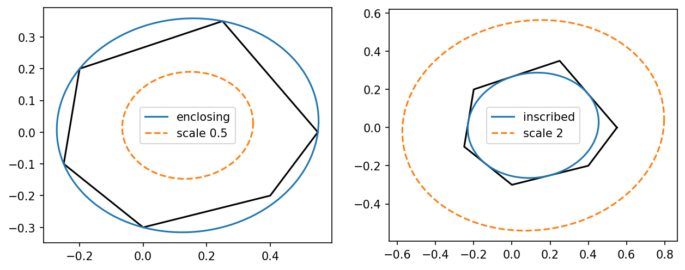

# fig 8 3: Minimum-volume enclosing and maximum-volume inscribed ellipsoids

**Exact-input reproduction.** Uses the printed instance or the named official numerical data. Numerical precision and drawing style can differ from the source.

[Textbook source](https://web.stanford.edu/~boyd/cvxbook/bv_cvxbook.pdf#page=426) · [Original Python](../../examples/application_geometry.py) · [Executed JSON](../../artifacts/examples/fig_8_3/results.json) · [Tests](../../tests/test_worked_applications.py)

## Model and verification

The enclosing ellipse is {x:||Ax+b||₂≤1}; minimize −log det A with each polygon vertex inside. For the inscribed ellipse {c+Bu:||u||₂≤1}, maximize log det B subject to aᵢᵀc+||Baᵢ||₂≤bᵢ. The same six published vertices define both problems. Independently check the explicit matrix KKT stationarity conditions using returned conic multipliers. Also verify both factor-two containment statements directly: half the enclosing ellipse is inside the polygon, and twice the inscribed ellipse contains every vertex.

## Inputs and source comparison

The common six-vertex polygon is explicitly given in official companion source.

- [Official reference](https://cvxopt.org/examples/book/ellipsoids.html)
- [Official reference](https://cvxopt.org/_downloads/c5acad6864ca8370986a44ad9fe55aee/ellipsoids.py)

The implementation is original Python. Reused numeric data are attributed separately in `data/worked_examples`, including conversion hashes and the upstream GPL-3.0-or-later notice. No textbook scans or reference program bodies are redistributed.

## Executed results

Run at 2026-10-10T05:03:39.895237+00:00; Python 3.12.14; NumPy 2.3.5; CVXPY 1.9.3; elapsed 1.469 s.

| Quantity | Actual value |
| --- | --- |
| enclosing / area | 0.43610350298 |
| enclosing / center | [0.14022620349413456, 0.02155390679359742] |
| inscribed / area | 0.296592311989 |
| inscribed / center | [0.11152760332570773, 0.011759883582039912] |

## Numerical checks

| Check | Measured error | Acceptance limit |
| --- | --- | --- |
| enclosing KKT stationarity | 7.2734e-06 | 0.0002 |
| inscribed KKT stationarity | 4.68591e-05 | 0.0002 |
| enclosing feasibility | 0 | 1e-06 |
| inscribed feasibility | 0 | 1e-06 |
| half-sized enclosing ellipse inside polygon | 0 | 1e-06 |
| twice-sized inscribed ellipse contains vertices | 0 | 1e-06 |

## Recomputed figures



## Reproduce

```sh
OPENBLAS_NUM_THREADS=1 python examples/application_geometry.py fig_8_3
python -m pytest tests/test_worked_applications.py -q
```
