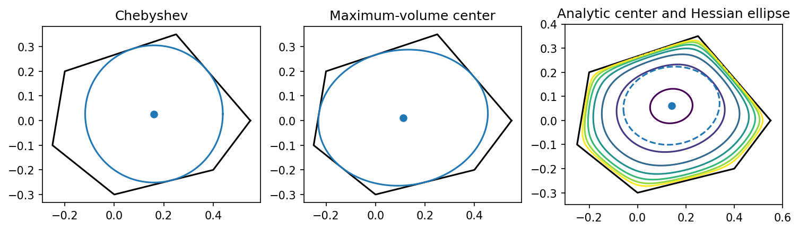

# fig 8 5: Three centers of a polyhedron

**Exact-input reproduction.** Uses the printed instance or the named official numerical data. Numerical precision and drawing style can differ from the source.

[Textbook source](https://web.stanford.edu/~boyd/cvxbook/bv_cvxbook.pdf#page=431) · [Original Python](../../examples/application_geometry.py) · [Executed JSON](../../artifacts/examples/fig_8_5/results.json) · [Tests](../../tests/test_worked_applications.py)

## Model and verification

The Chebyshev center solves the LP maximizing radius with aᵢᵀc+r||aᵢ||≤bᵢ. The maximum-volume center is the center of the log-determinant inscribed ellipse. The analytic center minimizes −Σlog(bᵢ−aᵢᵀx); a separate exact-gradient/Hessian trust-region solve agrees with the convex exponential-cone formulation. Plot the three centers, barrier contours and the local Hessian ellipse. LP duality and all center feasibility conditions are checked.

## Inputs and source comparison

The six-vertex polygon and its inequalities are constructed from literal constants in companion source.

- [Official reference](https://cvxopt.org/examples/book/centers.html)
- [Official reference](https://cvxopt.org/_downloads/37e398394eac2ba64d27afed043e8a59/centers.py)

The implementation is original Python. Reused numeric data are attributed separately in `data/worked_examples`, including conversion hashes and the upstream GPL-3.0-or-later notice. No textbook scans or reference program bodies are redistributed.

## Executed results

Run at 2026-10-10T05:03:40.160095+00:00; Python 3.12.14; NumPy 2.3.5; CVXPY 1.9.3; elapsed 0.262 s.

| Quantity | Actual value |
| --- | --- |
| Chebyshev_center | [0.16050776756592386, 0.02690464518140243] |
| Chebyshev_radius | 0.278215238056 |
| maximum_volume_center | [0.11152760332570773, 0.011759883582039912] |
| analytic_center | [0.14038886195804942, 0.06126227818159585] |

## Numerical checks

| Check | Measured error | Acceptance limit |
| --- | --- | --- |
| enclosing KKT stationarity | 7.2734e-06 | 0.0002 |
| inscribed KKT stationarity | 4.68591e-05 | 0.0002 |
| enclosing feasibility | 0 | 1e-06 |
| inscribed feasibility | 0 | 1e-06 |
| half-sized enclosing ellipse inside polygon | 0 | 1e-06 |
| twice-sized inscribed ellipse contains vertices | 0 | 1e-06 |
| analytic center convex versus Newton objective | 5.94191e-13 | 1e-08 |
| analytic center gradient | 1.39883e-13 | 1e-06 |
| Chebyshev LP dual gap | 0 | 1e-08 |

## Recomputed figures



## Reproduce

```sh
OPENBLAS_NUM_THREADS=1 python examples/application_geometry.py fig_8_5
python -m pytest tests/test_worked_applications.py -q
```
