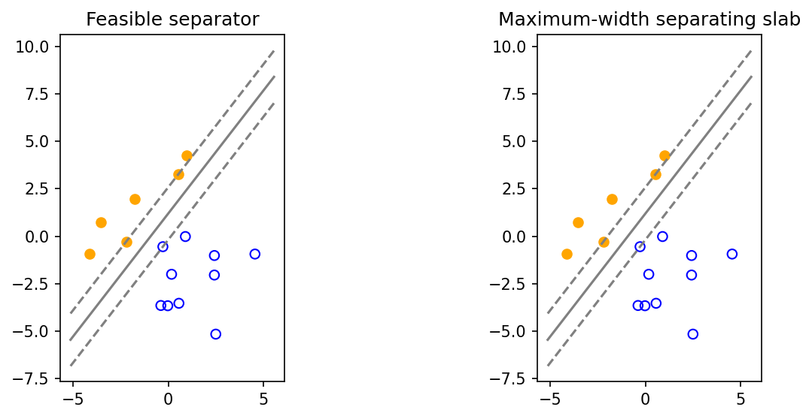

# fig 8 8: Linear and maximum-margin discrimination

**Method reproduction, approved substitute data or source convention.** This is not an exact recreation of the book’s random realization or figure. The specific differences are documented below.

[Textbook source](https://web.stanford.edu/~boyd/cvxbook/bv_cvxbook.pdf#page=437) · [Original Python](../../examples/application_classification_methods.py) · [Executed JSON](../../artifacts/examples/fig_8_8/results.json) · [Tests](../../tests/test_worked_applications.py)

## Model and verification

Generate new 10-point and 6-point Gaussian clouds using the companion dimensions and transform, with explicitly identified PCG64 seed0. Solve a feasible margin-one separation and independently maximize slab half-width under ||a||≤1. A third formulation minimizes the distance between the two convex hulls; its objective must equal the full slab width. Seed selection is disclosed because not every new Gaussian realization is separable.

## Inputs and source comparison

Both official scripts regenerate the same point clouds with legacy MATLAB randn state 3.

- [Official reference](https://cvxr.com/cvx/examples/cvxbook/Ch08_geometric_probs/linear_discr.m)
- [Official reference](https://cvxr.com/cvx/examples/cvxbook/Ch08_geometric_probs/robust_lin_discr.m)
- Uses NumPy PCG64 seed 0 with the official point-cloud dimensions, Gaussian construction and linear transform. This is not MATLAB randn(state,3), and the exact original points/figure are not claimed. Seeds3,808,8 were checked and gave nonseparable replacement instances; seed0 was selected to demonstrate the prescribed separable case.

The implementation is original Python. Reused numeric data are attributed separately in `data/worked_examples`, including conversion hashes and the upstream GPL-3.0-or-later notice. No textbook scans or reference program bodies are redistributed.

## Executed results

Run at 2026-10-10T05:03:47.882879+00:00; Python 3.12.14; NumPy 2.3.5; CVXPY 1.9.3; elapsed 1.475 s.

| Quantity | Actual value |
| --- | --- |
| class_sizes | [10, 6] |
| maximum_slab_width | 1.68922954478 |
| seed | 0 |

## Numerical checks

| Check | Measured error | Acceptance limit |
| --- | --- | --- |
| minimum-norm versus max-margin formulation | 6.88147e-11 | 1e-06 |
| convex-hull distance duality | 4.55012e-10 | 1e-06 |
| margin feasibility | 0 | 1e-06 |

## Recomputed figures



## Reproduce

```sh
OPENBLAS_NUM_THREADS=1 python examples/application_classification_methods.py fig_8_8
python -m pytest tests/test_worked_applications.py -q
```
