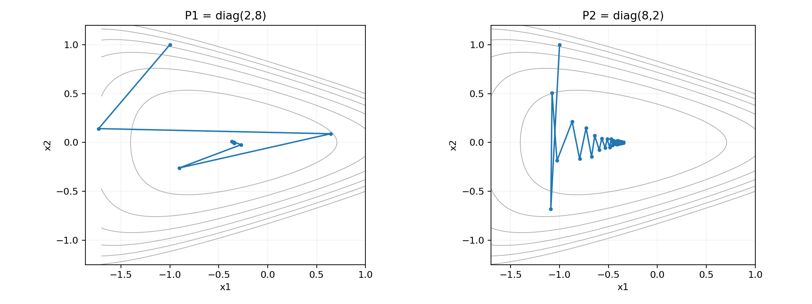
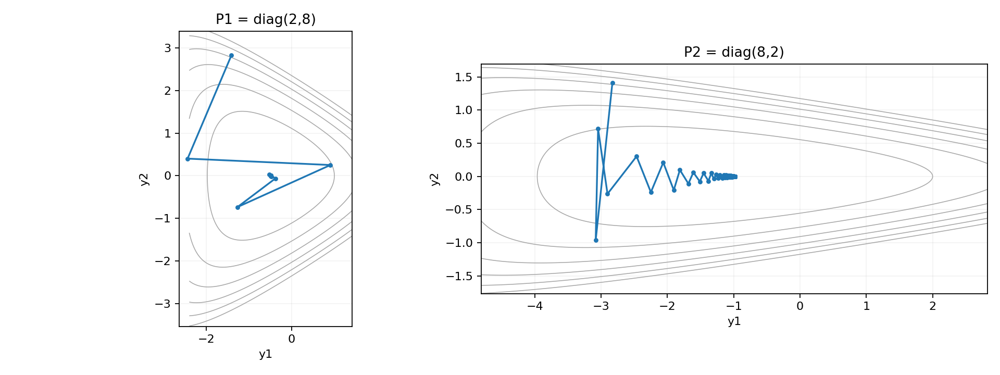
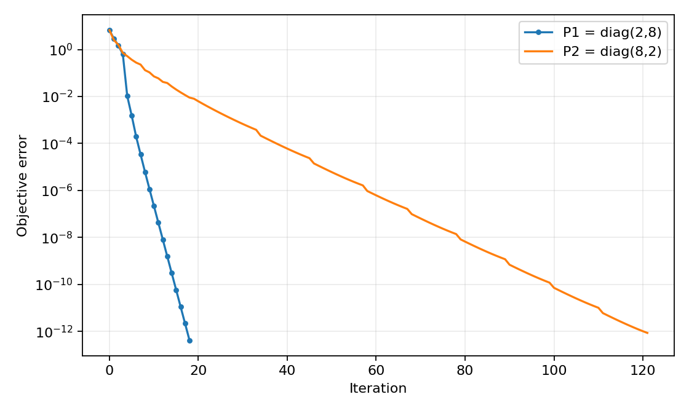

# Steepest descent under two quadratic norms

[Textbook source](https://web.stanford.edu/~boyd/cvxbook/bv_cvxbook.pdf#page=495). [Official reference 1](https://web.stanford.edu/~boyd/cvxbook/cvxbook_examples/chap9/figure_9_3.m).

## Formulation and method

```math
f(x)=e^{x_1+3x_2-0.1}+e^{x_1-3x_2-0.1}+e^{-x_1-0.1},\quad x^{(0)}=(-1,1).
```

Directions are negative gradients, negative metric-inverse gradients, or negative Hessian-inverse gradients as appropriate. Backtracking uses alpha = 0.1 and beta = 0.7. The quadratic-norm plots also show the coordinate transformation y = square-root(P) x.

## Input provenance and comparison

Explicit textbook and companion constants.

The exact optimum is derived by symmetry: x2 = 0 and exp(2 x1) = 1/2. It provides an independent benchmark, rather than taking the last iterate as the optimum.

The companion approximates exact line search by bisection with a 0.001 interval width and caps backtracking at ten reductions. This implementation solves the directional derivative to numerical precision and requires the Armijo inequality before every accepted step. Thus the same instance and methods are reproduced, without claiming pixel-identical paths under the companion stopping approximations.

## Recomputed output

The following values come from the checked-in [results](../../artifacts/examples/fig_9_11/results.json).

| Quantity | Computed value |
| :--- | ---: |
| Analytic optimal x1 | -0.34657359028 |
| Analytic optimal value | 2.55926669666 |
| P1 = diag(2,8): updates | 18 |
| P1 = diag(2,8): objective error | 4.22e-13 |
| P1 = diag(2,8): point error | 2.71e-07 |
| P2 = diag(8,2): updates | 121 |
| P2 = diag(8,2): objective error | 8.61e-13 |
| P2 = diag(8,2): point error | 6.89e-07 |







## Reproduction

```sh
OPENBLAS_NUM_THREADS=1 python -m examples.algorithms_ch09 fig_9_11
```

The implementation preserves complete numerical histories, uses explicit algorithm steps, and checks the final conditions independently. Iteration counts denote accepted updates; the initial point is iteration zero.

## Compact input delivery

Generated inputs larger than 256 KiB are represented by [array hashes and regeneration metadata](../../artifacts/examples/fig_9_11/input_manifest.json). The [regeneration helper](../../examples/algorithm_evidence.py) reconstructs every omitted array and verifies its exact bytes under the pinned numerical environment. Run the original study command to materialize all inputs locally. No problem dimension, trial count or numerical accuracy is reduced.
