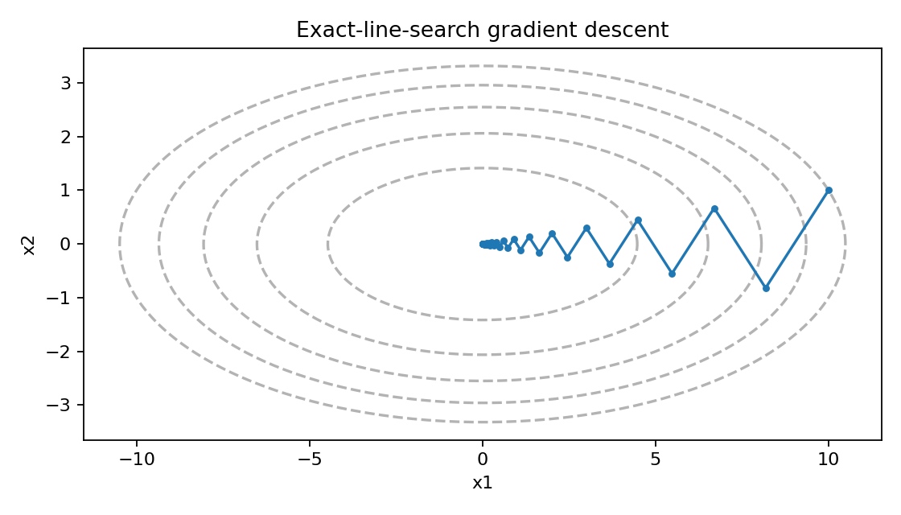
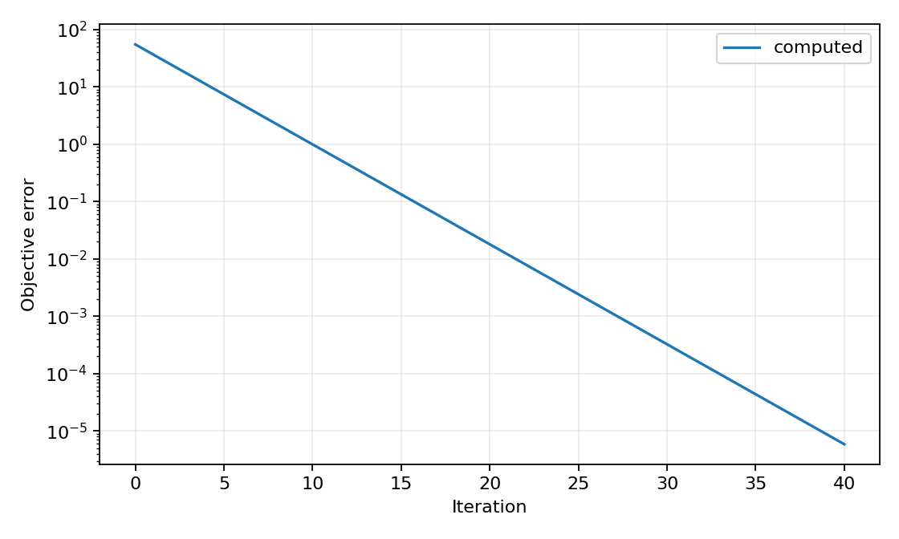

# Gradient descent on an ill-conditioned quadratic

[Textbook source](https://web.stanford.edu/~boyd/cvxbook/bv_cvxbook.pdf#page=483). [Official reference 1](https://web.stanford.edu/~boyd/cvxbook/cvxbook_examples/chap9/figure_9_2.m).

## Formulation and method

```math
f(x)=\frac12(x_1^2+10x_2^2),\quad x^{(0)}=(10,1),\quad t_k=\frac{g_k^Tg_k}{g_k^TQg_k}.
```

The exact directional quadratic minimizer is computed at every iteration. Its closed-form trajectory is checked independently, along with the ratio of successive objective values.

## Input provenance and comparison

Explicit textbook and companion constants.

The companion contour code omits the objective factor 1/2. The book normalization is used here; this does not change the exact-search iterates.

## Recomputed output

The following values come from the checked-in [results](../../artifacts/examples/fig_9_2/results.json).

| Quantity | Computed value |
| :--- | ---: |
| Updates | 40 |
| Objective contraction | 0.669421487603 |
| Maximum trajectory error | 1.78e-15 |
| Maximum ratio error | 2.22e-16 |
| Final objective | 5.86608878651e-06 |





## Reproduction

```sh
OPENBLAS_NUM_THREADS=1 python -m examples.algorithms_ch09 fig_9_2
```

The implementation preserves complete numerical histories, uses explicit algorithm steps, and checks the final conditions independently. Iteration counts denote accepted updates; the initial point is iteration zero.

## Compact input delivery

Generated inputs larger than 256 KiB are represented by [array hashes and regeneration metadata](../../artifacts/examples/fig_9_2/input_manifest.json). The [regeneration helper](../../examples/algorithm_evidence.py) reconstructs every omitted array and verifies its exact bytes under the pinned numerical environment. Run the original study command to materialize all inputs locally. No problem dimension, trial count or numerical accuracy is reduced.
