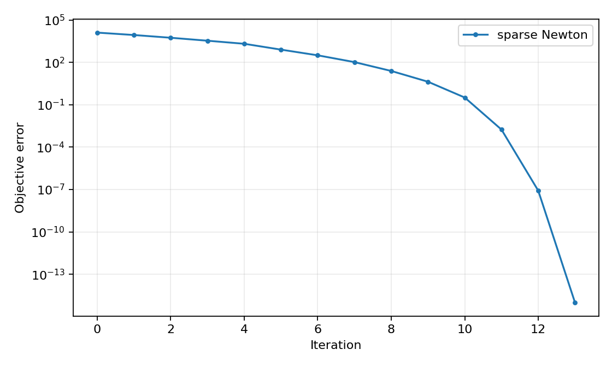

# Sparse Newton solve with 10000 variables

[Textbook source](https://web.stanford.edu/~boyd/cvxbook/bv_cvxbook.pdf#page=508). [Official reference 1](https://web.stanford.edu/~boyd/cvxbook/cvxbook_examples/chap9/figure_9_23.m).

## Formulation and method

```math
f(x)=-\sum_{i=1}^{100000}\log(b_i-a_i^Tx),\quad n=10000.
```

The full companion dimension is retained. Sparse block-diagonal plus sparse global couplings are used, and every Newton system is solved by sparse direct factorization. No generic convex solver replaces Newton.

## Input provenance and comparison

Random instances use NumPy PCG64, with saved arrays and seeds. They are method reproductions; MATLAB rand(state,...) uses v5uniform and randn(state,...) uses v5normal, whereas seed selects the v4 family. Equal integer seeds do not identify equal arrays. No exact MATLAB fixture was published in the checked companion sources; exact book-figure matching is not claimed. [MATLAB generator documentation](https://www.mathworks.com/help/matlab/math/updating-your-random-number-generator-syntax.html).

Target choice: the companion has 100000 total rows including 20000 box rows; the book states 100000 additional log terms. This implementation follows the source dimensions and explicitly does not certify the larger book interpretation. The replacement b distribution is uniform (0.001,1).

## Recomputed output

The following values come from the checked-in [results](../../artifacts/examples/fig_9_23/results.json).

| Quantity | Computed value |
| :--- | ---: |
| Variables | 10000 |
| Total inequalities | 100000 |
| Nonzeros | 220800 |
| Newton updates | 13 |
| Final squared decrement | 8.422e-16 |
| Minimum slack | 0.00104 |



## Reproduction

```sh
OPENBLAS_NUM_THREADS=1 python -m examples.algorithms_ch09 fig_9_23
```

The implementation preserves complete numerical histories, uses explicit algorithm steps, and checks the final conditions independently. Iteration counts denote accepted updates; the initial point is iteration zero.

## Compact input delivery

Generated inputs larger than 256 KiB are represented by [array hashes and regeneration metadata](../../artifacts/examples/fig_9_23/input_manifest.json). The [regeneration helper](../../examples/algorithm_evidence.py) reconstructs every omitted array and verifies its exact bytes under the pinned numerical environment. Run the original study command to materialize all inputs locally. No problem dimension, trial count or numerical accuracy is reduced.
