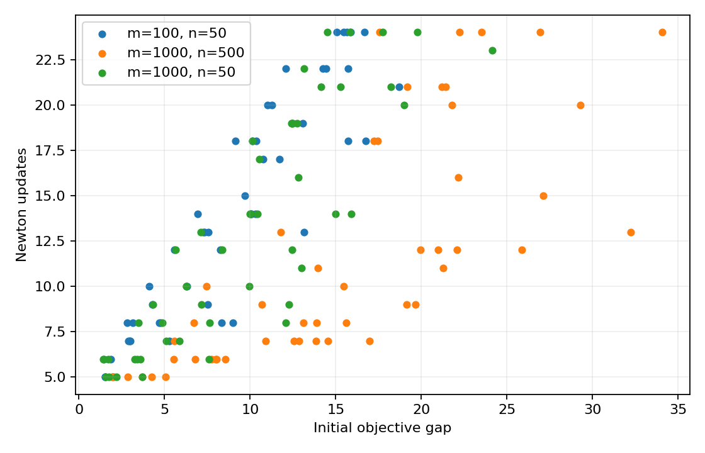

# Newton iteration counts for self-concordant functions

[Textbook source](https://web.stanford.edu/~boyd/cvxbook/bv_cvxbook.pdf#page=520). [Official reference 1](https://web.stanford.edu/~boyd/cvxbook/cvxbook_examples/chap9/figure_9_25.m).

## Formulation and method

```math
f(x)=-\sum_i\log(b_i-a_i^Tx),\quad(m,n)\in\{(100,50),(1000,500),(1000,50)\}.
```

Each of the three full-size families contains five independently generated bounded analytic-center problems, with ten prescribed objective-gap starts per problem. A start lies along a random ray from the optimum, selected to attain a chosen fraction of the near-boundary gap. All 150 Newton runs use alpha = 0.1 and beta = 0.8.

## Input provenance and comparison

Random instances use NumPy PCG64, with saved arrays and seeds. They are method reproductions; MATLAB rand(state,...) uses v5uniform and randn(state,...) uses v5normal, whereas seed selects the v4 family. Equal integer seeds do not identify equal arrays. No exact MATLAB fixture was published in the checked companion sources; exact book-figure matching is not claimed. [MATLAB generator documentation](https://www.mathworks.com/help/matlab/math/updating-your-random-number-generator-syntax.html).

The source uses MATLAB v4 seed semantics, unlike the state-based figures elsewhere. New PCG64 arrays are saved explicitly. The center rejection threshold is squared decrement 1e-12 after at most 20 steps; the source uses decrement 1e-8. The replacement right-hand sides use uniform (0.001,1). Rejection is recorded, rather than conflating nonconvergence in 20 steps with a mathematical proof of unboundedness.

## Recomputed output

The following values come from the checked-in [results](../../artifacts/examples/fig_9_25/results.json).

| Quantity | Computed value |
| :--- | ---: |
| Total runs | 150 |
| Smallest iteration count | 5 |
| Largest iteration count | 24 |
| Worst final objective gap | 4.9397e-11 |
| Worst squared decrement | 9.8096e-11 |



## Reproduction

```sh
OPENBLAS_NUM_THREADS=1 python -m examples.algorithms_ch09 fig_9_25
```

The implementation preserves complete numerical histories, uses explicit algorithm steps, and checks the final conditions independently. Iteration counts denote accepted updates; the initial point is iteration zero.

## Compact input delivery

Generated inputs larger than 256 KiB are represented by [array hashes and regeneration metadata](../../artifacts/examples/fig_9_25/input_manifest.json). The [regeneration helper](../../examples/algorithm_evidence.py) reconstructs every omitted array and verifies its exact bytes under the pinned numerical environment. Run the original study command to materialize all inputs locally. No problem dimension, trial count or numerical accuracy is reduced.
