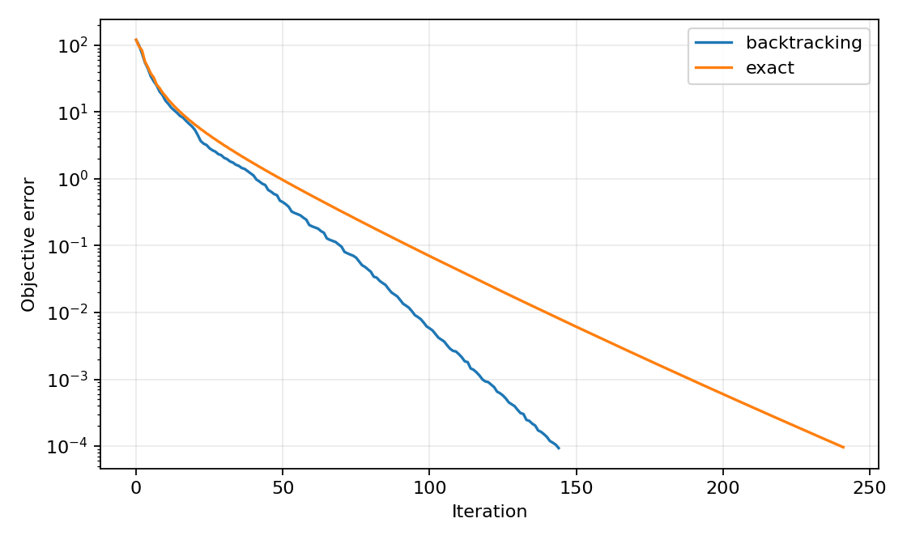
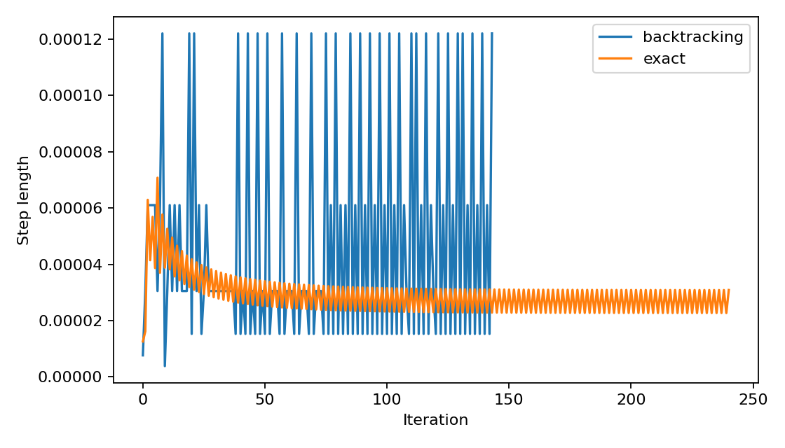

# Gradient descent for a 100-variable log-barrier objective

[Textbook source](https://web.stanford.edu/~boyd/cvxbook/bv_cvxbook.pdf#page=486). [Official reference 1](https://web.stanford.edu/~boyd/cvxbook/cvxbook_examples/chap9/figure_9_6.m).

## Formulation and method

```math
f(x)=c^Tx-\sum_{i=1}^{500}\log(b_i-a_i^Tx),\quad n=100,\quad x^{(0)}=0.
```

Gradients and Hessians are formed directly. Exact search roots the directional derivative within the strictly feasible interval. The independent reference is a high-accuracy Newton solution; saved slacks, derivatives and histories permit direct checks. The nine alpha/beta combinations quantify parameter sensitivity.

## Input provenance and comparison

Random instances use NumPy PCG64, with saved arrays and seeds. They are method reproductions; MATLAB rand(state,...) uses v5uniform and randn(state,...) uses v5normal, whereas seed selects the v4 family. Equal integer seeds do not identify equal arrays. No exact MATLAB fixture was published in the checked companion sources; exact book-figure matching is not claimed. [MATLAB generator documentation](https://www.mathworks.com/help/matlab/math/updating-your-random-number-generator-syntax.html).

Reference-data substitution: b is uniform (0.01,1), rather than the companion uniform (0,1). Domain tests require strictly positive slacks; the companion permits a small negative slack in an intermediate test, which is unsafe for real logarithms.

## Recomputed output

The following values come from the checked-in [results](../../artifacts/examples/fig_9_6/results.json).

| Quantity | Computed value |
| :--- | ---: |
| Reference objective | 338.663254372 |
| backtracking updates | 144 |
| exact updates | 241 |
| backtracking final objective gap | 9.33e-05 |
| exact final objective gap | 9.62e-05 |





## Reproduction

```sh
OPENBLAS_NUM_THREADS=1 python -m examples.algorithms_ch09 fig_9_6
```

The implementation preserves complete numerical histories, uses explicit algorithm steps, and checks the final conditions independently. Iteration counts denote accepted updates; the initial point is iteration zero.

## Compact input delivery

Generated inputs larger than 256 KiB are represented by [array hashes and regeneration metadata](../../artifacts/examples/fig_9_6/input_manifest.json). The [regeneration helper](../../examples/algorithm_evidence.py) reconstructs every omitted array and verifies its exact bytes under the pinned numerical environment. Run the original study command to materialize all inputs locally. No problem dimension, trial count or numerical accuracy is reduced.
